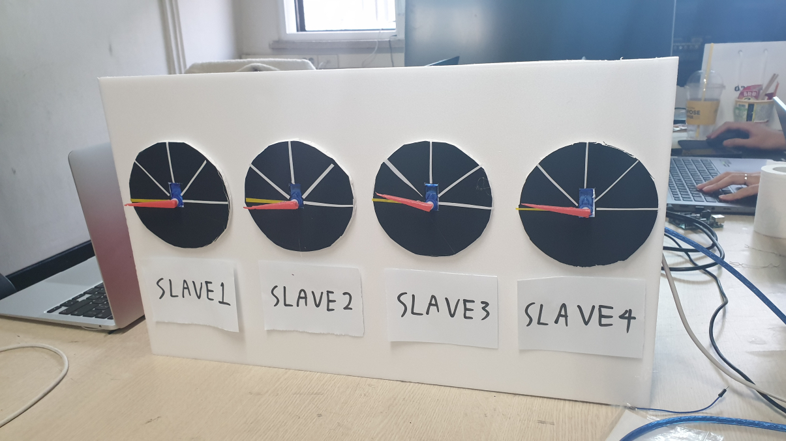
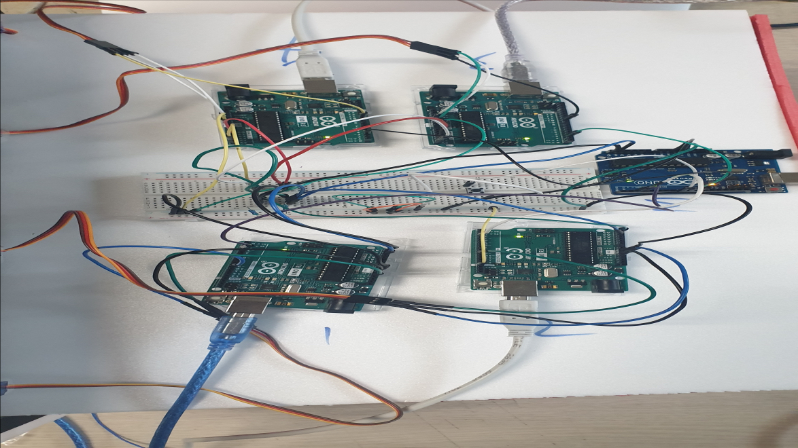
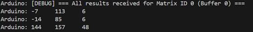

# Arduino Dynamic Load Balancer

5대의 Arduino UNO로 5×5 입력 행렬과 3×3 필터의 합성곱을 분산 처리하는 임베디드 팀 프로젝트입니다. Master가 9개 패치를 현재 미처리 부하가 가장 적은 Slave에 배정하고, 4개 Slave는 연산 잔량을 서보 각도로 보여줍니다.


<!-- LOC:START -->
## 코드 규모와 기술적 과제

**771 LOC · 12개 파일** · 구현 571 / 테스트·예제 187 / 빌드·CI·설정 13.

주석·빈 줄·외부 코드·자동 생성 파일을 제외한 프로젝트 규모입니다. [언어별·범주별 분석](docs/LOC.md)

- **기술적 과제:** 제한된 MCU에서 비동기 완료·큐·배치별 결과를 일관되게 관리.
- **설계 선택:** 현재 작업+대기 부하로 배정하고 배치·패치 ID·결과 ACK로 버퍼 수명 관리.
- **확인 근거:** 무작위 완료 순서의 1,800개 패치 검산·5개 보드 구성 빌드. [문제·해결·검증](../../docs/TECHNICAL_CHALLENGES.md#arduino-load-balancer)
<!-- LOC:END -->


## 제출용 프로젝트 요약

| 항목 | 내용 |
|---|---|
| 분야 | 분산 임베디드 연산 · 동적 부하 분산 · 레지스터 제어 |
| 사용 기술 | C/C++, ATmega328P, Arduino UNO, I²C/TWI, UART, INT0/INT1/PCINT, Timer1 PWM, Timer2, Python |
| 시스템 구성 | Master 1대 + Slave 4대 + 부하 표시 서보 4개 |
| 처리 대상 | 5×5 입력 × 3×3 필터 → 3×3 출력, 9개 패치 |
| 핵심 기여 | Master 스케줄링, I²C·완료 인터럽트, Slave 연산·큐, PWM·UART·타이머 |
| 성능 기록 | 시연 조건 기준 234,000 ms → 80,500 ms, 약 2.91배 |
| 검증 | 실보드 시연 기록, 공개 코드 5개 보드 구성 컴파일, C++·Python 테스트 |

Master·Slave의 레지스터 제어, 공통 스케줄러와 PC 호스트 도구를 함께 구성했습니다. 실보드 동작과 결과는 아래 시연 자료에서 확인할 수 있습니다.

## 개인 기여 범위

이민석의 담당 영역은 다음과 같습니다.

- **Master의 부하 계산·작업 분배·스케줄링**: 패치 단위 부하 계산, 최소 미처리 부하 기반 Greedy 배정, Slave별 원형 큐와 실행 작업 추적
- **I²C 레지스터 통신·완료 인터럽트**: TWI Master/Slave 상태 처리, 필터 브로드캐스트·작업 송수신, INT0/INT1·PCINT 완료 이벤트
- **Slave의 합성곱 연산·작업 큐**: zero-skip 연산, 수신과 처리의 이중 버퍼, 연산 결과 수집
- **PWM 서보·UART·타이머 제어**: Timer1 50 Hz PWM으로 연산 부하 표시, UART 입력·결과 출력, Timer2 시간 기준 제어

**아이디어·시스템 설계·배선·통합, 실험·성능 분석·시연은 공동 작업 영역**입니다.

## 주요 기능

- PC에서 UART로 입력 행렬과 필터 수신
- 9개 패치의 유효 연산량을 계산하고 Greedy 방식으로 분배
- 입력 또는 필터가 0인 항의 곱셈·덧셈 생략
- 4개 Slave의 동시 연산과 I²C 결과 수집
- 두 행렬을 처리하는 파이프라인과 Slave당 2개 작업 버퍼
- 완료 인터럽트를 통한 후속 작업 전달
- 서보 4개로 Slave별 미처리 부하 시각화
- Flash 문자열과 레지스터 코드로 UNO 메모리 사용 관리

## 시스템 구조

```text
PC / Python 호스트
        │ UART 115200, 행렬·필터
        ▼
┌───────────────────────────────────────┐
│ Master Arduino UNO                    │
│ 패치 생성 → 부하 계산 → Greedy 배정   │
│ Slave별 큐 / 실행 작업 / 결과 추적    │
└──────┬────────┬────────┬────────┬───────┘
       │        │        │        │ I²C/TWI
       ▼        ▼        ▼        ▼
    Slave 1  Slave 2  Slave 3  Slave 4
    주소 1   주소 2   주소 3   주소 4
       │        │        │        │
    서보 1   서보 2   서보 3   서보 4
       └────────┴────────┴────────┘
       완료 신호 → Master D2/D3/D9/D10
```

| 구성 | 역할 | 주변장치 |
|---|---|---|
| Master | 입력 관리·스케줄링·결과 결합 | USART, TWI Master, INT0/INT1, PCINT0 |
| Slave 1~4 | 합성곱·이중 버퍼·부하 표시 | TWI Slave, Timer1 OC1A, Timer2 CTC |
| Python 호스트 | 입력 스트림·결과 검산 | pyserial, CPU 기준 계산 |

## 부하 분산과 파이프라인

각 패치에서 입력과 필터가 모두 0이 아닌 항의 수를 `n`이라고 할 때, 부하는 `n=0`이면 0, 그 외에는 `2n + (n−1)`입니다. 곱셈 2초·덧셈 1초의 시연 지연에 맞춰 곱셈 2, 덧셈 1의 가중치를 사용합니다.

Master는 Slave별 **큐에 대기 중인 작업과 실행 중인 작업의 부하 합계**를 비교합니다. 최소 부하가 같은 경우 작업 수가 적은 Slave를 선택합니다. 결과를 받으면 해당 작업의 부하를 차감하고 다음 작업을 전달합니다.

각 행렬의 입력·필터·패치 부하·결과는 같은 배치 버퍼에서 관리합니다. 완료되지 않은 행렬 버퍼는 새 데이터로 재사용하지 않습니다. 호스트는 `ARDUINO_READY`와 `RDY_FOR_NEXT`에 맞춰 데이터를 보내고, `RESULT`를 기준 계산과 비교합니다.

## 통신·제어 안정성 개선

- Master와 Slave의 서로 다른 부하 계산식을 공통 연산 가중치로 통일
- 음수가 될 수 있던 PWM 값을 1~2 ms의 유효 범위로 제한
- 입력·필터의 부호를 int8로 통일하고 합성곱 결과를 int32로 확장
- 패치 데이터와 필터를 행렬별로 보존해 다음 입력의 덮어쓰기 방지
- 8비트 전역 패치 번호 대신 16비트 배치 번호와 패치 번호 사용
- 중복·과거 결과를 작업 소속과 번호로 검사
- 완료 결과를 명시적 ACK까지 보존해 연속 결과의 덮어쓰기 방지
- 완료 ISR과 버튼 디바운스를 분리하고 결과 재확인을 추가
- TWI 응답 상태·타임아웃·STOP 완료를 확인한 뒤 전송 상태 반영
- TWI ISR의 UART 출력을 제거하고 짧은 수신·응답 처리로 정리
- Slave 4개 코드를 주소 설정 하나로 바꿔 빌드하는 공통 코드로 통합

I²C 작업·결과 프레임의 정합성을 위해 Master와 Slave를 같은 버전으로 빌드합니다. [통신 규격](docs/PROTOCOL.md)과 [코드 검토 기록](docs/CODE_REVIEW.md)에 변경 내용을 정리했습니다.

## 성능 측정

보고서에 기록된 동일한 9개 패치의 실행 결과입니다. **곱셈 단계 2초·덧셈 단계 1초의 시연 지연과 통신·스케줄링 시간을 포함한 값**입니다.

| 처리 방식 | 완료 시간 |
|---|---:|
| 단일 Arduino 순차 처리 | 약 234,000 ms (234초) |
| Slave 4대 분산 처리 | 약 80,500 ms (80.5초) |

속도 향상은 `234000 / 80500 ≈ 2.91배`이며 완료 시간은 약 **65.6% 감소**했습니다. 서보 움직임과 UART 결과를 통해 배정된 부하와 결과 행렬을 확인했습니다.

## 빌드 및 실행

### 펌웨어

Arduino CLI와 Arduino AVR Boards core를 설치합니다. 프로젝트 폴더에서 실행합니다.

```bash
arduino-cli compile --fqbn arduino:avr:uno --libraries firmware/libraries firmware/master

for address in 1 2 3 4; do
  arduino-cli compile --fqbn arduino:avr:uno --libraries firmware/libraries     --build-path "build/slave-$address"     --build-property "compiler.cpp.extra_flags=-DSLAVE_ADDRESS=$address" firmware/slave
done
```

서보 부하 시연 지연은 `DEMO_MUL_MS=2000`, `DEMO_ADD_MS=1000`이며 빌드 옵션으로 조정할 수 있습니다. [펌웨어 안내](firmware/README.md)를 참고하세요.

### PC 호스트

```bash
cd host
python3 -m venv .venv
source .venv/bin/activate
pip install -r requirements.txt
python stream_matrices.py /dev/tty.usbmodemXXXX
```

Master가 준비되면 예시 행렬이 전송됩니다. 데이터 수신 후 Master D8 버튼을 눌러 시작합니다. 기본 예시는 서로 다른 입력·필터 두 개이며 반환된 결과를 Python에서 검산합니다. Windows에서는 포트를 `COM5`와 같이 지정합니다.

입력 파일은 `example_matrices.json`을 참고합니다. 행렬·필터는 행 우선의 길이 25·9 배열이며, 값은 -128~127의 정수입니다.

### 테스트

```bash
make -C tests test
python3 -m unittest discover -s tests -p 'test_*.py' -v
```

Python 테스트에는 `host/requirements.txt`의 pyserial이 필요합니다.

## 코드 읽기

처음 보는 분을 위한 [파일별 역할·호출 흐름 안내](docs/CODE_GUIDE.md)를 제공합니다. 각 source 파일의 첫머리와 함수 위에도 기능·입력·출력·처리 구조를 한글로 설명했습니다.

## 저장소 구조

```text
firmware/
├── master/                    # TWI master, UART, 완료 ISR, dispatcher
├── slave/                     # TWI worker, 이중 버퍼, PWM, Timer2
└── libraries/LoadBalancerCore/ # 공통 부하·연산·큐·스케줄러·wire format
host/                          # UART 입력 도구, 예시 행렬, 결과 검산
docs/                          # architecture, protocol, review
hardware/                      # 배선·핀 설정
media/                         # 시제품·회로도·결과 기록
tests/                         # 스케줄러·연산·호스트 회귀 검사
```

## 시연 영상 및 결과

- [동작 영상 1](https://drive.google.com/file/d/1xwdSqLJl-OsLrrc-rYr6B4zbAYaf_x3W/view?usp=sharing)
- [동작 영상 2](https://drive.google.com/file/d/1ejdjlAy-tDUhgHhRa9EzB8iDE1putLxQ/view?usp=sharing)





## 참고 자료

- [Arduino UNO Rev3](https://docs.arduino.cc/hardware/uno-rev3/)
- [avr-libc interrupts](https://www.nongnu.org/avr-libc/user-manual/group__avr__interrupts.html)
- [avr-libc atomic operations](https://www.nongnu.org/avr-libc/user-manual/group__util__atomic.html)
