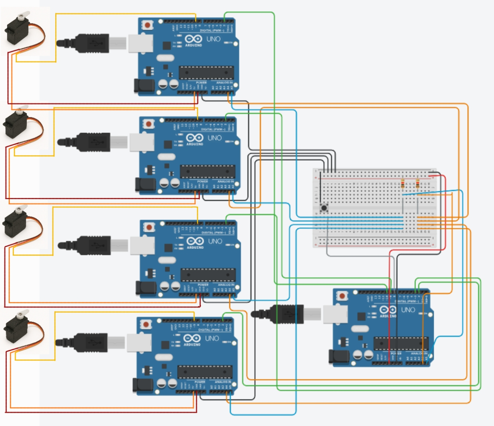

# Wiring

| 연결 | Master UNO | Slave UNO |
|---|---|---|
| I²C SDA | A4 | 4개 Slave A4 공통 |
| I²C SCL | A5 | 4개 Slave A5 공통 |
| Slave 1 완료 | D2 / INT0 | Slave 1 D2 |
| Slave 2 완료 | D3 / INT1 | Slave 2 D2 |
| Slave 3 완료 | D9 / PB1 PCINT | Slave 3 D2 |
| Slave 4 완료 | D10 / PB2 PCINT | Slave 4 D2 |
| 시작 버튼 | D8 / PB0, GND로 누름 | — |
| 부하 표시 서보 | — | 각 Slave D9 / OC1A |
| PC UART | D0 RX / D1 TX, USB serial | debug용 UART |
| 기준 전위 | GND 공통 | GND 공통 |

보드는 ATmega328P 16 MHz UNO다. I²C 주소는 Slave 1~4이며 general call로 필터를 전달한다. 완료선은 Master의 pull-up을 사용하고 Slave는 LOW를 구동하거나 입력으로 해제한다. 서보 전원 구성과 통신선 pull-up은 실제 회로의 전압·소비 전류에 맞게 구성한다.
