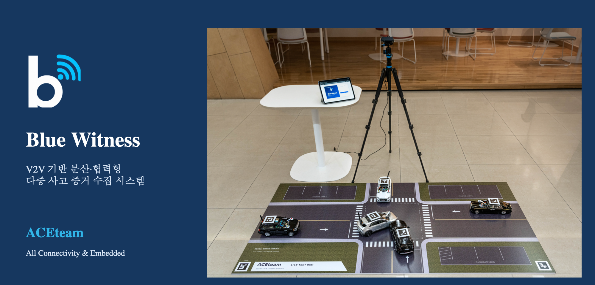
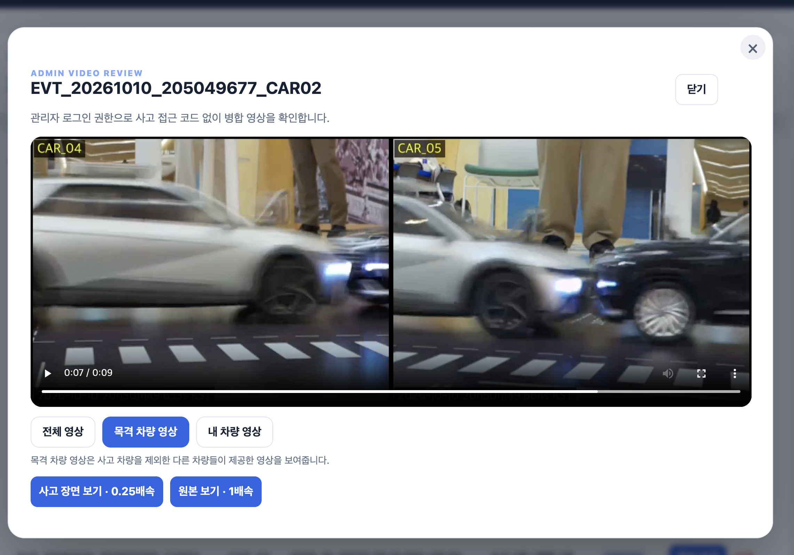

# Blue Witness · 다중 시점 사고 영상 수집

사고 차량과 주변 차량의 **사고 전 8초·후 2초 영상**을 모아 촬영 시각에 맞춰 병합하고 웹에서 확인하는 임베디드 팀 프로젝트입니다. **제24회 임베디드SW경진대회 자동차/모빌리티 부문 결선 진출팀 ACE**의 프로젝트입니다. [결선 참가 요청 공문](docs/evidence/2026-embedded-sw-finals-invitation-ace.pdf)

**이민석 담당:** 차량 검출 모델 학습·배포, 서버·웹, 시간 동기화 상태 서비스, 전체 Fail-safe 설계·Uploader 전체 개발, CI/CD 설계·구축.


**구현 결과:** 사고차와 관측차의 영상을 같은 화면에서 비교하고, 웹에서 시점·배속을 선택해 확인합니다. [실제 장치·개인 구현 사진과 설명](docs/IMPLEMENTATION_GALLERY.md)

| 먼저 확인할 내용 | 자료 |
|---|---|
| 결선 진출 공식 근거 | [참가 요청 공문 PDF](docs/evidence/2026-embedded-sw-finals-invitation-ace.pdf) · [문서 정보·미리보기](docs/EVIDENCE.md#결선-진출-공식-근거) |
| 실제 장치·AI 검수·웹·CI 화면 | [사진으로 보는 개인 구현](docs/IMPLEMENTATION_GALLERY.md) |
| 실제 구현 파일과 읽는 순서 | [코드 안내](source/README.md) · [기여 구분](docs/CODE_GUIDE.md) |
| 대안과 선택 이유 | [설계 결정표](docs/design/DECISIONS.md) |
| 영상 보존·재전송·ACK | [Uploader 전체 모듈](source/uploader/README.md) · [Fail-safe](docs/FAILSAFE.md) |
| 데이터 준비·학습·ONNX | [학습 파이프라인](source/model_training/README.md) · [평가 분석](analysis/README.md) |
| 서버 인증·권한·TLS | [서버·보안 설계](docs/SERVER_SECURITY.md) |
| 학습 이력·개선 전후 결과 | [학습 곡선·모델 비교](analysis/model-results/README.md) · [비교 HTML](analysis/model-results/index.html) |
| 웹·업로드·영상 병합 | [서버 코드](source/server/README.md) · [서버 설계](docs/design/SERVER.md) |
| 자동 빌드와 회귀 검사 | [이 저장소 Actions](https://github.com/eLunaaaa/portfolio/actions/workflows/portfolio-ci.yml) · [팀 CI/CD 코드](source/automation/README.md) |
<!-- LOC:START -->
## 코드 규모와 기술적 과제

**45,105 LOC · 221개 파일** · 구현 36,189 / 테스트·예제 5,230 / 빌드·CI·설정 3,686.

주석·빈 줄·외부 코드·자동 생성 파일을 제외한 프로젝트 규모입니다. [언어별·범주별 분석](docs/LOC.md)

**개인 작성 확인 33,418 LOC** · 개인 구현 담당 영역의 원본 Git 작성 이력 기준. [개인·팀 수정·통합분 구분](docs/PERSONAL_LOC.md)

- **기술적 과제:** 단절·재시작·지연 도착 속에서 영상 보존과 시간 정합성 유지.
- **설계 선택:** 영속 큐·저장 ACK·촬영 시각 정렬·병합 revision으로 처리 단계를 분리.
- **확인 근거:** 27회 충돌·81건 저장·단절 복구 12건. [문제·해결·검증](../../docs/TECHNICAL_CHALLENGES.md#blue-witness)
<!-- LOC:END -->


## 개인 기여와 협업

| 담당 영역 | 수행한 작업 |
|---|---|
| AI 학습·배포 | 촬영 등록·BBox 검수 도구, COCO 변환·세션별 split, 2-class YOLOX-Tiny 학습·평가·ONNX 내보내기, 모델 배포·검출 설정 |
| 서버·웹 | FastAPI 증거 업로드·저장 ACK, SQLite 사건·사용자·차량 관리, FFmpeg 시간 정렬·재병합, 사용자·관리자 화면 |
| 시간 동기화 | Chrony 상태 조회 C 서비스, offset·상태·측정 시각 IPC, 타임아웃·스레드 종료 |
| 전체 Fail-safe 설계·Uploader 전체 개발 | 스레드 진행 감시, 영속 spool·큐, 로컬/서버 ACK 구분, 단절 재시도·재시작 복구 구조 |
| CI/CD | 변경 영향별 검사·ARM64 빌드, 검증 산출물 기반 수동 배포, 사전 권한 점검·canary·smoke·실패 복원 흐름 |

업로더는 **개인 전체 개발 후 CD 연동 과정에서 팀 수정**, 카메라·추론 런타임과 공통 IPC는 **팀 구현 및 개인 학습·배포·설정 연동**으로 표시했습니다. 라벨 검수·실장치 시나리오·전체 통합은 공동 작업입니다. 원본 기여 커밋과 파일별 출처는 [기여 안내](docs/CODE_GUIDE.md)와 [manifest](source/PROVENANCE.json)에 남겼습니다.

## 전체 동작

```text
사고 감지 → 사고차 촬영 / 주변 차량 위치·화각 선별 → 관측차 AI
                └──────── 사고 전후 Snapshot ─────────┘
                                  ↓
Chrony → Time Sync 상태 IPC → 촬영 시각·영상 메타데이터
                                  ↓
                  Uploader: spool → 영속 큐 → HTTPS·ACK
                                  ↓
                   FastAPI / SQLite → FFmpeg → 웹
```

Raspberry Pi 5 · IMX219 · C/C++ · POSIX IPC · PyTorch · YOLOX-Tiny · ONNX Runtime · FastAPI · SQLite · FFmpeg · Chrony · systemd · GitHub Actions를 사용했습니다.


촬영 callback과 추론·인코딩·전송을 분리하고 Snapshot 참조로 사고 구간을 보호합니다. 업로더는 HTTP 성공만으로 완료하지 않고 사고·차량·파일 hash·서버 저장 상태를 확인합니다. 서버는 늦게 도착한 영상을 새 revision으로 재병합합니다. [모듈별 설계](docs/design/README.md)

## 개발환경·협업·CI/CD

### 작업 관리부터 장치 배포까지 하나의 흐름으로 연결

**Windows VS Code → SSH → VMware Ubuntu**의 크로스 툴체인 환경에서 개발했습니다. Trello의 주간 목표·작업 상태, Slack의 실험 자료·이슈 공유, GitHub의 코드 통합을 검사·빌드·장치 배포로 연결했습니다.

| Trello · 일정과 작업 관리 | Slack · 실험 자료와 연동 이슈 |
|---|---|
|  |  |

```text
주간 목표·작업 분담 → 구현·Git 통합 → PR 변경 모듈 검사
  → main 전체 CI·ARM64 빌드·산출물 보관
  → 수동 배포 요청 → VMware 실행기 → Pi 한 대 선행 점검
  → 차량별 순차 배포 → 서비스·IPC·P2P smoke 점검
```

**개인 담당:** CI/CD 구조 설계·구축과 운영 개선입니다. 변경 영향별 검사, 검증한 산출물의 배포 연결, 권한 사전 점검·canary·순차 배포·실패 복원 흐름을 구성하고 팀과 통합했습니다.

### CI · 모듈 검사와 배포 산출물 생성


변경 영향 선택과 SDK 준비 후 서버 Ubuntu·Windows, Pi 6개 모듈, ArUco 오프라인 검사·FFmpeg 병합을 연결했습니다. 선택된 검사 결과를 최종 CI 결과로 모으고 ARM64 빌드 산출물을 보관해 배포 대상으로 넘깁니다.

### CD · 선행 점검과 차량별 순차 배포


성공한 CI 산출물을 받아 Pi 한 대에 먼저 적용하고 서비스·프로세스·IPC·P2P를 점검한 뒤 다음 차량으로 진행합니다. 화면에는 `Smoke PASS`, `DEPLOY PASS`, 차량별 배포와 `Fleet P2P ready` 확인 과정이 표시돼 있습니다. 배포 실패 시 이전 release로 복원하도록 구성했습니다.

[실제 팀 CI/CD 코드·실행 기록](source/automation/README.md) · [CI 설계와 검사 기준](docs/design/CI.md) · [CD 설계와 복구 흐름](docs/design/CD.md)

## 홈페이지 개발과 사용성

FastAPI·SQLite로 차량·사고·증거와 접근 권한을 관리하고, 별도 Worker·FFmpeg로 촬영 시각을 맞춰 병합합니다. 웹에서는 **사고 찾기 → 주변 차량 시점 확인 → 사고 장면 비교** 순서로 필요한 영상을 확인할 수 있게 구성했습니다.

### 차량별 사고 조회


로그인한 사용자의 등록 차량과 사고 기록을 표시합니다. 차량별 사고를 선택하고 수집 중·병합 완료 상태를 확인할 수 있습니다.

### 주변 차량 시점 확인



내 차량 화면에 보이지 않는 상황을 주변 차량의 시점으로 확인합니다. 전체 영상·목격 차량 영상·내 차량 영상을 같은 사고 안에서 전환합니다.

### 함께 보기·사고 장면 재생


촬영 시각을 맞춘 여러 영상을 한 화면에서 비교하고, 사고 장면은 0.25배속으로 재생합니다. 시점 전환 시 재생 위치·배속을 유지하고 늦게 도착한 영상은 새 병합본으로 반영합니다.

### 로그인과 사고별 접근

| 사용자 로그인 | 임시 사고 접근 코드 |
|---|---|
|  |  |

차량 소유권·로그인 세션을 확인해 사고 목록을 제공하고, 사고 접근 코드는 기본 5분·사고 세션은 30분으로 접근 범위와 시간을 관리합니다. 촬영 후보는 위치·화각과 AI로 선별하고 사고 전 8초·후 2초 영상만 수집합니다.

[홈페이지·서버 구현 설명](docs/IMPLEMENTATION_GALLERY.md) · [인증·선별 수집 구조와 코드](docs/SERVER_SECURITY.md)

## 서버·보안 구현

차량 업로드부터 사용자 열람까지 **전송 암호화·장치 인증·파일 무결성·조회 권한**을 나누어 구현했습니다.

- **서버 처리:** FastAPI·SQLite 저장 → 기본 12초 수집 창 → 별도 Worker·FFmpeg 시간 정렬·병합. 늦은 영상은 새 revision에 반영합니다.
- **전송·차량 인증:** TLS 1.2 이상·CA·서버 hostname/IP SAN 검증, 등록 노드 API Key 해시·활성 상태 확인.
- **저장 무결성:** SHA-256·사고/차량 ID와 서버 저장 ACK를 대조하고, 응답 유실 시 저장 상태를 재조회합니다.
- **열람 권한:** 비밀번호 해시·사용자 세션·차량 소유권, 기본 5분 사고 접근 코드·30분 사고 세션, 실패 횟수 제한과 HttpOnly 쿠키.

[로그인·임시 접근 코드 화면, 인증 구조와 관련 코드](docs/SERVER_SECURITY.md)

## AI 학습과 개선 결과


5 epoch 중 검증 mAP@0.50:0.95가 가장 높은 **epoch 1**을 선택했습니다. 선택 모델의 검증 **mAP@0.50 70.57% / mAP@0.50:0.95 57.95%**입니다.


동일 프레임·정답·Confidence 0.60으로 비교했을 때 전체 12,873프레임의 **유무 검출률 96.51%→97.62%, 부재 시 오탐률 3.69%→1.17%**를 기록했습니다. 전체·최신 시연은 학습 자료를 포함한 내부 비교이며, 운영 임계값 선정에 사용했습니다.

[Epoch별 결과·모델 비교·BBox·영상 판정](analysis/model-results/README.md) · [묶음·Confidence를 선택하는 HTML](analysis/model-results/index.html)

[상세 AI 평가 HTML](analysis/model-results/evaluation-report.html)에서는 Confidence 0.001~1.00, 이전·개선 모델 8개 묶음, 클래스·차량별 오분류와 영상 단위 판단을 확인할 수 있습니다. 최신 시연 3,314프레임에서 Confidence 0.60의 검출률은 **94.09%**, 부재 오탐률은 **0.73%**입니다. 학습에 사용한 47프레임을 포함하는 내부 평가이며, 비교 후보 0.75와 실장치 적용값 0.60을 구분했습니다.

## 검증 자료

- **코드 검사:** 서버 Python 74개, 웹 Node.js 51개, 학습·런타임 계약 44개 회귀 검사. Uploader 큐 중복·재시작 복구·ACK 불일치·HTTP 전송 검사.
- **팀 통합 기록:** 테스트베드 충돌 시나리오 27회, 사고·목격 영상 81건 서버 저장. [시나리오와 파일 체크섬](source/docs/measurements/20261008-scenarios/README.md)
- **모델 선정 기록:** 12,873프레임에서 Confidence별 유무 판정을 비교해 0.60을 선정했습니다. [조건·혼동행렬·재계산](analysis/README.md)

[검수 내용과 실행 명령](docs/CODE_REVIEW.md) · [측정·기여 자료](docs/EVIDENCE.md)
