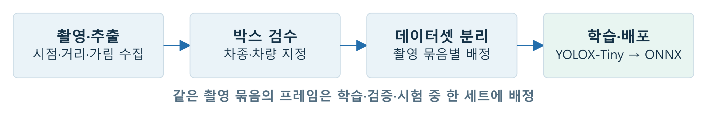
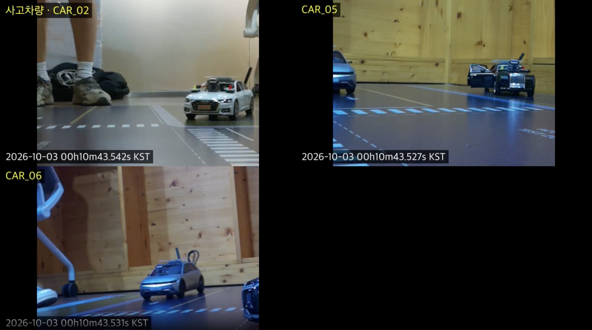

# Blue Witness

**여러 시점의 사고 영상을 한눈에** — 사고 차량과 주변 차량의 영상을 모아 촬영 시각에 맞춰 병합하고, 웹에서 사고 전후 장면을 확인하는 임베디드 팀 프로젝트입니다.

## 제출용 프로젝트 요약

| 항목 | 내용 |
|---|---|
| 분야 | 엣지 AI · 임베디드 Linux · 영상 처리 · 백엔드 · 개발 자동화 |
| 대회 | 2026 임베디드 소프트웨어 경진대회 본선 참가 · [대회 참여 자료](docs/EVIDENCE.md) |
| 장치 | Raspberry Pi 5, IMX219 카메라, 모형차 테스트베드 |
| 기술 | C/C++, libcamera, FFmpeg, YOLOX-Tiny, PyTorch/MPS, ONNX Runtime, FastAPI, SQLite, Chrony, POSIX IPC, systemd, GitHub Actions |
| 핵심 기여 | 전체 Fail-safe 설계, 차량 검출 모델 학습·AI 배포·검출 설정, 증거 서버·웹, 시간 동기화 상태 서비스, CI·수동 장치 배포 흐름 |
| 시험 범위 | 모형차 테스트베드에서 차종 유무 판정과 다중 차량 영상 수집·동기화·저장 검증 |
| 코드 공개 방식 | 담당 모듈 소스를 source/에 포함하고 파일별 원본·해시·기여 범위를 명시. 팀 전용 모듈·운영 데이터·키·가중치·서드파티 본체는 제외 |

[팀 원본 저장소](https://github.com/kingwooseok/2026ESWContest_mobility_ACE) · [정리 기준 버전 `5148804`](https://github.com/kingwooseok/2026ESWContest_mobility_ACE/tree/5148804)

## 설계 선택부터 보기

**어떤 기능을 만들었는가보다 왜 그 구조를 택했는가**를 중심으로 정리했습니다. [설계 결정표](docs/design/DECISIONS.md)에서 대안·선택 이유·비용을 한눈에 보고, [모듈별 상세 설계](docs/design/README.md)에서 실제 코드·상태 전이·복구·시험으로 이어집니다.

## 개인 기여 범위

이민석의 담당 영역은 다음과 같습니다. 팀 모듈 전체를 개인 단독 구현으로 표현하지 않습니다.

| 담당 영역 | 수행한 작업 |
|---|---|
| 전체 Fail-safe 설계 | 프로세스·업무 스레드 정지 감지, systemd 재시작, 영상·큐 영속 보존, IPC·네트워크 재시도, ACK 유실·재시작 복구를 계층별로 연결하는 시스템 장애 대응 구조 설계 |
| AI 학습·배포·설정 | 차량 검출 모델 학습·내보내기·배포와 검출 설정 변경. 촬영·Snapshot·inference 런타임 본체는 팀 구현으로 구분 |
| 모델 학습 | 촬영 등록·프레임 추출·BBox 검수 도구, 데이터 버전·출처 관리, COCO 변환과 촬영 묶음별 분리, 2-class YOLOX-Tiny 학습·평가·ONNX 내보내기 |
| 서버·웹 | FastAPI 업로드·ACK·증거 저장, SQLite 사건 관리, 시간 기준 FFmpeg 병합, 재병합·영상 모드, 사용자·차량·프로필·관리자 화면 |
| Time Sync | Chrony 상태 조회 C 서비스, 상태 판정·오차·측정 시각을 제공하는 IPC, 스레드·타임아웃·서비스 운영 |
| CI/CD | 모듈별 검사와 ARM64 빌드 흐름, 서버 계약·HTTP/TLS 검증, 검증된 산출물 기반 수동 Pi 배포, 배포 권한 사전 확인·P2P smoke check |

**공동 작업:** 영상 라벨링·검수, 시스템 통합, 실장치 시연과 성능 측정. 센서·V2V·위치/화각 필터·업로더는 팀원이 개발한 모듈과 연결했습니다. CI 캐시 최적화·SDK 정렬·후속 복원 강화, 프런트엔드 경쟁 상태 수정, 최종 Confidence 통일 등에는 팀원의 후속 개선이 포함됩니다. [개인 커밋과 팀 구현 구분](docs/CODE_GUIDE.md)

**Fail-safe는 전체 구조 설계를 담당했고, 각 팀 모듈에 적용하는 세부 구현·통합은 팀과 협업했습니다.** 업로더·센서·V2V 모듈의 전체 구현을 개인 단독 기여로 확대하지 않습니다.

## 시스템 구조

```text
사고차 Sensor ──────┬──▶ 사고차 카메라: 사고 전 8초 + 후 2초 보존
                   └──▶ V2V → 위치·화각 Filter → 관측차 AI
                                                │ 대상 차종 검출 시
                     모델 학습 → ONNX ───────────┘
                                                ▼
서버 NTP → Pi Chrony → Time Sync 상태 IPC → 카메라 메타데이터
                                                │
                                                ▼
                          Uploader → HTTPS → FastAPI / SQLite
                                                │
                                                ▼
                                FFmpeg 시간 정렬·병합 → 사용자 웹
```

센서 감지·V2V·위치 선별·업로드 전송은 팀 시스템의 맥락입니다. 이 포트폴리오는 그 사이를 연결한 담당 영역을 중심으로 설명합니다. [세부 구조](docs/ARCHITECTURE.md)

## 주요 구현

### 전체 Fail-safe 설계 — 장애가 나도 사고 영상이 남도록

프로세스가 살아 있는지만 확인하지 않고, 중요한 업무 스레드가 실제로 진행하는지를 감시하도록 설계했습니다. 유한 대기·정상 재시도와 업무 정지를 구분하고, 스레드가 멈추면 systemd watchdog 알림을 중단해 프로세스 재시작으로 연결합니다.

프로세스 재시작만으로 끝내지 않고 촬영 파일·인계 기록·업로드 큐의 디스크 보존, 원자적 파일 공개, IPC 재시도, 서버 저장 ACK 검증, 재시작 후 spool·DB 대조까지 연결했습니다. 네트워크 단절은 영상 삭제나 무조건적인 프로세스 재시작 대신 보존·backoff·복구 후 전송으로 처리합니다. [장애 유형별 설계와 구현 경계](docs/FAILSAFE.md)

### 촬영을 유지하면서 사고 구간 처리

촬영 callback에서 긴 추론·인코딩·네트워크 작업을 수행하지 않도록 작업을 분리했습니다. 최근 프레임을 RAM Ring에 보관하고, 사고 전 8초·후 2초의 Snapshot은 프레임 복사 대신 참조로 보호합니다. 촬영된 프레임의 절대 시각과 MP4 PTS를 연결해 서버에서 같은 순간을 비교할 수 있도록 했습니다.

관측차는 640×480 입력의 2-class YOLOX-Tiny를 ONNX Runtime C++로 실행합니다. 최신 기준은 Confidence 0.60, class별 NMS IoU 0.65, 6프레임 간격 추론입니다. 최근 추론 3회 중 2회 이상 대상 차종 검출로 단일 프레임의 흔들림을 줄입니다. 장치의 입력·출력 shape와 전처리 계약도 검사합니다.

### 촬영 데이터에서 배포 모델까지

자동 BBox 초안은 정답으로 간주하지 않고 작업자의 승인·수정을 거칩니다. 차량 없음 프레임도 유지하고, 같은 촬영 세션·원본 계열을 서로 다른 split에 섞지 않도록 데이터셋을 구성합니다. 학습 설정·환경·seed·dataset/checkpoint hash를 실험별로 기록하고, ONNX checker와 PyTorch/ONNX 출력 비교 도구를 연결했습니다.



[학습 환경·설정·평가 상세](ml/README.md)

### 업로드된 영상을 사고 증거로 제공

`event_id`로 사고를 묶고 차량별 영상과 시간 메타데이터를 저장합니다. 원본 저장 상태·해시·중복 요청과 ACK 계약을 다루고, 첫 영상 이후 기본 12초 수집 창을 둔 뒤 최소 1개로 병합합니다. 늦게 도착한 영상은 새 revision으로 재병합합니다.

각 영상의 실제 시간 구간을 기준으로 trim·padding하고 원본 비율·영상 수에 맞게 배치합니다. 사고차 화면은 노란 테두리로 구분합니다. 전체·목격 차량·내 차량 보기, 7초부터 0.25배속 사고 장면 보기, 원본 재생·다운로드를 제공합니다. 사용자 소유 관계와 접근 세션, 관리자 권한을 분리하고 모바일 레이아웃·모달·차량 선택 갱신을 개선했습니다.



팀 저장소의 초기 병합 시연 화면입니다. 최신 코드는 여백·비율과 영상 개수별 배치를 개선했으며, 이 이미지는 최신 레이아웃의 화면 캡처가 아닙니다.

### 시각 보정과 상태 제공을 분리

Chrony가 Pi 시스템 시계를 보정하고, 별도의 Time Sync 서비스는 `chronyc -n tracking`을 조회해 상태·offset·측정 시각을 IPC로 제공합니다. `UNKNOWN / SYNCING / SYNCED / UNSYNCED / ERROR`를 구분하며, IPC 대기와 측정 명령에는 타임아웃을 둡니다. ns 단위 timestamp는 데이터 표현의 정밀도이며, 실제 동기 오차가 1ns라는 뜻은 아닙니다.

### 검사한 코드만 장치에 배포

GitHub Actions에서 변경된 모듈의 검사·ARM64 빌드와 서버 검증을 연결했습니다. CD는 push마다 자동 운영 배포하는 방식이 아니라 **성공한 main CI 실행을 선택하는 수동 승인형 배포**입니다. 산출물·모델·설정을 묶어 canary 장치 점검 후 나머지 장치로 순차 적용하며, 사전 권한·서비스·IPC·P2P 상태를 확인합니다. 후속 팀 코드에는 실패 장치 복원과 CI 비용 제한도 포함돼 있습니다.

## 평가와 성과

| 항목 | 저장소의 측정 결과 | 해석 범위 |
|---|---|---|
| 전체 BBox 검증 | 12,873프레임, 대상 차종 유무 정답률 98.39%, 검출률 97.62%, 부재 시 오탐률 1.17% | Confidence 선정에 사용된 전체 평가 묶음. 독립 시험 성능이나 mAP로 표현하지 않음 |
| 별도 test 묶음 | 1,633프레임, 유무 정답률 98.65%, 검출률 97.55%, 부재 시 오탐률 0.75% | 저장소가 분리해 보고한 test 결과 |
| 차량 간 시각 | 관측차별 10,000회 교환, 절대 시간차 P95 11.30~19.18ms | 해당 로컬 네트워크·시험 조건의 측정값 |
| 실장치 시나리오 | 9조건 × 3회 = 27회 성공, 사고차 27건·관측차 54건 = 81건 서버 저장 | 팀 통합 결과. 실제 도로 사고 전체에 대한 100% 정확도를 뜻하지 않음 |

[프레임 평가 원자료](https://github.com/kingwooseok/2026ESWContest_mobility_ACE/tree/5148804/docs/measurements/ai-evaluation) · [시각 측정 CSV](https://github.com/kingwooseok/2026ESWContest_mobility_ACE/blob/5148804/docs/measurements/clock-summary-20260923.csv) · [27회 시나리오·81개 영상 근거](https://github.com/kingwooseok/2026ESWContest_mobility_ACE/tree/5148804/docs/measurements/20261008-scenarios)

## 문제 해결에서 배운 점

- **시간 단위 혼동:** 초·ms·ns 또는 monotonic·Unix epoch를 섞으면 1970년 표시·영상 정렬 오류가 생김. 사건 시각과 촬영 구간, 단위 변환을 경계에서 검사해야 함.
- **저장과 병합은 다른 상태:** 영상이 도착했어도 수집 대기·병합 실패·늦은 업로드가 있을 수 있음. 저장 ACK와 병합 상태를 분리하고 revision으로 결과를 관리함.
- **검출 정확도만으로 충분하지 않음:** 라벨 품질·촬영 묶음 분리·런타임 전처리·영상 보존·재시도까지 연결해야 실제 증거가 남음.
- **로컬 통과와 CI 통과의 차이:** Windows FFmpeg 누락으로 프로필 시험이 초기화 단계에서 실패한 사례를 경험함. 팀 후속 CI는 FFmpeg·ffprobe·미디어 기능 설치 검증을 추가함.

## 검증과 공개 범위

2026년 10월 16일 기준 버전에서 서버 Python 72개, 웹 JavaScript 51개, 모델 실행 계약 4개 테스트와 27회 시나리오 검증 스크립트를 다시 실행했습니다. 이번 정리에서 GPU 재학습·실장치 재시연·fleet 배포는 수행하지 않았습니다.

[검증 명령·남은 한계](docs/CODE_REVIEW.md) · [구현 위치와 기여 커밋](docs/CODE_GUIDE.md) · [기술 선택과 트러블슈팅](docs/TECHNICAL_NOTES.md)

## 포트폴리오 안에서 코드 읽기

| 담당 모듈 | 코드 | 설계·장애 대응 설명 |
|---|---|---|
| 서버·웹 | [source/server/backend](source/server/backend) | [서버 상세](docs/design/SERVER.md) |
| 모델 학습 | [source/model_training](source/model_training) | [학습 상세](docs/design/MODEL_TRAINING.md) |
| Time Sync | [source/time_sync](source/time_sync) | [시간 상태 서비스 상세](docs/design/TIME_SYNC.md) |
| AI 변경 | [설정·개인 patch](source/ai) | [AI 연동·보존 설계](docs/design/AI_HANDOFF.md) |
| CI/CD | [개인 작업 시점의 자동화 코드](source/automation) | [CI 상세](docs/design/CI.md) · [CD 상세](docs/design/CD.md) |
| 전체 Fail-safe | [서버 상태 검증 코드](source/server/backend/app/services/failsafe_verification.py) | [전체 설계](docs/FAILSAFE.md) · [Uploader 연동 계약](docs/design/UPLOADER_CONTRACT.md) |

[코드 범위·빌드 의존성](source/README.md) · [파일별 출처 manifest](source/PROVENANCE.json) · [기여 및 대회 증빙 상태](docs/EVIDENCE.md)
