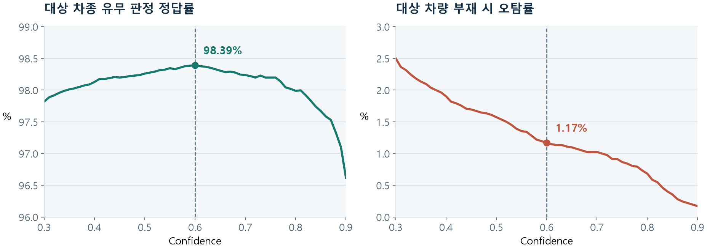

# 모델 결과 분석 · Confidence 선정

**12,873프레임에서 Confidence를 비교하고, 대상 차종의 유무 판정 정답률이 가장 높은 0.60을 선택했습니다.** 학습 코드만 아니라 선택 근거와 재계산 가능한 결과를 함께 제공합니다.

[학습 곡선·체크포인트 선정·이전 모델 비교](model-results/README.md) · [상호작용 HTML](model-results/index.html)



## 결과부터 보기

| 평가 묶음 | 프레임 수 | 대상 차종 유무 정답률 | 대상 차량 검출률 | 부재 시 오탐률 |
|---|---:|---:|---:|---:|
| 전체 BBox 검증 | 12,873 | 98.39% | 97.62% | 1.17% |
| test 묶음 | 1,633 | 98.65% | 97.55% | 0.75% |

전체 혼동행렬은 TP 4,560 / FN 111 / FP 96 / TN 8,106입니다. 정답률은 **대상 차종의 프레임 유무 판정**입니다. 전체 묶음은 학습 자료를 포함한 운영 임계값 선정용 내부 평가이며, BBox 위치 평가는 [학습·모델 비교](model-results/README.md)에 별도로 정리했습니다.

## 설계 선택과 해석

- Confidence가 낮으면 대상 차량을 놓칠 가능성은 줄지만 불필요한 영상 업로드가 늘어납니다. 높이면 반대 비용이 생깁니다. 단일 수치보다 임계값별 정답률·검출률·오탐률을 함께 비교했습니다.
- 프레임 판정과 실제 장치의 시간축 선별은 다릅니다. 배포 설정은 Confidence 0.60, class별 NMS IoU 0.65, 6프레임 간격 추론, 최근 3회 중 2회 검출입니다.
- 평가 모델은 YOLOX-Tiny 2-class `tiny_blur_removed_v009_b8`, epoch 1, `dataset_v009`입니다. 로컬 학습 release 기록의 0.55와 후속 팀 검증에서 선정한 0.60은 서로 다른 시점의 설정입니다.

## 상세 AI 평가 화면

[전체 상호작용 평가 HTML](model-results/evaluation-report.html)에서 Confidence 0.001~1.00을 조절하고 클래스·차량별 결과, 유무 혼동행렬과 시간축 영상 판정을 비교할 수 있습니다. [최신 시연의 0.51·0.60·0.75 비교 조건과 수치](model-results/README.md#상세-상호작용-평가)

## 근거 파일과 재현

| 자료 | 내용 |
|---|---|
| [선정값 CSV](measurements/ai-evaluation/selected_threshold_metrics.csv) | Confidence 0.60의 묶음별 결과 |
| [임계값별 CSV](measurements/ai-evaluation/threshold_metrics.csv) | 임계값별 유무 판정·BBox 집계 |
| [프레임별 CSV](measurements/ai-evaluation/frame_results.csv) | 12,873개 프레임의 정답·점수·판정·BBox |
| [평가 조건](measurements/ai-evaluation/evaluation_conditions.csv) | 모델·데이터·판정 규칙·해시 |
| [분석 코드](measurements/ai-evaluation/render.py) | 프레임/집계 대조 및 그래프·HTML 생성 |
| [평가 HTML](measurements/ai-evaluation/index.html) | 내려받아 브라우저로 열면 묶음·임계값을 바꿔 비교 가능 |

추가 패키지 없이 수치 일관성부터 확인할 수 있습니다.

```bash
cd projects/blue-witness/analysis/measurements/ai-evaluation
python3 -c 'import render; render.reconcile(); print("12,873프레임 집계 대조 통과")'
```

그래프 재생성은 Matplotlib과 코드에 명시된 한글 글꼴이 필요합니다. `python3 render.py`로 PNG·HTML·파일 해시를 갱신합니다.

## 출처와 버전

평가 기준 버전은 [팀 저장소 `5148804`](https://github.com/kingwooseok/2026ESWContest_mobility_ACE/tree/5148804/docs/measurements/ai-evaluation)입니다. 개인 학습 구현과 팀 통합 모델 평가를 연결하며, 모델·자료 버전은 [평가 출처 기록](measurements/ai-evaluation/source_manifest.json)으로 추적합니다.

[프로젝트 개요](../README.md) · [학습 구현](../source/model_training/README.md) · [학습 설계](../docs/design/MODEL_TRAINING.md)
