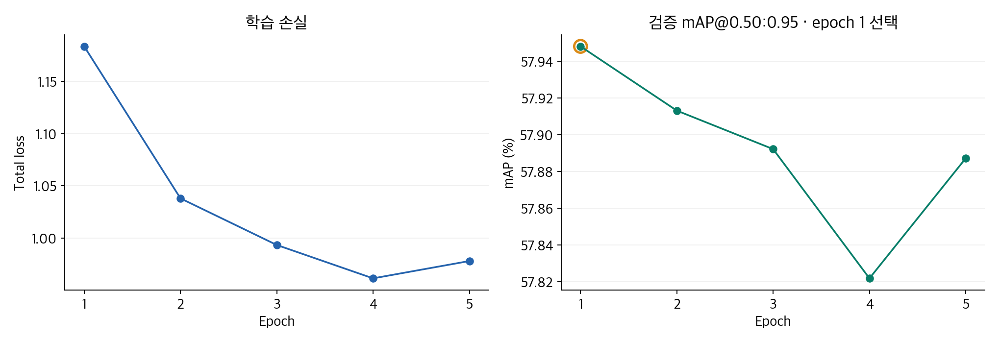
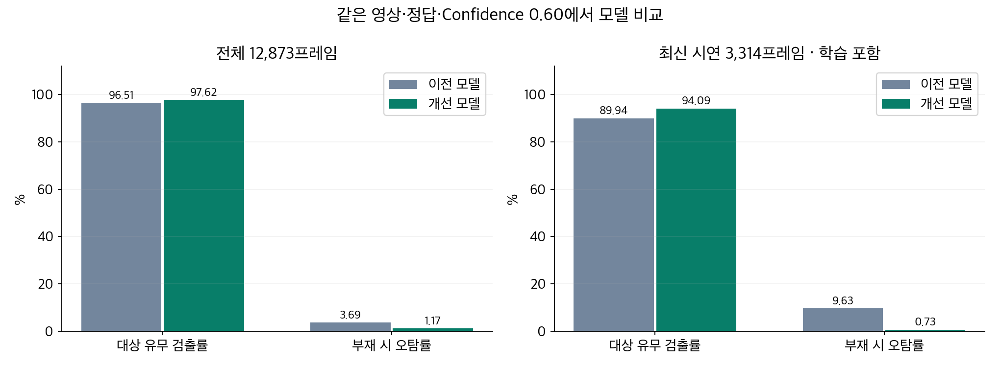

# 모델 학습과 개선 결과

YOLOX-Tiny를 대상 차종·기타 차량의 2-class로 학습하고, ONNX로 내보내 장치에 연결했습니다. 촬영·라벨 검수 도구와 데이터 분리, 학습·평가·배포를 담당했습니다.

## 5 epoch 학습과 체크포인트 선택

| Epoch | 학습 Total loss | 검증 mAP@0.50 | 검증 mAP@0.50:0.95 |
|---:|---:|---:|---:|
| **1 · 선택** | **1.18349** | **70.57%** | **57.95%** |
| 2 | 1.03795 | 70.81% | 57.91% |
| 3 | 0.99333 | 70.75% | 57.89% |
| 4 | 0.96137 | 70.74% | 57.82% |
| 5 | 0.97797 | 70.85% | 57.89% |

학습 손실만으로 모델을 고르지 않고 **검증 mAP@0.50:0.95가 가장 높은 epoch 1**을 선택했습니다. `tiny_blur_removed_v009_b8`의 epoch별 학습 로그와 COCO 평가 집계입니다.

[학습 이력 JSON](training.json) · [Epoch별 COCO 평가](epochs.json)

## 데이터 검수·재학습 전후 비교

움직임 블러가 심한 프레임을 정리하고 정답을 재검수한 뒤 재학습했습니다. 이전 `tiny_other1_v008_finetune_v007_b8`과 개선 `tiny_blur_removed_v009_b8`을 **동일 이미지·정답, NMS IoU 0.65, Confidence 0.60**으로 비교했습니다.

| 평가 묶음 | 프레임 | 유무 검출률 · 이전 → 개선 | 부재 시 오탐률 · 이전 → 개선 |
|---|---:|---:|---:|
| 전체 | 12,873 | 96.51% → **97.62%** | 3.69% → **1.17%** |
| 최신 시연 | 3,314 | 89.94% → **94.09%** | 9.63% → **0.73%** |
| 기존 test | 1,633 | 97.38% → **97.55%** | 2.54% → **0.75%** |
| 기존 val | 1,358 | 95.03% → **95.03%** | 6.45% → **6.99%** |

전체에서는 오탐 303→96건, 최신 시연에서는 210→16건으로 줄었습니다. 전체·최신 시연은 학습에 포함된 자료를 포함하는 내부 모델 비교이며, 전체 12,873프레임은 운영 임계값 선정에도 사용했습니다.

## 프레임·객체·영상 판정 결과

| 판정 단위 | 조건과 의미 | 개선 모델 결과 |
|---|---|---|
| 프레임 유무 | 전체 12,873프레임, Confidence 0.60에서 대상 존재 여부 | TP 4,560 · FN 111 · FP 96 · TN 8,106 / 정답률 **98.39%** |
| 객체 BBox | 같은 전체 자료, 정답 매칭 IoU 0.50에서 대상 차종의 위치·클래스 일치 | Precision **96.76%** · Recall **97.07%** · F1 **96.91%** |
| 영상 단위 내부 재생 평가 | 최신 시연 90영상, 저장 JPEG 예측에 5프레임 간격·최근 3회 중 2회 검출 적용 | 대상 영상 53/53 · 부재 영상 37/37 |
| 실장치 통합 | 장치에서 6프레임 간격·최근 3회 중 2회 검출 적용 | [9조건·27회 충돌, 81건 저장](../../source/docs/measurements/20261008-scenarios/README.md) |

유무 판정은 대상이 보이는지, BBox 평가는 위치와 클래스까지 맞는지, 영상 평가는 시간축에서 검출 신호가 발생했는지를 측정합니다. **내부 영상 평가의 5프레임 간격과 실장치의 6프레임 간격을 구분했습니다.**

## 운영 임계값과 비교 후보

실장치 통합에는 **Confidence 0.60 / NMS IoU 0.65 / 6프레임 간격 / 2-of-3**을 적용했습니다. 평가 화면에는 오탐 억제 후보 0.75, 최신 시연 검출률 우선 후보 0.51, 기존 val BBox F1 후보 0.87도 함께 정리했습니다. 이 후보는 각각 다른 선택 기준이며 실장치 설정 변경을 뜻하지 않습니다.

[비교 HTML](index.html)을 내려받아 브라우저로 열면 평가 묶음과 임계값을 바꾸어 두 모델의 수치·혼동행렬·클래스별 결과를 비교할 수 있습니다. 외부 연결 없이 동작합니다.

[비교 집계 JSON](comparison.json) · [임계값별 CSV](comparison.csv) · [프레임별 결과·선정 근거](../measurements/ai-evaluation) · [학습 코드](../../source/model_training/README.md)
