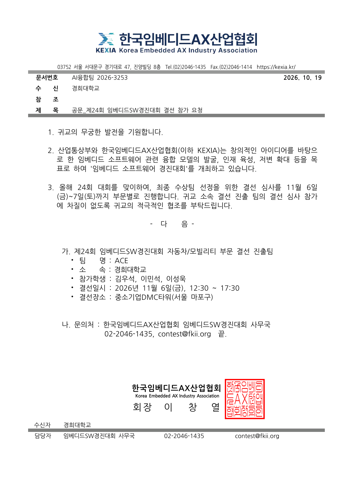

# 기여·측정 자료

## 결선 진출 공식 근거

한국임베디드AX산업협회가 경희대학교에 발송한 공문에 **자동차/모빌리티 부문 결선 진출팀 ACE**와 참가학생 **이민석**이 명시돼 있습니다.

| 항목 | 공문 내용 |
|---|---|
| 문서명 | 제24회 임베디드SW경진대회 결선 참가 요청 |
| 발급기관 | 한국임베디드AX산업협회 |
| 문서번호·발급일 | AI융합팀 2026-3253 · 2026년 10월 19일 |
| 수신 | 경희대학교 |
| 부문·팀명 | 자동차/모빌리티 · ACE |
| 참가학생 | 김우석·이민석·이성욱 |
| 결선 일정 | 2026년 11월 6일 12:30~17:30 |
| 결선 장소 | 중소기업DMC타워(서울 마포구) |

[원본 공문 PDF](evidence/2026-embedded-sw-finals-invitation-ace.pdf)

## 개인 역할과 구현

[기여 안내](CODE_GUIDE.md)는 담당 모듈·대표 기여 커밋·협업 역할을 연결합니다. [소스 manifest](../source/PROVENANCE.json)는 원본 기준과 파일 hash를 기록합니다. 실제 코드는 모두 이 저장소의 [source/](../source/README.md)에서 확인할 수 있습니다.

## 실제 장치와 구현 화면

[실제 장치·개인 구현](IMPLEMENTATION_GALLERY.md)에서 차량 실장·AI 검수·웹 포털·병합 영상·Trello·Slack·실제 팀 CI 실행 화면을 코드와 함께 확인할 수 있습니다.

## 측정 자료

| 자료 | 확인할 내용 |
|---|---|
| [AI 프레임 평가 CSV와 분석](../analysis/README.md) | 12,873프레임의 대상 차종 유무 판정과 Confidence 선정 |
| [시나리오 기록](../source/docs/measurements/20261008-scenarios/README.md) | 충돌 시나리오 27회와 서버 저장 영상 81건의 사건·차량·체크섬 연결 |
| [시각 오차 CSV](../source/docs/measurements/clock-summary-20260923.csv) | 차량별 10,000 samples의 시각 차이 집계 |
| [코드 회귀 검사](CODE_REVIEW.md) | 서버·웹·학습·업로드 전송·Linux 빌드 |
| [실제 포트폴리오 Actions](https://github.com/eLunaaaa/portfolio/actions/workflows/portfolio-ci.yml) | 이 저장소 commit을 대상으로 실행한 job·로그 |

AI 자료는 **당시 임계값 선정을 위한 프레임 평가 기록**입니다. 독립 시험 점수와 BBox mAP는 별도 지표이므로 평가 조건·집계 방식을 [분석 안내](../analysis/README.md)에 함께 표시했습니다.

대회 운영 대화방 이미지는 다른 참가자 개인정보가 포함되어 정리 자료에서 제거했습니다.
