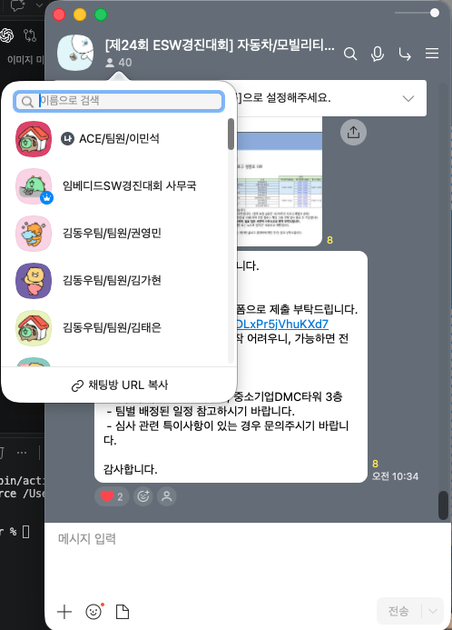

# 대회·기여·코드·결과 증빙

증빙의 강도를 구분합니다. 참가 사실, 역할 설명, Git 작성 기록, 실행 결과는 서로 다른 근거입니다.

## 대회 이력

**2026 임베디드 소프트웨어 경진대회 본선 참가 프로젝트 — Blue Witness / ACE 팀.**

대회 운영 대화방 스크린샷에서 **‘제24회 ESW경진대회 자동차/모빌리티…’**, 대회 사무국과 **`ACE/팀원/이민석`** 참여를 확인할 수 있습니다. 본선 프로젝트 참가 이력을 보충하는 자료이며 수상·순위 증명으로 사용하지 않습니다.

원본 스크린샷에는 다른 참가자의 이름도 보이므로 현재 교수님 검토용 비공개 저장소에서 사용합니다. 외부 공개 전에는 본인·팀 외 참가자 정보를 가린 사본으로 바꾸는 것이 좋습니다.

## 개인 기여

| 주장 | 현재 근거 | 확인 가능한 범위 |
|---|---|---|
| 서버·웹 담당 | [개인 커밋 목록](CODE_GUIDE.md), 실제 소스·시험 | 기능 추가·변경과 해당 모듈 담당 |
| 모델 학습·AI 배포 담당 | 학습 파이프라인·배포 커밋과 AI 개인 patch | 데이터 도구·학습·모델 교체·threshold 조정 |
| Time Sync 담당 | `fd45a67`, `0c27930` 등 개인 커밋 | 서비스 추가·실장치 옵션 수정 |
| CI·수동 CD 구축 | `4a6d361`, `360dc82`, `bc6371a`와 보존된 코드 | 초기 구축부터 캐시·비용·복원 개선까지 설계 기여 · [최신 코드와 실제 Actions](../source/automation/README.md) |
| 전체 Fail-safe 설계 | 본인 역할 설명, [구조·모듈 설계](design/README.md), 구현 연결 | 설계 담당 설명. 공통 watchdog 및 팀 모듈 코드의 단독 저작 증거는 아님 |

실제 Git 기록에서 카메라·Snapshot·AI 런타임 본체와 공통 watchdog은 다른 팀원 기여가 중심입니다. 해당 코드를 본인 단독 구현으로 복제하지 않고 설계 인터페이스와 연동 근거로만 설명합니다. 담당 모듈에 후속 팀 수정이 존재하므로 [manifest](../source/PROVENANCE.json)는 ‘전체 파일 저자 증명’이 아니라 정확한 복제 출처 증명입니다.

현재 서버와 학습 코드의 최신 출처는 [로컬 스냅샷](LOCAL_SNAPSHOT.md)입니다. 아직 원격 커밋에 없는 변경은 파일별 로컬 원본 hash로 연결하고 Git 이력의 기여 근거와 구분합니다. 부모 checkpoint·dataset·ONNX hash는 [로컬 release 명세](../source/model_training/experiment_evidence/blur_removed_v009_release_manifest.json)에 남겨 실험 설정과 연결했습니다.

## 수치의 재현 근거

- 12,873프레임 결과: 원본 `selected_threshold_metrics.csv`의 전체 묶음. 임계값 선정에 쓰였으므로 독립 test 결과로 취급하지 않습니다.
- test 1,633프레임 결과: 같은 CSV의 `test` 묶음.
- 시간차: `clock-summary-20260923.csv`의 차량별 10,000 samples.
- 27회·81건 저장: 팀 `scenarios.csv`·`clips.csv`·체크섬을 검증기로 대조.
- 포트폴리오 소스 시험: [재검증 기록](CODE_REVIEW.md). 이번에 실장치나 학습을 새로 실행했는지 여부를 구분합니다.

## 포함하지 않는 자료

운영 API key·비밀번호·쿠키·인증서 개인키·실제 사용자 DB·원본 사고 영상·전체 학습 데이터는 포트폴리오 근거로 공개하지 않습니다. 시스템 설계 설명을 위해 실제 인증 정보를 노출할 필요는 없습니다.
