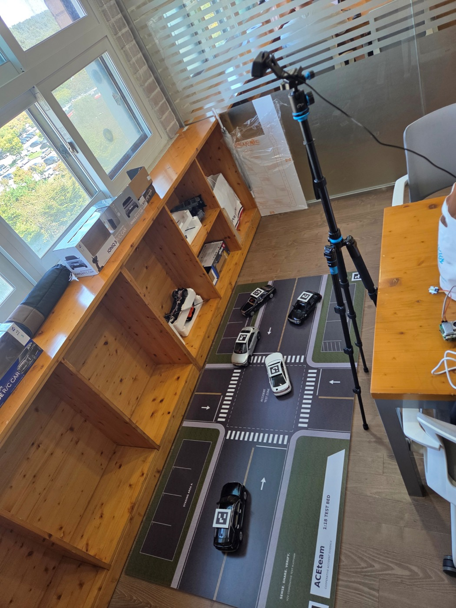
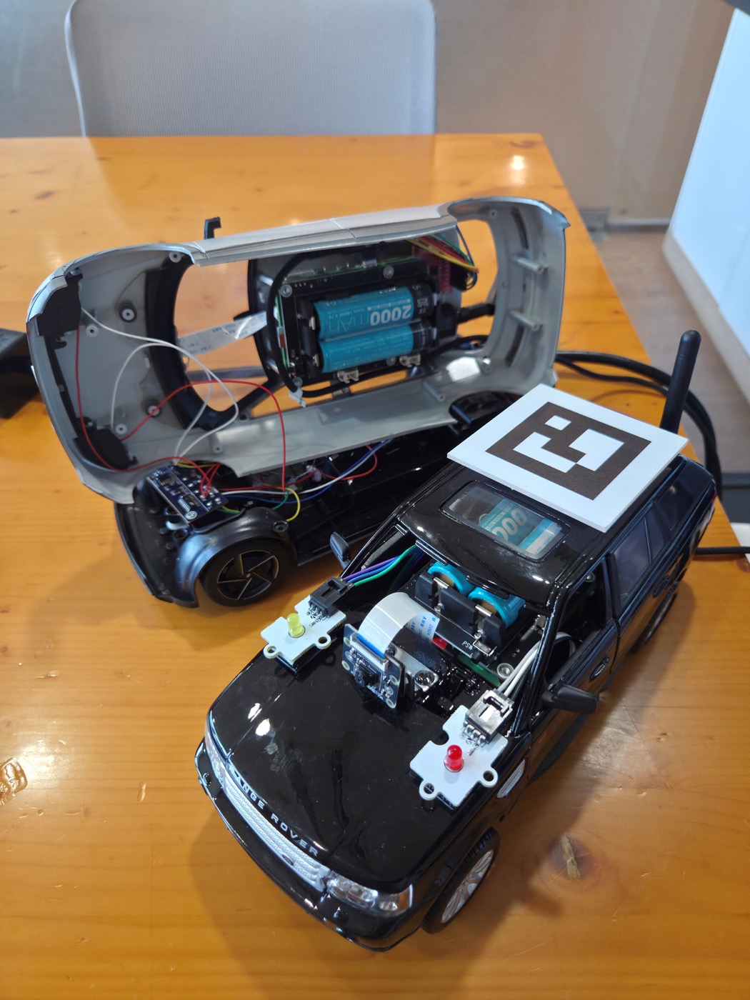
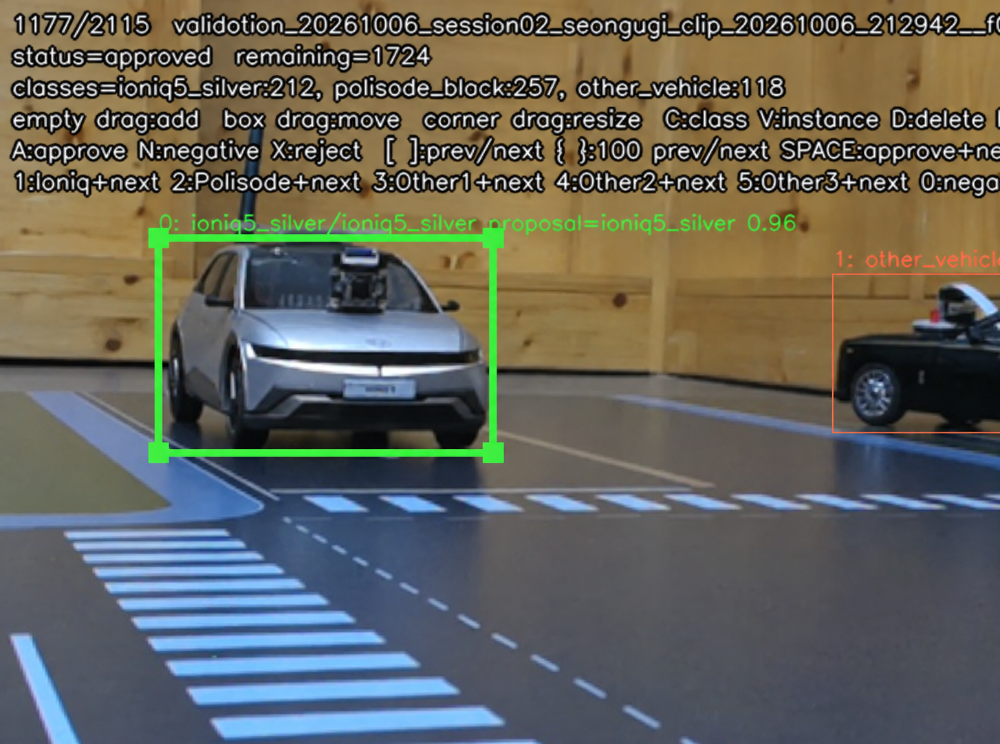
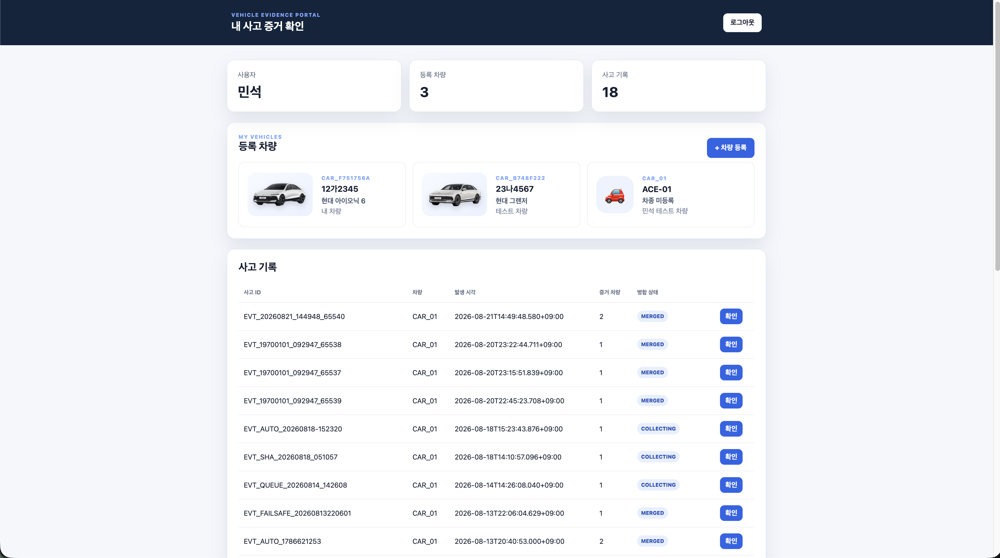
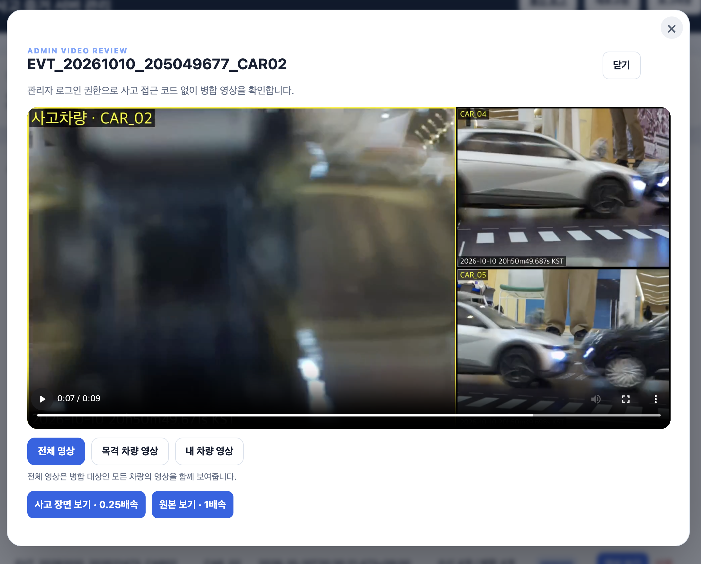
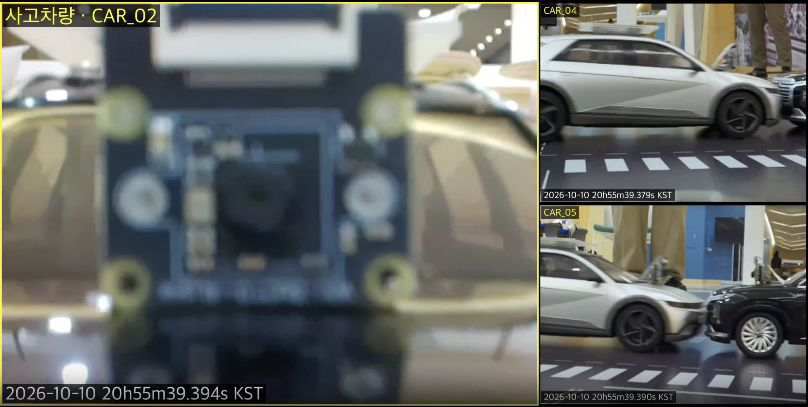
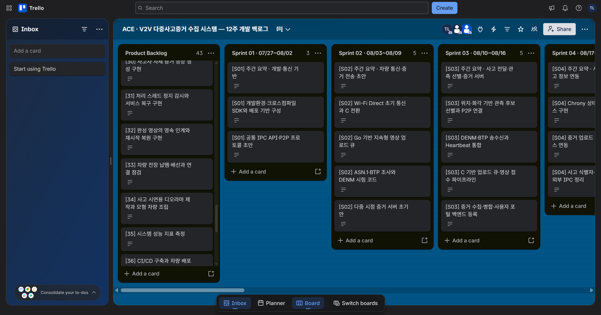
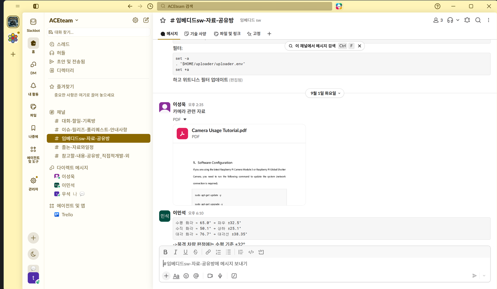
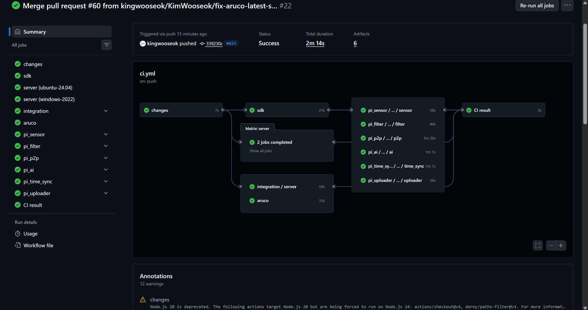

# Blue Witness · 실제 장치와 개인 구현

사고차와 주변 차량이 확보한 영상을 서버에 모아 **같은 사고를 여러 시점에서 확인**하는 시스템입니다. 실제 장치·AI·서버·웹의 동작과 개인 담당 코드·설계를 함께 확인할 수 있습니다.

**이민석 담당:** AI 학습·배포, 서버·웹, 시간 동기화 상태 서비스, 전체 Fail-safe·Uploader 설계, CI/CD 설계·구축. 업로더는 개인 설계·팀 구현이며, 장치 실장·통합 시험과 라벨 검수는 공동 작업입니다.

## 1. 실제 차량과 시험 환경

| 1:18 시험 도로·상부 촬영 | 차량 내부 실장·외부 모듈 |
|---|---|
|  |  |

Raspberry Pi 5·BNO086 IMU·IMX219 카메라·배터리 모듈을 모형 차량에 실장했습니다. 전체 환경은 차량 5대, 상부 카메라, BLE 위치 관제 컴퓨터, 영상 전송용 공유기와 서버로 구성했습니다. 사진은 **팀 전체 시스템의 구현 결과**이며, 개인 소프트웨어는 이 장치의 모델·시간 정보·영상 업로드와 서버 조회를 연결합니다.

## 2. AI 학습 · 실제 카메라 데이터에서 장치 배포까지

**문제:** 위치·화각상 사고를 볼 수 있는 차량도 다른 차량이나 구조물에 가려 실제 영상에는 대상이 보이지 않을 수 있습니다.

**개인 구현:** 촬영·프레임 출처 기록, BBox 검수 도구, COCO 변환과 촬영 세션별 데이터 분리, YOLOX-Tiny 학습·평가·ONNX 내보내기를 연결했습니다. 화면에서는 박스 위치·차종·차량 정보와 승인 상태를 확인하며, 라벨 검수는 팀원이 분담했습니다.

**장치 연동:** 대상 차종과 기타 차량의 2-class 모델을 ONNX Runtime에 연결했습니다. Confidence **0.60**, NMS IoU **0.65**, **6프레임 간격·최근 3회 중 2회 검출**을 적용해 한 프레임의 흔들림으로 영상 전송 여부가 바뀌는 것을 줄였습니다. 추론 프로세스는 팀 구현이며, 학습·내보내기·배포 설정을 담당했습니다.

[학습·검수 도구와 실행 순서](../source/model_training/README.md) · [12,873프레임의 임계값 선정 기록](../analysis/README.md)

[학습 곡선·Epoch별 결과·개선 전후 비교](../analysis/model-results/README.md)

## 3. 서버·웹 · 수집한 영상이 사용자가 보는 결과가 되기까지

등록 차량과 사고 기록을 조회하는 사용자 화면입니다. 차량 소유권과 로그인 세션을 확인하고, 사고별로 수집 중·병합 완료 상태를 표시합니다.

**입력:** 차량에서 보낸 MP4와 사고 ID·촬영 차량 ID·사고/영상 시각·동기 상태를 담은 메타데이터입니다.

**처리:** FastAPI가 차량 인증·입력을 검사하고 파일·SQLite 기록을 저장합니다. 같은 `event_id`의 영상을 모아 별도 Worker가 `clip_start_time_ns` 기준으로 시간 정렬하고 FFmpeg로 병합합니다. 추가 영상이 늦게 도착하면 병합본을 갱신합니다.

**출력:** 전체·목격 차량·내 차량 시점 선택, 병합 영상 재생·다운로드, 사고 장면 0.25배속 재생을 제공합니다. 병합 작업을 업로드·조회와 분리해 영상 처리 중에도 API를 사용할 수 있게 했습니다.

사고차 `CAR_02`와 관측차 `CAR_04`·`CAR_05`의 화면을 함께 배치한 실제 결과입니다. 사고차 화면만으로 보기 어려운 주변 상황을 관측차 시점에서 확인할 수 있습니다.

[서버·웹 코드 안내](../source/server/README.md) · [수집·병합 설계](design/SERVER.md)

**서버·보안:** TLS·노드 API Key·SHA-256·사용자 세션·차량 소유권·사고별 접근 코드의 역할과 구현은 [서버·보안 설계](SERVER_SECURITY.md)에서 확인할 수 있습니다.

## 4. 영속 업로드·시간 동기화 · 단절 후에도 영상을 이어서 전달

**설계 이유:** 인터넷이 끊기거나 전송 도중 프로세스가 재시작돼도 사고 영상과 다음 처리 단계를 잃지 않아야 합니다. 또한 여러 차량의 영상을 촬영 시각에 맞춰야 합니다.

| 담당 영역 | 구현 구조 | 확인할 결과 |
|---|---|---|
| Uploader 설계 | 완성 MP4·메타데이터를 로컬 보존 → SQLite 작업 등록 → `PEND` → `UPLOAD` → `DONE` | 전송 실패 시 5·10·20·40·최대 60초 간격으로 재시도 |
| 서버 저장 확인 | HTTP 응답뿐 아니라 사고·차량 ID, SHA-256, `storage_ack`·`STORED` 대조 | 응답이 불명확하면 서버 저장 상태 재조회 후 완료·재전송 결정 |
| 전체 Fail-safe 설계 | 스레드 진행 감시·영속 큐·재시작 복구·로컬 접수와 서버 저장 ACK 분리 | 처리 중단·통신 단절 후에도 원본과 작업 상태 보존 |
| 시간 동기화 서비스 | 서버 NTP를 기준으로 Chrony 상태 조회, offset·동기 상태·측정 시각을 IPC로 전달 | 영상 메타데이터에 시간 상태를 연결해 정렬 기준 제공 |

업로더는 개인 설계·팀 구현, 서버와 시간 동기화 상태 서비스는 개인 담당입니다.

**팀 통합 시험:** 2026년 10월 8일 9조건을 각 3회 반복해 **27/27회 시나리오 성공, 81/81건 서버 저장, 단절·복구 영상 12/12건 저장**을 기록했습니다. 이 시험은 사고차 1대·관측차 3대로 수행했으며, 위 전체 환경 사진의 차량 수와 시험 구성을 구분했습니다.

[업로더 코드](../source/uploader/README.md) · [시간 동기화 C 코드](../source/time_sync/src/time_sync.c) · [Fail-safe 설계](FAILSAFE.md) · [사건별 CSV·ACK·체크섬](../source/docs/measurements/20261008-scenarios/README.md)

## 5. 협업·CI/CD · 개발과 장치 배포를 연결

Trello에서 주간 목표·작업 우선순위·담당과 진행 상태를 관리했습니다. 통신·서버 기반부터 차량 기능 통합, 실장·반복 시험, 복구 보완으로 기능을 확장했습니다.

Slack에서 공유한 장치 자료와 연동 기준

장치 사용 자료와 실험 결과를 공유하고, 카메라 화각 같은 모듈 간 연동 기준을 협의했습니다. 화면의 자료 공유·논의는 팀 협업 기록입니다.

**개인 담당:** CI/CD 구조·개선 방향 설계와 구축·운영 개선입니다. PR에서는 변경 영향에 맞는 검사를 선택하고, main에서는 전체 검사·빌드와 산출물을 연결했습니다. 서버 Ubuntu·Windows, Pi의 6개 모듈, ArUco 오프라인 검사·FFmpeg 병합 등을 자동 검사 흐름에 포함했습니다.

**배포:** 사용자가 요청한 배포는 VMware 실행기에서 검증 산출물을 받아 Pi 한 대를 선행 점검한 뒤 순차 진행합니다. 서비스·P2P smoke 검사와 실패 복원 흐름을 구성했습니다. 위 이미지는 **원본 팀 CI의 실행 화면**이며, 이 포트폴리오의 코드 검사 실행은 아래 별도 링크에서 확인할 수 있습니다.

[보존된 실제 팀 workflow·배포 스크립트](../source/automation/README.md) · [CI 설계](design/CI.md) · [CD 설계](design/CD.md) · [포트폴리오 Actions](https://github.com/eLunaaaa/portfolio/actions/workflows/portfolio-ci.yml)
