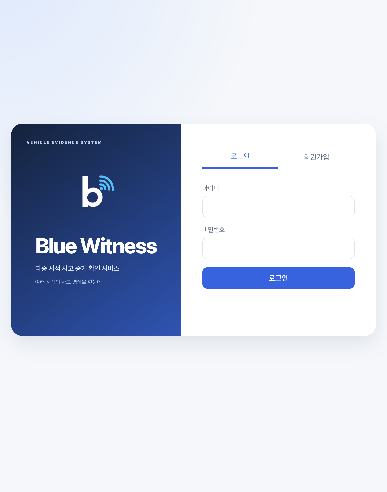
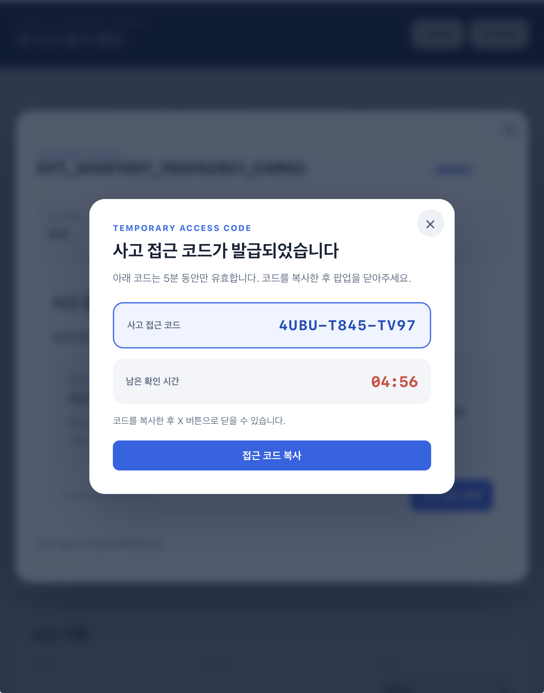

# 서버와 보안 설계

**개인 담당:** FastAPI 서버·웹과 시간 동기화 상태 서비스, 전체 Fail-safe 설계·Uploader 전체 개발입니다. 서버는 여러 차량에서 도착한 영상을 저장·정렬·병합하고, 인증된 사용자가 자신의 사고 영상을 확인할 수 있도록 구성했습니다. 업로더는 개인이 전체 개발했고 이후 CD 연동 과정에서 팀 수정이 반영됐습니다.

## 서버 구조와 데이터 흐름

```text
차량 MP4 + 메타데이터
  → 노드 인증·차량 ID 확인
  → 크기·형식·SHA-256 검사
  → 원본 파일 + SQLite 저장
  → 저장 ACK 응답
  → 사고별 수집 창 → 병합 작업 선점
  → FFmpeg 시간 정렬·병합 → revision 갱신
  → 사용자·차량·사고 접근 권한 검사 → 웹 재생
```

| 설계 선택 | 처리 방식 | 선택한 이유 |
|---|---|---|
| 원본·메타데이터·작업 상태 분리 | 영상은 파일, 사건·증거·병합 작업은 SQLite에 저장 | 원본을 보존하면서 저장·병합 단계를 각각 추적 |
| 업로드와 병합 분리 | 별도 Worker가 FFmpeg 실행 | 영상 처리 중에도 업로드·조회 API 응답 유지 |
| 기본 12초 수집 창 | 첫 정상 저장을 기준으로 수집 후 병합 | 도착하지 않는 차량 때문에 결과를 계속 기다리지 않도록 구성 |
| 늦은 영상 반영 | 다음 revision으로 재병합, 기존 완료 결과 유지 | 빠른 최초 확인과 추가 증거 반영을 함께 지원 |
| 시간 기반 정렬 | 촬영 시작·종료 시각으로 trim/pad | 업로드 순서 대신 실제 촬영 구간으로 시점 비교 |
| 멱등 저장·재조회 | 사고·차량·파일 해시와 저장 상태 대조 | 재전송·응답 유실에서 중복이나 잘못된 완료 처리 방지 |

[서버 코드와 실행 순서](../source/server/README.md) · [저장 처리](../source/server/backend/app/services/storage.py) · [병합 설계](design/SERVER.md)

## 전송·인증·무결성의 역할 분리

<p align="center"></p>

**차량 업로드 인증 구조:** 등록된 차량 노드의 인증키를 확인한 뒤 영상을 접수합니다. 아래 구현에서 TLS·노드 인증·파일 무결성의 역할을 각각 구분했습니다.

| 보호 대상 | 구현 | 코드 |
|---|---|---|
| 전송 구간 | OpenSSL TLS 1.2 이상, 지정 CA·서버 인증서 검증, DNS hostname 또는 IP SAN 대조 | [uploader_tls.c](../source/uploader/src/worker/uploader_tls.c) |
| 차량 업로드 권한 | 등록 `node_id`와 API Key 해시를 constant-time 비교하고 노드 활성 상태 확인. 인증된 노드에 연결된 차량 ID 사용 | [node_auth_service.py](../source/server/backend/app/services/node_auth_service.py) |
| 영상 파일 무결성 | 수신 파일의 SHA-256을 계산해 제출값 대조. 사고·차량·해시·`storage_ack`·`STORED`를 업로더에서도 확인 | [storage.py](../source/server/backend/app/services/storage.py) · [uploader_ack.c](../source/uploader/src/worker/uploader_ack.c) |

**TLS는 전송 암호화와 서버 신원 확인, API Key는 차량 인증, SHA-256은 파일 대조를 담당합니다.** HTTPS 연결 실패 시 HTTP로 자동 전환하지 않으며, 실패한 작업은 영속 큐에 남겨 재시도합니다.

## 사용자와 사고별 접근 제어

| 사용자 로그인 | 사고별 임시 접근 코드 |
|---|---|
|  |  |

**로그인 → 차량 소유권 확인 → 사고 선택 → 임시 접근 코드 → 영상 열람** 순서로 접근을 관리합니다. 왼쪽은 계정 로그인 화면, 오른쪽은 사고 접근 코드의 복사 기능과 남은 유효시간을 보여주는 실제 웹 화면입니다. 코드의 유효기간은 서버에서도 검사하며, 검증 후 발급하는 사고 세션은 해당 사고와 만료 시각에 연결합니다.

| 단계 | 구현 내용 | 목적 |
|---|---|---|
| 계정 로그인 | `pwdlib`의 권장 비밀번호 해시 사용, 존재하지 않는 계정도 더미 해시 검증. 무작위 세션 토큰의 해시를 DB에 저장 | 비밀번호·세션 원문 저장을 피하고 로그인 처리 시간 차이를 줄임 |
| 차량 소유권 | 로그인 세션과 사용자·차량 소유 관계를 확인한 뒤 사고 목록·영상 접근 판정 | 다른 사용자의 차량 ID를 지정한 조회 차단 |
| 사고별 접근 코드 | 기본 유효기간 5분의 무작위 코드, 검증 후 해당 사고의 30분 세션 발급 | 사건 범위와 접근 시간을 제한 |
| 반복 실패 제한 | 사고 접근 코드 5회 실패 시 10분 잠금 | 접근 코드 반복 추측 억제 |
| 브라우저 쿠키 | `HttpOnly`·`SameSite=Lax`, HTTPS 운영 시 `Secure` 설정 | JavaScript의 세션 접근을 제한하고 HTTPS에서 쿠키 전달 |
| 관리자 | 일반 사용자·사고 접근 세션과 관리자 권한을 구분 | 관리 기능을 별도 권한으로 제한 |

[계정·세션](../source/server/backend/app/services/account_service.py) · [차량 접근 판정](../source/server/backend/app/services/portal_access_service.py) · [접근 코드 발급](../source/server/backend/app/services/user_access_code_service.py) · [사고 세션·실패 제한](../source/server/backend/app/services/access_service.py) · [쿠키 설정](../source/server/backend/app/api/access.py)

## 입력과 운영 기록

파일은 1 MiB chunk로 읽고 업로드 100 MiB 한도를 적용합니다. 파일 경로·식별자·해시·영상 시각을 검증하고, 검증 실패를 저장 성공으로 응답하지 않습니다. 관리자 로그는 bounded buffer로 유지하며 API Key·쿠키·요청 body를 기록하지 않습니다.

사고 전 8초·후 2초와 선별된 관측 영상만 수집하고, 업로드·사용자 조회·관리 권한을 각각 검사하도록 구성했습니다.

[서버 회귀 검사](../source/server/backend/tests) · [전송·ACK 검사](../source/uploader/tests) · [자동 검사](https://github.com/eLunaaaa/portfolio/actions/workflows/portfolio-ci.yml)
