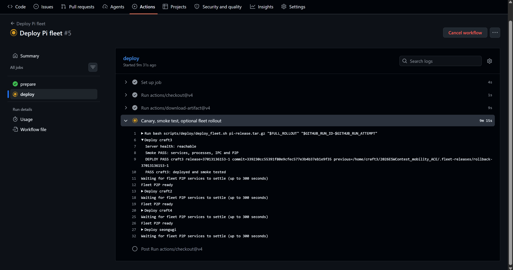

# CD 설계 — main의 검증 결과를 한 대씩 안전하게 승격하기

[workflow](../../source/automation/.github/workflows/deploy.yml) · [fleet 진입점](../../source/automation/scripts/deploy/deploy_fleet.sh) · [장치 적용 helper](../../source/automation/scripts/deploy/apply_release.sh)



## 문제와 제약

Pi 5대는 사고차·관측차 역할과 서비스가 다르고, 같은 P2P 그룹에 연결됩니다. 한꺼번에 바이너리를 바꾸면 어느 장치부터 잘못됐는지 찾기 어렵습니다. SSH가 된다고 서비스 재시작 권한까지 보장되지 않고, 배포 중 기존 영상·spool을 지우면 복구 자체가 손실을 만들 수 있습니다.

## 선택 1. 모든 push 즉시 운영 반영 대신 수동 승격

`workflow_dispatch`에서 성공한 main CI run ID를 선택합니다. workflow 이름·branch·SHA·성공 결론과 필요한 artifact를 확인하고, 검증된 실행 파일·모델·설정·release SHA를 하나의 묶음으로 만듭니다. 사람이 배포 시점을 고르는 운영 gate이며 ‘완전 무인 자동 배포’라고 표현하지 않습니다.

CI 실패·다른 commit·누락 artifact면 준비 단계에서 중단합니다. 장치에 복사하고 나서 불일치를 발견하는 것보다 앞에서 차단하는 선택입니다. 성공한 과거 commit을 사용한다고 현재 모든 환경과 호환된다는 보장은 없어 장치 smoke가 뒤따릅니다.

## 선택 2. 외부 runner와 장치 접근 runner 분리

GitHub-hosted runner는 검증·release 준비를, 장치에 접근 가능한 self-hosted runner는 SSH 적용을 맡습니다. 네트워크 접근 범위를 나누는 대신 별도 runner·배포 환경·권한 준비가 필요합니다. 이 코드는 서버 웹 자동 배포가 아니라 Pi fleet 배포용입니다.

## 선택 3. 사전 권한 검사

`deploy_fleet.sh`는 지정 계정과 기기만 대상으로 합니다. `sudo -n`을 통한 무인 재시작 가능 여부를 파일 교체 전에 확인합니다. SSH 성공만 확인하고 진행하면 교체는 됐는데 재시작에서 password 대기·실패가 날 수 있기 때문입니다.

장치 helper는 release ID·호스트·archive·설치 위치를 검사하고 역할별 실행 파일·서비스·소켓을 선택합니다. 임의 shell 명령을 배포 계정에 열어두는 대신 제한된 helper와 sudoers를 사용합니다. 최초 root helper 설치·권한 검토는 별도 운영 작업입니다.

## 선택 4. canary 후 순차 확대

```text
CI run/SHA/artifact 확인
   → release 구성
   → 대상 권한·연결 사전 검사
   → canary craft3 적용
   → 서비스·process·IPC·P2P smoke
   → 사용자가 full rollout을 선택했으면 나머지 장치 순차 적용
   → 실패하면 중단·실패 장치 복원
```

모든 장치를 동시에 재시작하는 속도보다 한 대에서 확인하는 진단 가능성을 우선했습니다. canary는 모든 차량 역할을 대변하지 않으므로 후속 장치도 smoke를 검사해야 합니다. `full_rollout=false`로 한 대만 적용할 수 있습니다.

## 선택 5. 서비스 active만으로 성공 처리하지 않기

PID가 존재해도 잘못된 바이너리·소켓·P2P 상태일 수 있습니다. 배포 후 서비스 실행, 업무 process, 필요한 IPC 경로와 실제 P2P reachability를 확인합니다. 본인 커밋 `bc6371a`는 live P2P smoke를 강화한 기록입니다.

서버 health와 로컬 서비스 정상은 별개입니다. 인터넷 단절은 Uploader의 영속 큐·재시도와 연결되는 정상 장애 시나리오이므로, 원본 최신 버전의 각 smoke 정책을 확인해야 합니다.

## 파일 교체와 복원

교체 전 기존 실행 파일·동반 설정·서비스 상태를 보관하고 stage에서 준비한 뒤 적용합니다. 실패한 장치는 이전 파일·설정·실행 상태로 복원하고 다음 장치 진행을 멈춥니다. 영상·업로드 큐·운영 key는 배포 교체 대상과 분리해야 합니다.

포트폴리오에는 `5148804`의 실제 운영 배포본을 포함했습니다. P2P 재연결 대기·복원·서비스 상태·SDK 정렬 개선도 CI/CD 설계·구축 기여 범위로 설명합니다. 구현은 팀 협업 이력을 유지합니다. 이미 적용된 다른 차량까지 전부 되돌리는 fleet 전체 원자 트랜잭션은 아닙니다.

[실제 Pi fleet 배포 성공 기록](https://github.com/kingwooseok/2026ESWContest_mobility_ACE/actions/runs/37762360292)은 SHA `2ebe4da`의 실행입니다. 현재 보존본의 모든 실패 경로를 이 한 번의 성공 기록으로 검증했다고 해석하지 않습니다.

## 검증과 운영 제한

| 확인할 시험 | 기대하는 결과 |
|---|---|
| 다른 SHA·실패 CI run | 장치 적용 전 거부 |
| 필요한 artifact 없음 | release 준비 실패 |
| SSH 가능·sudo 불가 | 교체 전 사전 검사 실패 |
| canary 서비스 실패 | 진행 중단·복원 확인 |
| 서비스 active·IPC/P2P 불가 | smoke 실패 |
| 전체 배포 중 두 번째 장치 실패 | 이후 장치 중단, 해당 장치 복원·이전 성공 장치 상태 별도 확인 |

표의 항목은 배포 전 점검·실패 처리 규칙입니다. 실제 운영 설정은 배포 환경에서 주입합니다.
