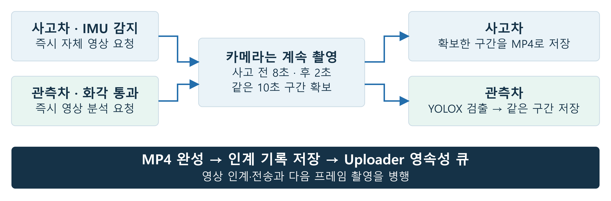
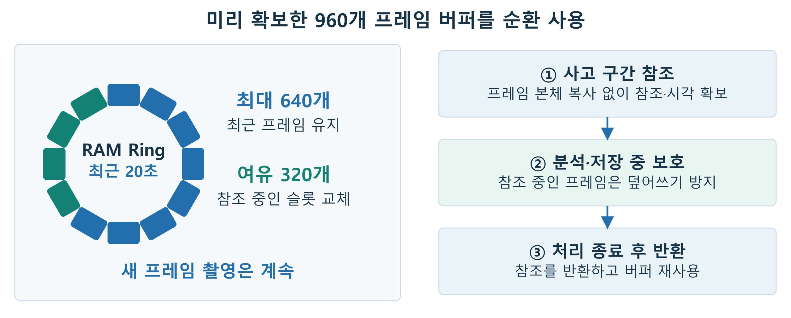

# Camera / AI — 촬영을 이어가며 사고 전후 영상 확보

기여: 촬영·추론 런타임은 팀 구현입니다. 이민석의 모델 학습·배포·검출 설정과 전체 Fail-safe 설계를 연결해 읽을 수 있도록 전체 소스를 포함했습니다.

**사고 전 8초·후 2초를 하나의 영상으로 확보합니다.** 사고차는 자체 영상을 보존하고, 관측차는 YOLOX-Tiny로 대상 차량을 찾은 영상을 저장합니다. 촬영·분석·영상 인계를 나누어 처리해 새 프레임을 계속 받습니다.

[](../docs/assets/vision-event-flow.png)

## 같은 사고 구간을 판정하고 저장합니다

| 차량 역할 | 시작 신호 | 영상 처리 |
|---|---|---|
| **사고차** | IMU가 사고 ID·시각을 확정하면 즉시 영상 요청 | 위치 수신과 별도로 사고 전후 구간을 확보해 저장 |
| **관측차** | 위치·화각 선별을 통과하면 즉시 사고 접수 | 사고 후 2초까지 모은 구간에서 AI 판정 → AI 판정에 사용한 10초 구간 저장 |

사고 시각은 IMU가 정한 값을 유지합니다. 관측차의 AI 판정과 인코딩은 **동일한 10초 Snapshot**을 사용해 사고 전 접근과 충돌 후 장면을 함께 담습니다.

## 메모리를 재사용하고 사고 구간은 참조로 보호합니다

[](../docs/assets/vision-frame-pool.png)

- **시작할 때 미리 확보:** 960개 NV12 버퍼를 확보해 반복 사용합니다. Ring에는 최근 20초, 최대 640개 프레임을 유지합니다.
- **필요한 구간만 참조:** Snapshot은 프레임 본체를 복사하지 않고 버퍼 참조와 촬영 시각을 확보합니다. 분석·저장 중인 프레임은 참조 횟수로 보호합니다.
- **촬영과 처리를 병행:** 참조 중인 슬롯은 여유 버퍼 320개로 교체합니다. 처리가 끝나면 참조를 반환해 다음 촬영에 재사용합니다.

RAM에는 최근 영상을 순환 보관하고, 디스크에는 선택된 사고 영상을 MP4로 저장합니다. 버퍼 재사용은 반복 메모리 할당을 줄이고, 참조 방식은 사고 구간을 별도로 복사하는 부담을 줄입니다.

## 사고 영상과 AI 판정

| 단계 | 동작 |
|---|---|
| 사고 접수 | 수신 스레드가 ID·시각을 검사하고 Worker 대기열에 등록 |
| 영상 확보 | 사고 후 구간까지 수집한 뒤 전 8초·후 2초를 Snapshot으로 고정 |
| 관측 영상 분석 | 6프레임 간격으로 YOLOX-Tiny 추론 |
| 검출 확정 | 최근 추론 3회 중 2회 이상 대상 차량 검출 시 `INFERENCE_FOUND` |
| 저장·인계 | 사고차와 검출된 관측 영상의 MP4 생성 → Uploader 인계 |

현재 실행 모델은 **2-class YOLOX-Tiny**입니다. class 0은 아이오닉 target, class 1은 나머지 차량이며 `station_id=1`을 class 0으로 찾습니다. Confidence는 **0.60**, class별 NMS IoU는 0.65입니다. 모델 입출력과 세부 판정 규칙은 아래 상세 계약에 정리했습니다.

## Confidence 선정과 프레임 검증

**검증용 12,873프레임에서 임계값별 유무 판정 정답률을 비교해, 가장 높은 정답률을 보인 Confidence 0.60을 선정했습니다.** 테스트베드에서 검증용으로 촬영한 영상에 BBox 정답을 표시하고, 임계값별로 대상 차종의 유무 판정을 비교했습니다.

[](../../analysis/measurements/ai-evaluation/README.md)

| 전체 BBox 검증 · 12,873프레임 | 결과 | 계산 |
|---|---:|---|
| 대상 차량 유무 판정 정답률 | **98.39%** | 정답 12,666 / 전체 12,873 |
| 대상 차량 검출률 | **97.62%** | 검출 4,560 / 대상 차량이 있는 4,671 |
| 대상 차량 부재 시 오탐률 | **1.17%** | 오탐 96 / 대상 차량이 없는 8,202 |

프레임의 검출 점수는 `objectness × class score`입니다. 점수가 **0.60 이상**인 검출에 class별 NMS IoU 0.65를 적용합니다. 장치는 **6프레임 간격**으로 추론하고, **최근 3회 중 2회** 대상 차량을 검출하면 영상을 선별합니다.

[평가 조건·전체 묶음별 결과·CSV](../../analysis/measurements/ai-evaluation/README.md) · [임계값별 결과 화면](../../analysis/measurements/ai-evaluation/index.html)

[차량 검출 모델의 데이터 수집·학습](../model_training/README.md) · [위치·화각 선별](../../docs/ARCHITECTURE.md) · [처리 단계별 장치 부하](../docs/measurements/README.md#처리-단계별-부하)

## 실제 장치 시나리오 검증

**Confidence 0.60·6프레임 간격·최근 3회 중 2회 검출을 적용한 실제 충돌 27회에서 시나리오 판정 100%를 확인했습니다.** 모두 가시, 관측차별 화각 이탈·시야 가림, 모두 화각 밖, 인터넷 단절·복구의 9조건을 각 3회 시험했습니다. 사고차 영상 27건과 선별된 관측 영상 54건이 서버에 저장됐습니다.

[사건별 판정·영상 구간·서버 저장 CSV와 사용 버전](../docs/measurements/20261008-scenarios/README.md)

## 저장·인계와 복구

MP4를 `.part`에 완성하고 fsync한 뒤 `.handoff` metadata를 저장합니다. 최종 `.mp4` 공개 후 별도 인계 스레드가 Time Sync를 조회하고 Uploader에 전달하므로 촬영은 계속됩니다.

| 상황 | 처리 |
|---|---|
| Uploader 인계 실패 | MP4와 최초 payload를 보관하고 1초 간격으로 재시도 |
| 로컬 ACK 수신 | `.handoff` 제거, 원본 MP4 보존 |
| 프로세스 재시작 | 디스크의 인계 기록을 읽어 대기 작업 복구 |
| 카메라 1초 무수신 | libcamera 재초기화; 정상 frame 복구 실패 시 프로세스 실패 종료 |
| 작업 스레드 진행 정지 | watchdog 알림 중단 → systemd 서비스 재시작 |

로컬 ACK는 Uploader의 영상 보존·Queue 등록 완료를 뜻합니다. 서버 저장 완료까지의 재시도는 Uploader가 담당합니다.

## 프로세스 연결

| 프로세스 | 사고 입력 | 완성 영상 출력 |
|---|---|---|
| `video_processor` · 사고차 | Sensor → `/tmp/video_processor_event.sock` | MP4 + `/tmp/uploader.sock` 인계 |
| `inference` · 관측차 | Filter → `/tmp/inference_event.sock` | MP4 + `/tmp/uploader.sock` 인계 |

`station_id`, `sequence_number`, `detection_time`으로 같은 사고를 연결합니다. Video Processor는 Sensor의 ITS epoch ms를 Unix epoch ns로 바꾸고, Inference는 Filter의 Unix epoch ns를 사용합니다. [IPC 규약](../ipc/README.md)과 [Uploader 저장 계약](../uploader/README.md)에 따라 전달합니다.

## 빠른 시작

Pi에서 [공통 의존성 설치](../automation/README.md)를 마친 뒤 저장소 루트에서 실행합니다.

```bash
make -C ai
sudo sh ai/deploy/install-service.sh
```

| 대상 | 실행 파일 | 서비스 | 필요한 모델 |
|---|---|---|---|
| `craft2` | `test/video_processor` | `video_processor.service` | 없음 |
| `craft3`·`craft4`·`seongugi`(`craft5`)·`craft6` | `test/inference` | `inference.service` | `ai/vehicle_detector.onnx` |

서비스는 `ai/`에서 실행되며 `uploader/deploy/uploader.env`의 차량 ID를 읽습니다. 영상과 인계 기록은 `ai/recordings/`에 남습니다.

## 상세 계약과 운영

<details>
<summary>카메라·Frame Pool·Snapshot의 메모리와 구간 검사</summary>

### 카메라와 RAM 영상

| 항목 | 설정 |
|---|---|
| 카메라 | IMX219 / libcamera |
| ISP 출력 | 640×480, NV12, Rec.709 limited-range |
| 촬영 속도 | 약 30 fps, frame duration 33333 µs |
| libcamera buffer | 6개 |
| Frame 시각 | `FrameWallClock`, Unix epoch nanoseconds |
| Ring 보존 | 최근 20초, 최대 640 frame |
| Snapshot 여유 | 320 frame |
| 전체 Frame Pool | 960개, NV12 storage 421.875 MiB |

카메라 ISP가 출력한 NV12는 RAM Frame Pool과 Ring에 유지하고, 선택된 사고 영상은 MP4로 디스크에 저장한다. Frame Pool은 프로세스 시작 시 확보하여 재사용한다. 위 421.875 MiB는 NV12 frame 저장 공간이며, 프로세스는 모델·추론 buffer·카메라·인코더 자원도 함께 사용한다.

`requestCompleted` callback이 정상 frame을 Ring에 저장한다. Snapshot은 frame 본체의 deep copy 없이 buffer 참조와 timestamp만 확보하고, 참조 횟수로 추론·저장 중인 영상을 보호한다. Ring이 참조 중인 frame을 교체할 때는 여유 buffer를 사용하여 촬영과 Snapshot 처리를 병행한다. 처리가 끝나면 Snapshot 참조를 반환해 buffer를 재사용한다.

DMA buffer의 CPU 접근에는 `DMA_BUF_IOCTL_SYNC START | READ`와 `END | READ`를 사용한다. `FrameSuccess`, `FrameWallClock`, buffer 크기 조건을 만족한 frame을 저장한다. Camera Recovery Thread가 200ms마다 정상 frame 수신을 점검하고, 1초간 frame이 없거나 request 재등록에 실패하면 libcamera stop/start로 application-level 재초기화를 수행한다. 재초기화 후 정상 frame 없이 다시 timeout 또는 복구 요청이 발생하면 프로세스를 실패 종료한다.

### 사고 Event와 Snapshot

Witness Filter와 `inference`는 고정 1:1 IPC 경로를 사용한다. 목격차량 Event는 공용 IPC header와 `IPC_MSG_INFERENCE_EVENT`로 전달하며, payload는 다음과 같다.

```c
typedef struct {
    uint32_t station_id;
    uint16_t sequence_number;
    int64_t detection_time;  // Unix epoch nanoseconds
} inference_event_t;
```

수신 스레드는 message type, payload 크기, sequence, 사고 시각을 검사하고 **4개 항목의 FIFO Queue**에 넣는다. Queue가 가득 차면 가장 오래된 대기 Event를 새 Event로 교체한다. Worker는 Event를 순서대로 꺼내 영상 구간을 확보하고 추론·저장한다.

사고차량 Sensor는 같은 `station_id`, `sequence_number`, `detection_time`을 `/tmp/p2p.sock`과 `/tmp/video_processor_event.sock`에 각각 전달한다. `video_processor`는 Sensor의 ITS epoch ms 시각을 Unix epoch ns로 복원한다.

저장 영상은 사고 시각 기준 **이전 8초와 이후 2초, 총 10초**다.

```text
begin = detection_time - 8,000,000,000 ns
end   = detection_time + 2,000,000,000 ns
```

목격차량은 위치 필터를 통과한 사고를 즉시 접수하고, 위 구간을 Snapshot으로 한 번 고정한 뒤 AI 판정을 수행한다. FOUND이면 같은 Snapshot을 인코딩하고, 처리 완료 후 참조를 반환한다. 사고차량은 같은 구간을 확보해 바로 인코딩한다. Worker는 `end` 직후 500ms 안의 frame이 도착할 때까지 최대 2.5초 기다리며, 프로세스 종료 요청 시 대기를 해제한다. 아래 조건으로 저장 구간을 검사하고 Frame Pool 참조를 획득한다.

- 첫 frame이 `begin` 직후 500ms 안에 존재한다.
- 인접 frame의 간격이 500ms 이내다.
- 마지막 frame이 `end` 직전 500ms 안에 도달한다.

Frame 대기에는 `CLOCK_MONOTONIC`을 사용하며, 영상 구간은 `FrameWallClock`과 Event의 Unix epoch ns 시각으로 비교한다. 차량 간 시간 동기화는 촬영 시작 전에 준비한다.

</details>

<details>
<summary>모델 입출력·전처리·검출 규칙·LED 배선</summary>

### AI 판정

| 항목 | 설정 |
|---|---|
| 모델 | 2-class YOLOX-Tiny, `vehicle_detector.onnx` |
| 실행 | ONNX Runtime C++ API, 프로세스당 Session 1개 |
| 입력 | `images`, FP32, `[1, 3, 480, 640]` |
| 출력 | `raw_predictions`, FP32, `[1, 6300, 7]` |
| Class | 0: 아이오닉 target / 1: 나머지 차량 |
| Confidence threshold | 0.60 |
| NMS IoU threshold | 0.65, class별 수행 |
| Target mapping | `station_id=1` → class 0 |

시작 시 모델 파일과 입출력 개수·이름·형식·shape를 검사한다. 위 계약에 맞는 모델을 사용하며, `station_id=1` Event를 Snapshot 처리 대상으로 받는다.

전처리는 NV12를 Rec.709 limited-range BGR로 변환하고, 왼쪽 위 정렬 letterbox(Pad=114)를 거쳐 0~255 값을 FP32 NCHW에 담는다. YOLOX 출력은 stride `8 / 16 / 32` grid로 decode하고 `objectness × class score`와 NMS를 적용한다.


### 평가 모델과 내보내기

| 항목 | 내용 |
|---|---|
| 평가 모델 | `tiny_blur_removed_v009_b8` · checkpoint epoch 1 |
| 데이터 버전 | `dataset_v009` |
| 내보내기 | `best.pth` → FP32 `vehicle_detector.onnx` |
| 클래스 순서 | `0: ioniq5_silver`, `1: other_vehicle` — 팰리세이드 포함 |
| 실행 기준 | Confidence 0.60 · class별 NMS IoU 0.65 · 6프레임 간격 |
| 입력·후처리 | `/255` 정규화 없음 · ONNX graph 안에 NMS 없음 |

평가 모델의 checkpoint·데이터 SHA-256은 [평가 조건](../../analysis/measurements/ai-evaluation/evaluation_conditions.csv)에 기록한다. 내보내기 도구는 ONNX checker로 graph를 검사하고, 생성한 ONNX와 checkpoint의 SHA-256을 `model_manifest.json`에 함께 기록한다. `compare_outputs.py`로 PyTorch와 ONNX 출력을 비교한다.

검출 기준값과 프레임 간격은 [`inference_config.h`](inference_config.h)에서 관리한다. C++ 추론기와 ONNX 내보내기 도구가 이 설정을 함께 사용하며, 설정 변경 후 추론기를 재빌드한다. 학습 도구의 사용법은 [학습·평가·내보내기](../model_training/README.md)를 참고한다.

### 프레임 검출과 사고 판정

```text
prediction = [x offset, y offset, log width, log height,
              objectness, class 0 score, class 1 score]
```

Snapshot의 **6, 12, 18, 24, …번째 frame**을 추론한다. 약 300 frame이면 최대 약 50 frame을 검사한다. NMS 후 target이 검출된 sampling frame을 positive 1회로 기록하고, sampling 결과 3회가 모두 모인 뒤 최근 3회 중 2회 이상 positive이면 `INFERENCE_FOUND`로 확정한다. `[1, 0, 1]`도 FOUND에 해당한다. 판정 window는 Event마다 초기화한다.

FOUND가 확정되면 sampling을 마치고 판정에 사용한 **이전 8초~이후 2초** Snapshot을 그대로 저장한다. 결과 상태는 `INFERENCE_FOUND`, `INFERENCE_NOT_FOUND`, `INFERENCE_ERROR`다.

### FOUND LED

`inference`는 FOUND 직후 LED를 켜고 마지막 FOUND 시점부터 5초간 유지한다. 전용 스레드가 `CLOCK_MONOTONIC`으로 LED 시간을 관리하며 영상 저장은 동시에 진행한다.

| 항목 | 연결·설정 |
|---|---|
| GPIO device | `/dev/gpiochip0` |
| GPIO line | BCM GPIO17, Physical Pin 11 |
| 전원·접지 | Physical Pin 4: 5V / Pin 6: GND |
| 제어 라이브러리 | libgpiod v2 |

</details>

<details>
<summary>MP4 시각·원자 저장·Time Sync·Uploader payload</summary>

### MP4 저장과 시각

| 항목 | 설정 |
|---|---|
| 입력 | 640×480 NV12 Snapshot |
| 영상 | H.264, 2.5 Mbps, GOP 30 frame |
| 색 정보 | BT.709 limited-range |
| Container | MP4 |
| 라이브러리 | FFmpeg `libavcodec`, `libavformat`, `libavutil` |
| 저장 경로 | `recordings/station_<station_id>_<detection_time>.mp4` |

시작 시 실제 저장 설정으로 `avcodec_open2()`를 실행해 encoder를 검사한다. 사고 영상 저장은 다음 순서로 진행한다.

1. `.part`에 encode하고 encoder flush, MP4 trailer, close, 파일 fsync를 완료한다.
2. 영상 경로와 사고 metadata를 `.mp4.handoff`에 원자 저장하고 fsync한다.
3. 최종 `.mp4`로 rename하고 디렉터리를 fsync한다.
4. 완성 영상을 인계 스레드에 등록하고 Snapshot 참조를 반환한다.

완성 영상과 인계 기록은 디스크에 보존하며 재시작 시 인계 Queue에 다시 등록한다. 완료 기록과 함께 남은 `.part`는 최종 `.mp4`로 복원하여 인계한다. Rename·fsync 실패 항목도 인계 스레드에서 재시도한다.

PTS는 실제 frame 간 촬영 시각 차이를 사용하며 time base는 `1 / 1,000,000,000`이다. MP4 metadata의 `capture_start_timestamp_ns`에는 첫 frame의 절대 시각을 저장한다.

```text
frame PTS = current_frame.timestamp_ns - first_frame.timestamp_ns
frame_absolute_time_ns = capture_start_timestamp_ns + frame PTS
```

### Time Sync와 Uploader 인계

인계 스레드는 완성 MP4의 경로와 사고 metadata를 처리한다. 촬영과 다음 Event의 추론·저장은 병행한다.

| 단계 | 처리 |
|---|---|
| Time Sync 조회 | 완성 영상의 첫 인계 시 `/tmp/time-sync.sock`에 `IPC_MSG_TIME_SYNC_REQUEST`, 최대 2초 |
| 시간 정보 확정 | 조회 결과를 최초 전송 전에 `.handoff`에 원자 저장 |
| 영상 인계 | `/tmp/uploader.sock`, `IPC_MSG_CAMERA_READY`, `ACK_REQUIRED`, 최대 5초 |
| 실패 재시도 | 1초 간격으로 대기 항목을 순환하며 저장된 payload와 MP4 재전송 |
| 로컬 ACK 수신 | `.handoff` 삭제 및 디렉터리 fsync, 대기 항목 제거, 원본 MP4 보존 |

Time Sync 응답의 `system_offset_ms`를 `chrony_offset_ms`로 저장하고 상태를 다음과 같이 변환한다. 조회 실패에는 `UNRELIABLE`과 offset `0.0`을 사용한다.

| Time Sync 상태 | 인계 상태 |
|---|---|
| `TIME_SYNC_SYNCED` | `SYNCED` |
| `TIME_SYNC_UNKNOWN` | `UNKNOWN` |
| `TIME_SYNC_SYNCING`, `TIME_SYNC_UNSYNCED`, `TIME_SYNC_ERROR` | `UNRELIABLE` |

재시도와 재시작 복원에는 저장된 ID·사고 시각·영상 시각·동기 상태를 그대로 사용한다. ACK 유실로 다시 인계되는 영상은 Uploader의 중복 처리에 따라 접수한다. 로컬 ACK는 Uploader의 영상 보존과 Queue 등록 완료를 의미하며, 오프라인 영상은 Uploader가 `PEND`로 보관한다.

| Payload 값 | 생성 기준 |
|---|---|
| `action_id` | `(station_id << 16) \| sequence_number`의 10진 문자열 |
| `event_time_ns` | 원본 사고 시각 |
| `clip_start_time_ns` | Snapshot 첫 frame 시각 |
| `clip_end_time_ns` | Snapshot 마지막 frame 시각 |
| `vehicle_id` | `UPLOADER_VEHICLE_ID` |
| `accident_vehicle_id` | 목격차량: `station_id=1` → `CAR_02`; 사고차량: 로컬 `UPLOADER_VEHICLE_ID` |
| `video_path` | 최종 MP4 절대 경로 |

응답은 type, sequence, payload 길이, protocol version, response code를 검사한다.

</details>

<details>
<summary>수동 실행·개별 배포·빌드 의존성</summary>

Pi의 프로젝트 루트에서 의존성을 설치하고 빌드한다.

```bash
make -C ai
```

실행 파일은 `test/inference`와 `test/video_processor`에 생성된다. `inference` 실행에는 **`ai/vehicle_detector.onnx`**가 필요하다. ONNX Runtime은 공식 ARM64 1.29.0을 사용한다. 설치 스크립트는 실제 버전과 실행 상태를 검사해 `/opt/onnxruntime-linux-aarch64-1.29.0`을 준비하고, 빌드·실행의 기본 경로인 `/opt/onnxruntime`을 해당 폴더의 링크로 연결한다. 공통 빌드 의존성은 libcamera와 FFmpeg이며, `inference`에는 ONNX Runtime과 libgpiod v2가 추가된다. libcamera `FrameWallClock`과 FFmpeg H.264 encoder를 지원하는 환경으로 준비하며, 설치 방법은 [공통 설치 안내](../automation/README.md)를 따른다.

두 프로세스는 시작 시 `UPLOADER_VEHICLE_ID`를 읽는다. 수동 실행 시 Uploader 환경 파일을 먼저 적용하고 `ai/`에서 차량 역할에 맞는 프로그램을 실행한다.

```bash
sudo systemctl stop inference.service
cd ai
. ../uploader/deploy/uploader.env
../test/inference
```

사고차량 실행:

```bash
sudo systemctl stop video_processor.service
cd ai
. ../uploader/deploy/uploader.env
../test/video_processor
```

수동 실행을 종료한 뒤 목격차는 `sudo systemctl start inference.service`, 사고차는 `sudo systemctl start video_processor.service`로 서비스를 다시 시작한다.

`MODEL_PATH`는 작업 디렉터리의 `vehicle_detector.onnx`를 가리킨다. MP4와 인계 기록은 `ai/recordings/`에 저장하며, Uploader에는 최종 MP4의 절대 경로를 전달한다.

### systemd 배포

`ai/deploy/deploy.sh`는 대상 Pi의 hostname에 맞는 실행 파일을 배포한다.

| hostname | 실행 파일 | 서비스 |
|---|---|---|
| `craft2` | `video_processor` | `video_processor.service` |
| `craft3`~`craft6` (`craft5`의 별칭 `seongugi` 포함) | `inference` | `inference.service` |

목격차량 배포에는 `ai/vehicle_detector.onnx`도 포함된다. 서비스는 저장소의 `uploader/deploy/uploader.env`에서 호스트명에 맞는 차량 설정을 읽는다.

```bash
sh ai/deploy/deploy.sh --build pi@192.168.2.2
sudo sh ai/deploy/install-service.sh
```

배포 명령은 개발 환경에서, 설치 명령은 대상 Pi에서 실행한다. 설치 스크립트의 기본 서비스 계정은 `sudo`를 호출한 사용자이며 `AI_SERVICE_USER`로 지정할 수 있다. 이 계정에 `recordings/` 쓰기 권한, 카메라용 `video` 그룹, Inference LED용 `gpio` 그룹을 설정한다. 차량 역할에 맞는 AI 서비스 하나를 활성화한다.

서비스는 `ai/`를 작업 디렉터리로 사용하고 `PrivateTmp=false`로 공용 `/tmp` IPC 소켓에 접근한다. Uploader와 Time Sync를 함께 시작하며 오프라인에서도 촬영·분석·영상 인계를 계속한다.

</details>

<details>
<summary>스레드별 watchdog·종료 처리</summary>

systemd는 `WatchdogSec=15s`, `Restart=on-failure`, `RestartSec=5s`로 두 서비스를 관리한다. systemd가 전달한 watchdog 환경으로 감시 스레드를 시작하며, 각 작업 스레드가 자신의 진행 기한을 갱신한다. 초기화 기한은 **60초**, 실행 중 다음 진행까지의 기한은 **30초**다. 전체 처리가 30초를 넘는 작업도 개별 단계의 진행이 이어지면 정상으로 관리한다. 진행 기한이 만료되면 watchdog 알림을 중단하고 systemd가 프로세스를 재시작한다.

| 경로 | 진행 갱신 | 복구·대기 처리 |
|---|---|---|
| 카메라 | RAM Ring에 frame 저장 성공 | 1초 무수신 시 libcamera 재초기화; 복구 실패 시 프로세스 실패 종료 |
| 카메라 복구 | 200ms 점검 루프 진행 | stop/start 내부 정지는 systemd watchdog으로 복구 |
| Event 수신 | 1초 idle 점검 또는 실제 수신 | 연결 수락부터 첫 바이트 대기를 포함해 헤더·본문 수신에 총 5초 기한 적용; 초과하면 해당 client를 닫고 다음 연결 수신 |
| 추론·인코딩 | Sampling frame 추론 단계, encode frame/packet 처리 | 개별 단계의 진행 기한 적용 |
| 영상 인계 | Idle 점검, 제한 시간 내 IPC 종료·재시도 | 연결 실패는 저장된 영상과 payload로 재시도 |
| LED (`inference`) | Idle 점검 또는 LED timer 진행 | 전용 스레드 진행 기한 적용 |

`SIGINT`·`SIGTERM` 종료 요청은 self-pipe와 `poll()`로 수신 스레드를 깨운다. Worker는 Queue에 남은 Event를 처리하고, 인계 스레드는 대기 항목을 디스크에 보존한 상태로 종료한다.

</details>

## Third-Party Software

| 구성 요소 | 용도 |
|---|---|
| ONNX Runtime | Raspberry Pi 5의 YOLOX ONNX 추론 |
| FFmpeg | H.264 encoding과 MP4 muxing |
| libcamera | IMX219 capture와 NV12 frame 수신 |
| libgpiod | GPIO17 LED 제어 |
| YOLOX | Megvii-BaseDetection/YOLOX 기반 검출 구조, Apache License 2.0 |

모델 가중치는 프로젝트 팀이 학습했다. 구성 요소별 라이선스와 고지는 [THIRD_PARTY_LICENSE.md](../THIRD_PARTY_LICENSE.md)를 따른다.
