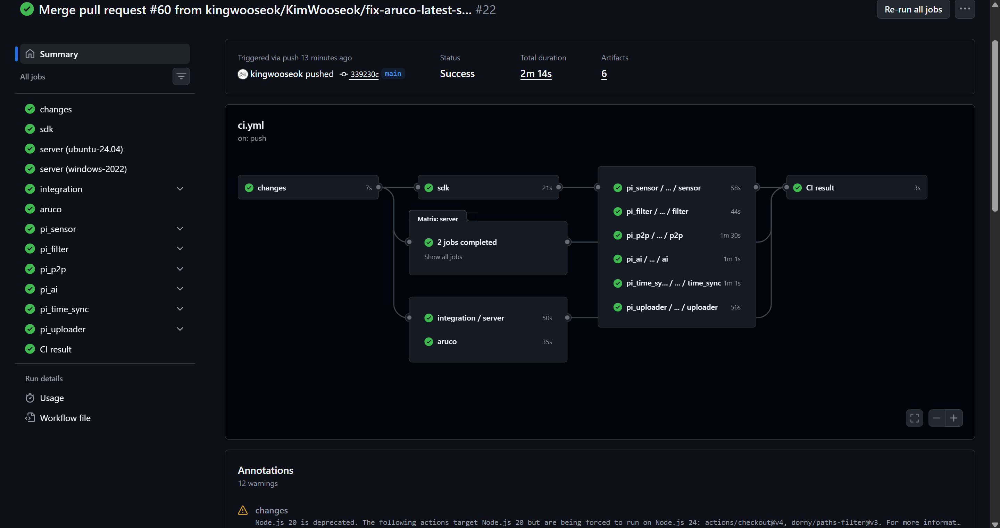

# 실제 운영 CI/CD · GitHub Actions

기준 커밋: [5148804](https://github.com/kingwooseok/2026ESWContest_mobility_ACE/tree/5148804) · 2026-10-16 확인한 원격 main. 과거 `bc6371a` 스냅샷을 최신 운영본으로 교체했습니다.

**이민석의 기여:** CI/CD 구조와 개선 방향의 아이디어·설계, 구축·운영 개선. 변경 영향별 검사, 캐시·비용 제한, 검증 artifact 승격, canary·순차 배포와 복구 흐름까지 담당 기여 범위로 설명합니다. 팀 협업 저장소의 실제 구현이며 Git 작성자 이력은 그대로 유지합니다. 설계 기여를 모든 줄의 단독 작성과 동일시하지 않습니다.

## 개발환경과 실제 실행 화면

Windows VS Code → SSH → VMware Ubuntu에서 개발·크로스 빌드하고, 검증 산출물을 VMware 실행기로 받아 장치에 배포했습니다. Trello·Slack의 작업 관리·이슈 공유와 GitHub의 검사·배포 흐름을 연결했습니다.

### CI · 전체 검사·빌드 성공

변경 영향·SDK·서버 Ubuntu/Windows·통합 검사·ArUco·Pi 모듈을 최종 CI 결과로 연결합니다.

### CD · canary·smoke·순차 배포 진행

화면은 배포 진행 중의 기록입니다. 첫 차량의 서비스·프로세스·IPC·P2P 점검과 `DEPLOY PASS`, 다음 차량들의 `Fleet P2P ready` 확인을 보여줍니다. 완료된 실행 이력은 아래 링크로 연결했습니다.

## 실제 Actions 실행 근거

- [main CI 성공 · 38017054195](https://github.com/kingwooseok/2026ESWContest_mobility_ACE/actions/runs/38017054195): 기준 SHA `5148804`.
- [Pi fleet CD 성공 · 37762360292](https://github.com/kingwooseok/2026ESWContest_mobility_ACE/actions/runs/37762360292): 실행 SHA `2ebe4da`. 최신 CI 실행과 같은 commit의 배포 기록은 아닙니다.
- [원본 Actions 목록](https://github.com/kingwooseok/2026ESWContest_mobility_ACE/actions).

[CI 설계 선택](../../docs/design/CI.md) · [CD 설계 선택](../../docs/design/CD.md)

| 코드 | 역할 |
|---|---|
| [.github/workflows/ci.yml](.github/workflows/ci.yml) | 변경 영향·모듈 검사 흐름 |
| [.github/workflows/pi-component.yml](.github/workflows/pi-component.yml) | Pi 모듈 빌드·artifact |
| [.github/workflows/integration.yml](.github/workflows/integration.yml) | 서버 통합 검사 |
| [.github/workflows/deploy.yml](.github/workflows/deploy.yml) | 성공한 main CI 확인·release·수동 배포 |
| [scripts/ci](scripts/ci) | 빌드·서버 시작·TLS·미디어 검사 |
| [scripts/ci/select-ci.py](scripts/ci/select-ci.py) | 변경 영향·이벤트별 검사 선택과 비용 제한 |
| [scripts/ci/install-host-deps.sh](scripts/ci/install-host-deps.sh) | ARM64 compiler 패키지 준비·APT archive 캐시 |
| [scripts/ci/setup-windows-ffmpeg.py](scripts/ci/setup-windows-ffmpeg.py) | 검증된 Windows FFmpeg 캐시·미디어 도구 확인 |
| [scripts/ci/check-server.py](scripts/ci/check-server.py) | 서버 계약·HTTP/TLS·FFmpeg 통합 검사 |
| [scripts/deploy/deploy_fleet.sh](scripts/deploy/deploy_fleet.sh) | 대상 사전 확인·canary·순차 rollout |
| [scripts/deploy/apply_release.sh](scripts/deploy/apply_release.sh) | 장치별 파일·서비스 적용·smoke·복원 |
| [scripts/deploy/fleet-deploy.sudoers](scripts/deploy/fleet-deploy.sudoers) | 제한된 배포 helper 권한 |

## 이 포트폴리오에서 실행하는 CI

[루트 workflow](../../../../.github/workflows/portfolio-ci.yml)는 이 저장소에 포함된 코드를 검사합니다. 서버·웹 회귀, Uploader·Time Sync Linux 빌드와 HTTP 계약, 모델 파이프라인, CNN 정수·RTL 일치, 제어 코어·문서 링크를 독립 job으로 실행합니다.

[포트폴리오 Actions 실행 목록](https://github.com/eLunaaaa/portfolio/actions/workflows/portfolio-ci.yml)

이 폴더의 팀 workflow는 원래 ARM64 빌드·Pi fleet 배포 설계와 구현을 읽기 위한 보존본입니다. 실제 운영 CD는 위 팀 실행 기록으로 연결하고, 포트폴리오의 루트 workflow는 코드 검사와 Linux 빌드 산출물을 생성합니다.
