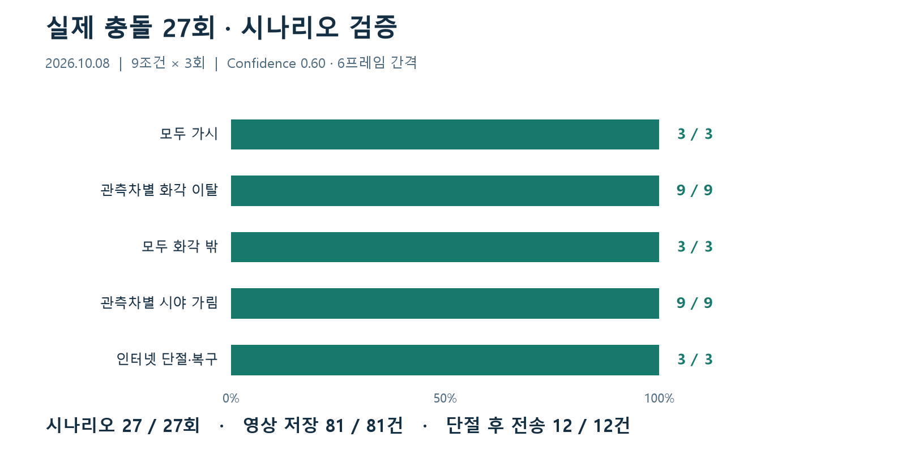
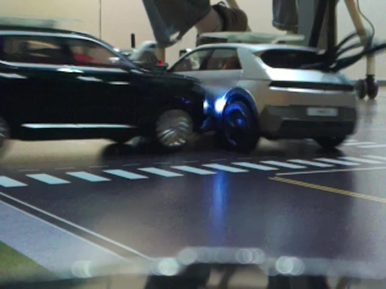
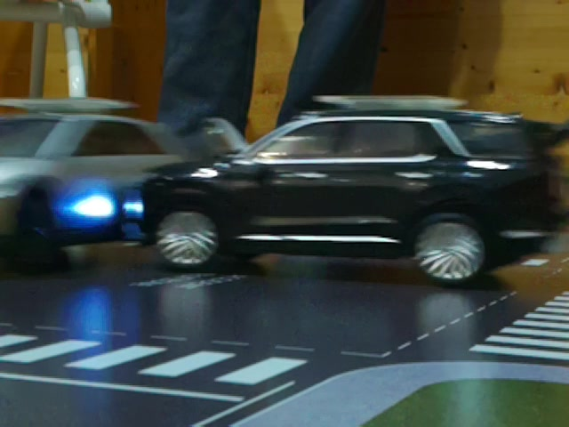
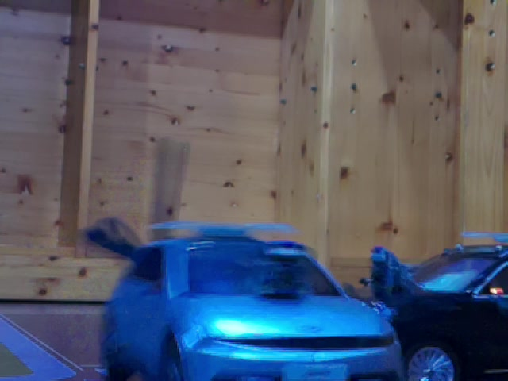

# 실제 충돌 27회 · 영상 선별·보존·전송 검증

[측정 결과](../README.md) · [프로젝트 소개](../../../README.md)

**9조건을 각 3회 시험해 시나리오 판정 27 / 27회, 영상 서버 저장 81 / 81건을 확인했습니다.** 사고차의 IMU 사고 인식부터 관측 영상 선별, 사고 전후 구간 보존, Uploader 인계와 서버 저장 응답까지 사건 ID로 연결했습니다.

<p align="center"></p>

## 시험 조건과 결과

2026년 10월 8일, 1:18 도로 테스트베드에서 사고차 1대와 관측차 3대로 시험했습니다. 관측차 1·2·3번은 각각 `CAR_04`·`CAR_05`·`CAR_06`, 사고차는 `CAR_02`입니다.

| 조건 | 반복 | 시나리오 성공 | 사고차 영상 | 관측 영상 | 서버 저장 |
|---|---:|---:|---:|---:|---:|
| 모두 가시 | 3회 | 3 / 3 | 3건 | 9건 | 12 / 12 |
| 관측차 1번 화각 밖 | 3회 | 3 / 3 | 3건 | 6건 | 9 / 9 |
| 관측차 2번 화각 밖 | 3회 | 3 / 3 | 3건 | 6건 | 9 / 9 |
| 관측차 3번 화각 밖 | 3회 | 3 / 3 | 3건 | 6건 | 9 / 9 |
| 모두 화각 밖 | 3회 | 3 / 3 | 3건 | 0건 | 3 / 3 |
| 관측차 1번 시야 가림 | 3회 | 3 / 3 | 3건 | 6건 | 9 / 9 |
| 관측차 2번 시야 가림 | 3회 | 3 / 3 | 3건 | 6건 | 9 / 9 |
| 관측차 3번 시야 가림 | 3회 | 3 / 3 | 3건 | 6건 | 9 / 9 |
| 인터넷 단절 중 사고·연결 복구 | 3회 | 3 / 3 | 3건 | 9건 | 12 / 12 |
| **합계** | **27회** | **27 / 27** | **27건** | **54건** | **81 / 81** |

시나리오 성공은 시험자가 현장에서 확인한 판정 결과를 집계하고, 27회 모두 기대한 차량과 실제 영상이 남은 차량 ID를 대조했습니다. 화각 밖 차량은 1차 선별에서 제외하고, 화각 안에서 사고차가 가려진 차량은 영상 판정 후 제외합니다. 사고차는 자체 영상을 보존합니다.

서버 저장은 Uploader의 `UPLOAD_SERVER_ACK`에서 `storage_ack_confirmed=true`·`status=STORED`와 사고 ID·차량 ID·SHA-256을 대조했습니다. 단절 시험은 영상·메타데이터 보관, 전송 대기, 복구 후 저장까지 12개 작업을 연결했습니다.

## 적용한 코드와 모델

| 항목 | 시험 적용값 |
|---|---|
| 코드 버전 | [`2ebe4da88c2260c5f5154ea688f5cd8187310019`](https://github.com/kingwooseok/2026ESWContest_mobility_ACE/commit/2ebe4da88c2260c5f5154ea688f5cd8187310019) |
| 모델 | YOLOX-Tiny / ONNX, 20,168,140 bytes |
| 모델 SHA-256 | `10d95656c33a0241a24f9f999178e48f31c07709382526f1b033478a63621462` |
| Confidence / NMS IoU | **0.60 / 0.65** |
| 추론 간격·영상 판정 | **6프레임 간격 / 최근 3회 중 2회 검출** |
| 영상 구간 | 사고 전 8초·후 2초 |

관측차 3대의 실행 모델과 추론 바이너리 해시를 대조했습니다. [차량별 배포 버전·실행 파일 해시](versions.json)

## 같은 사고를 선별한 관측차 대표 프레임

사건 `EVT_20261008_200908812_CAR02`의 IMU 사고 시각을 기준으로, 각 영상의 촬영 시각을 맞춰 추출한 프레임입니다.

| 관측차 1번 | 관측차 2번 | 관측차 3번 |
|---|---|---|
|  |  |  |

[프레임별 원본 영상 해시·추출 시각](frames.json)

## 사건별 자료와 시간 기준

| 파일 | 내용 |
|---|---|
| [scenarios.csv](scenarios.csv) | 27회 사건 ID, 시험 조건, 기대·실제 영상 차량, 결과 |
| [clips.csv](clips.csv) | 81건의 촬영 시작·종료, 사고 시각, 로컬 인계·전송·저장 시각, MP4 해시 |
| [recovery.csv](recovery.csv) | 단절·복구 3회의 영상 12건 |
| [timing.csv](timing.csv) | 차량별 처리시간의 평균·중앙값·P95 |
| [evidence.jsonl](evidence.jsonl) | 영상 접수·보존·전송 시작·서버 저장 응답의 근거 필드 |
| [summary.json](summary.json) | 전체 집계와 계산 기준 |
| [source_manifest.json](source_manifest.json) | 수집 로그 묶음과 공개 CSV·JSON의 SHA-256 |

사고 인식부터 영상 생성·큐 인계까지 **평균 6.55초, 중앙값 5.25초, P95 13.39초**입니다. 유효 영상 81건의 IMU `event_time_ns`부터 `CAMERA_READY_ACCEPTED`까지를 계산했습니다. 로그에 기록된 애플리케이션 시각을 사용했습니다.

영상별 서버 저장 경과 시간에는 전송 대기와 인터넷 단절 시간이 포함됩니다. `clip_start_time_ns`·`clip_end_time_ns`·`event_time_ns`는 ns, 처리시간은 초, 영상 크기는 bytes로 기록했습니다. CSV의 시각으로 사고 전후 영상 구간과 처리 단계를 직접 추적할 수 있습니다.

## 집계 재현

```sh
python docs/measurements/20261008-scenarios/verify.py
python docs/measurements/20261008-scenarios/render.py
```

검증기는 사건·차량 조합, 선별 결과, 81건의 저장 응답·파일 해시, 12건의 복구 결과와 공개 파일 체크섬을 대조합니다. 그래프는 같은 CSV로 생성합니다. 그래프 생성에는 Matplotlib과 한글 글꼴을 사용합니다.
