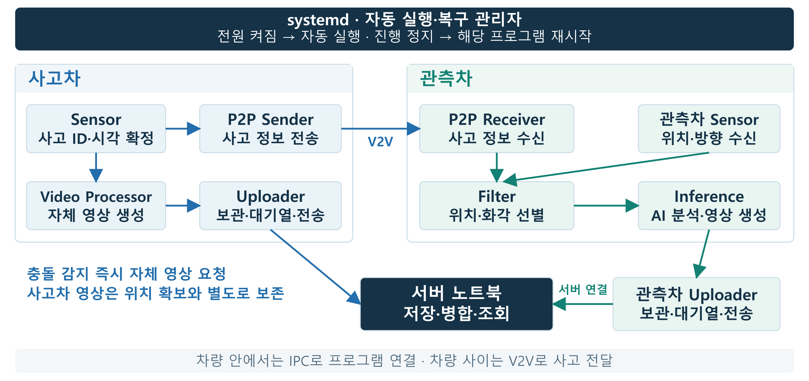

# 차량 내부 프로세스를 연결하는 IPC

**센서·통신·영상·업로더를 독립된 프로그램으로 실행하고, 사고 정보와 영상 준비 상태를 공통 메시지로 연결합니다.**

[프로젝트 소개](../README.md) · [센서](../../docs/ARCHITECTURE.md) · [P2P](../../docs/ARCHITECTURE.md) · [영상 처리](../ai/README.md) · [업로더](../uploader/README.md)

## 역할을 나누고, 필요한 정보로 연결

[](../docs/assets/embedded-process-architecture.png)

한 차량 안에서는 **Unix Domain Socket 기반 IPC**로 프로그램을 연결하고, 차량 사이는 P2P로 사고 정보를 전달합니다. 사고차와 관측차는 각자의 영상 처리기·업로더를 실행합니다. Time Sync는 각 영상 처리기에 동기화 상태를 응답합니다.

| 설계 | 동작과 효과 |
|---|---|
| **프로세스 분리** | 센서·통신·AI·업로더가 독립 실행되어 한 프로그램의 종료가 다른 프로그램까지 종료시키지 않습니다. |
| **큐와 재연결** | 처리 속도가 다른 모듈을 큐로 연결하고, 상대 프로그램이 다시 실행되면 IPC 연결을 복구합니다. |
| **자동 실행·복구** | systemd가 부팅 때 프로그램을 시작하고, 종료되거나 업무 진행이 멈춘 프로그램을 다시 실행합니다. |

업무 스레드는 처리 중 주기적으로 진행 상태를 갱신합니다. `runtime_watchdog.h`는 필수 스레드의 진행을 모아 systemd에 정상 알림을 보내고, 진행이 멈추면 해당 서비스가 재시작되도록 합니다. **사용자가 프로그램을 하나씩 켜지 않아도 차량 장치가 정해진 역할을 이어가는 구조**입니다.

## 모듈별 연결과 전달 데이터

| 송신 → 수신 | 소켓 | payload |
|---|---|---|
| 관측차 Sensor → Filter | `/tmp/witness_sensor.sock` | `vehicle_state_t` |
| 사고차 Sensor → P2P Sender | `/tmp/p2p.sock` | `accident_ipc_event_t` |
| 사고차 Sensor → Video Processor | `/tmp/video_processor_event.sock` | `video_processor_event_t` |
| P2P Receiver → Filter | `/tmp/filter.sock` | `accident_event_t` |
| Filter → Inference | `/tmp/inference_event.sock` | `inference_event_t` |
| Inference / Video Processor → Uploader | `/tmp/uploader.sock` | `uploader_evidence_ready_t` |
| 시간 상태 요청 → Time Sync | `/tmp/time-sync.sock` | `time_sync_request_t` / `time_sync_status_t` |

각 모듈의 Makefile이 `ipc.c`와 필요한 프로토콜 헤더를 함께 빌드하므로, 해당 모듈을 실행하면 IPC도 함께 동작한다. [Sensor](../../docs/ARCHITECTURE.md) · [Filter](../../docs/ARCHITECTURE.md) · [Camera/AI](../ai/README.md) · [Uploader](../uploader/README.md) · [Time Sync](../time_sync/README.md)

## 사고 ID·좌표·시각

사고차 Sensor가 사고 ID와 시각을 한 번 정하면 영상 보존과 P2P 전송이 같은 값을 사용한다. 자체 영상은 즉시 요청하고, 주변 차량에는 사고 후 처음 확보한 좌표를 담아 알린다. 위치를 받지 못해도 자체 영상 요청은 유지된다.

ID는 `station_id=1`과 사고마다 증가하는 `sequence_number`(1~65535)로 구성한다. 재연결이나 전송 재시도 중에도 ID와 시각은 그대로다. 영상 요청에는 ID·시각을, P2P 요청에는 좌표·방향까지 담는다. X/Y는 mm, 방향은 +Y=0°·+X=90°다.

| 경계 | payload의 시간 기준·단위 |
|---|---|
| 관측차 `vehicle_state_t.detection_time` | 마지막 정상 위치 측정의 Pi monotonic ns |
| Sensor → P2P / Video Processor | 사고 시각, ITS epoch ms |
| P2P Receiver → Filter → Inference | 같은 사고 시각, Unix epoch ns |
| Uploader `event_time_ns`, `clip_*_time_ns` | Unix epoch ns |

`action_id`는 `(station_id << 16) | sequence_number`의 10진 문자열이다. 사고 시각은 payload의 전용 필드에 보존하며, IPC header의 `timestamp`는 monotonic ns를 사용한다.

## 전송 API와 처리 방식

| API | 역할 |
|---|---|
| `ipc_server_create(path)` / `ipc_server_accept(fd)` | 서버 소켓 생성 / 연결 수락 |
| `ipc_client_connect(path)` | 서버 연결 |
| `ipc_send(fd, header, payload, size)` | 헤더·본문 송신, payload 크기를 `length`에 설정 |
| `ipc_recv(fd, header, payload, capacity)` | 헤더·본문 수신, 버퍼 용량 검사 |
| `ipc_close(fd)` | 연결 종료 |

전송은 로컬 C 구조체를 사용하므로 양쪽의 헤더·ABI가 같아야 한다. 기본 API는 blocking I/O이며 각 모듈이 timeout·재연결·Queue를 관리한다. `IPC_FLAG_ACK_REQUIRED`에 대한 응답은 수신 모듈이 생성한다.

사고차 Sensor의 영상·P2P Queue는 각각 8칸이며 독립적으로 송신·재시도한다. 성공한 대상은 다시 보내지 않는다. Queue가 가득 차면 해당 요청의 ID·시각과 payload를 보관하고 빈 공간이 생길 때 등록한다.

수신부는 함수 성공 여부와 함께 메시지 종류(`header.type`)와 크기(`header.length == sizeof(expected_payload)`)를 검사한다. Uploader로 영상을 넘길 때는 전송 후 저장 완료 응답(ACK)까지 받아 처리한다.

## 상세 규약

<details>
<summary>공통 헤더와 C 송수신 예</summary>

```c
typedef struct {
    uint16_t type;
    uint16_t flags;
    uint32_t length;
    uint32_t sequence;
    uint64_t timestamp;
} ipc_header_t;
```

```c
vehicle_state_t state = {
    .detection_time = capture_monotonic_ns,
    .x_mm = 100.0f,
    .y_mm = 200.0f,
    .heading_deg = 0.0f
};
ipc_header_t header = {
    .type = IPC_MSG_SENSOR_DATA,
    .sequence = sequence,
    .timestamp = (uint64_t)capture_monotonic_ns
};
int result = ipc_send(fd, &header, &state, sizeof(state));
```

수신부는 `ipc_recv()` 성공 여부뿐 아니라 `header.type`과 `header.length == sizeof(expected_payload)`를 검사합니다.

| 반환값 | 의미 |
|---|---|
| `IPC_SUCCESS` | 성공 |
| `IPC_ERROR_SOCKET / BIND / LISTEN / ACCEPT / CONNECT` | 연결 생성·수립 오류 |
| `IPC_ERROR_SEND / RECV` | 송신·수신 오류 |
| `IPC_ERROR_INVALID_LENGTH` | payload가 수신 버퍼보다 큼 |
| `IPC_CONNECTION_CLOSED` | 상대 연결 종료 |

</details>

<details>
<summary>메시지 번호</summary>

`protocol.h`가 메시지 번호·flags·header를 정의합니다.

| 번호 | 메시지 | 용도 |
|---|---|---|
| 100 | `IPC_MSG_SENSOR_DATA` | 관측차 위치·방향 |
| 200 | `IPC_MSG_ACCIDENT_EVENT` | 사고차 Sensor → P2P |
| 201 | `IPC_MSG_ACCIDENT_CONFIRM` | P2P Receiver → Filter |
| 203 | `IPC_MSG_VIDEO_PROCESSOR_EVENT` | 사고차 Sensor → Video Processor |
| 301 | `IPC_MSG_INFERENCE_EVENT` | Filter → Inference 사고 후보 전달 |
| 401 | `IPC_MSG_CAMERA_READY` | 영상 준비 통지 |
| 600 / 601 | `IPC_MSG_TIME_SYNC_REQUEST / STATUS` | 시간 상태 조회 |

Filter 결과·Camera 보호 요청·AI 결과 등 추가 메시지 번호도 헤더에 정의되어 있습니다. 각 단계의 payload와 호출 방법은 해당 모듈 문서를 따릅니다. Uploader의 응답·일시정지 제어 메시지는 `uploader_ipc_protocol.h`에 있습니다.

</details>

## 프로토콜 파일

| 파일 | 내용 |
|---|---|
| `ipc.h`, `ipc.c` | 통신 API·반환값·구현 |
| `runtime_watchdog.h` | 처리 스레드의 진행 기한 점검·systemd 정상 알림 |
| `protocol.h` | 공통 헤더·메시지 종류·flags |
| `sensor_protocol.h` | 관측차 위치·방향 |
| `accident_protocol.h` | Sensor → Sender의 사고 ID·시각·방향·좌표 |
| `video_processor_protocol.h` | Sensor → Video Processor의 같은 사고 ID·시각 |
| `p2p_protocol.h` | DENM 생성용 사고 정보 |
| `filter_protocol.h` | 관측 후보 판정용 사고 정보 |
| `inference_protocol.h` | Filter → Inference의 사고 ID·시각 |
| `time_sync_protocol.h` | 시간 상태 요청·응답 |
| `uploader_ipc_protocol.h` | 영상 준비·응답·제어 |
