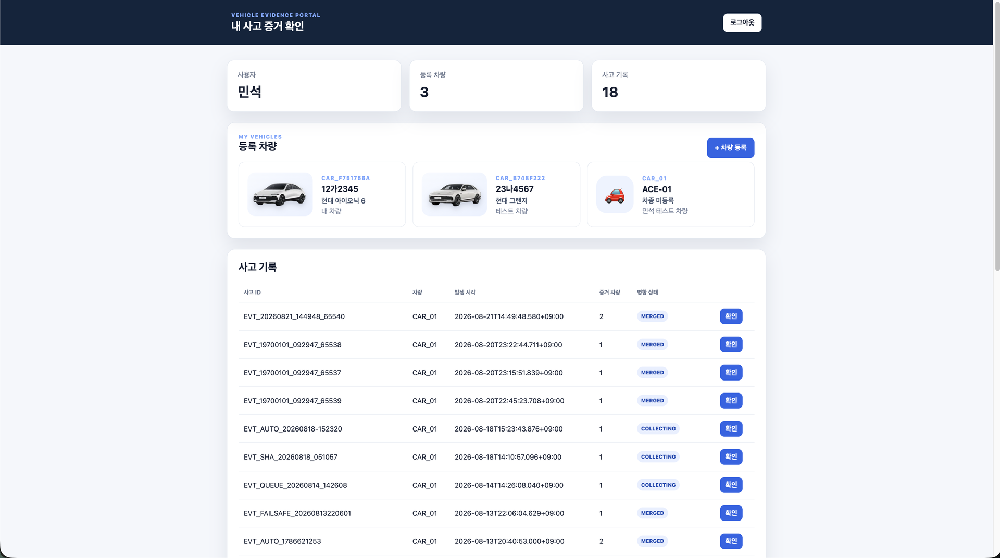
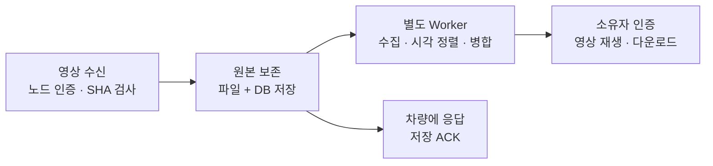

# 사고 증거 서버

**여러 차량이 보낸 사고 영상을 같은 시각에 맞춰 한 화면으로 합치고, 차량 소유자가 확인하도록 제공합니다.**

[프로젝트 소개](../README.md) · [차량 업로더](../uploader/README.md) · [업로드 API](backend/docs/pi-upload-api.md) · [서버 구조](docs/ARCHITECTURE.md)



## 영상이 도착한 뒤



**원본 파일과 DB 저장이 끝나면 차량에 저장 완료 응답(ACK)을 보냅니다.** 백그라운드 작업(Worker)이 추가 영상을 기다린 뒤 병합하므로 차량은 병합이 끝날 때까지 기다릴 필요가 없습니다.

| 기능 | 동작 |
|---|---|
| 원본 보존 | MP4를 파일 시스템에, 사고·차량·시각·해시를 SQLite에 저장 |
| 중복 전송 처리 | 같은 사고·차량·해시의 요청은 기존 저장 결과를 반환 |
| 자동 병합 | 첫 영상부터 수집 창이 지난 뒤 FFmpeg로 시각 정렬·병합 |
| 지연 도착 처리 | 뒤늦게 도착한 영상도 같은 사고에 추가하고 재병합 |
| 영상 접근 | 로그인한 소유자가 사고 접근 코드를 인증한 뒤 조회 |
| 소유 차량 관리 | 별명·번호·차종·사진·아이콘 수정, 사고 증거를 보존하며 소유 목록에서 등록 해제 |
| 장치 관리 | 노드 API Key, 접속 상태, 차량번호 변경·Pi 교체 이력 관리 |

차량 간 사고 전파는 [P2P](../../docs/ARCHITECTURE.md)가 맡고, 서버는 일반 Wi-Fi/AP망으로 [Uploader](../uploader/README.md)의 HTTP(S) 요청을 받습니다.

## 한 사고를 여러 시점으로 보기

**내 차량 영상으로 사고 전후를 확인하고, 목격 차량 영상으로 사각지대를 보완하며, 전체 영상으로 같은 순간을 비교합니다.** 공통 사고 ID로 모은 영상을 촬영 시각에 맞춰 정렬하고, 각 화면에 차량 ID와 프레임 시각을 표시합니다.

| 보기 모드 | 화면 구성과 활용 |
|---|---|
| **전체 영상** | 사고차와 주변 차량의 영상을 한 화면에서 비교 |
| **목격 차량 영상** | 사고차를 제외한 주변 차량 영상만 함께 보며 다른 방향에서 촬영된 상황 확인 |
| **내 차량 영상** | 해당 사고 차량이 촬영한 영상만 크게 확인 |

원본 비율과 영상 개수에 맞춰 불필요한 여백을 줄입니다. 사고차에는 노란 테두리, 주변 차량에는 검정 테두리를 적용합니다.

| 주변 차량 영상 수 | 전체 영상 | 목격 차량 영상 |
|---|---|---|
| 1개 | 사고차·주변차를 좌우 동일 크기로 배치 | 주변차 영상 하나 |
| 2개 | 사고차를 왼쪽에 크게, 주변차 둘을 오른쪽에 배치 | 두 영상을 좌우 동일 크기로 배치 |
| 3개 | 사고차를 포함한 네 영상을 동일 크기로 4분할 | 세 영상을 동일 크기로 가로 배치 |

- **사고 장면 보기:** 영상의 **7초 지점부터 0.25배속**으로 재생합니다. 7초 이하의 영상은 처음부터 재생합니다.
- **원본 보기:** 선택한 보기 모드의 영상을 처음부터 **1배속**으로 재생합니다.
- **시점 전환:** 모드를 바꿔도 현재 재생 위치·배속·재생 상태를 유지해 같은 순간을 이어서 비교합니다. 영상이 없는 모드는 비활성화합니다.
- **영상 다운로드:** 사용자 포털에서 선택한 보기 모드의 MP4를 내려받습니다. 저속 재생은 브라우저에만 적용하며 저장된 영상의 속도는 유지합니다.

사용자·관리자 화면에서 같은 보기 모드와 재생 방식을 제공합니다. 사용자 영상 접근에는 소유 관계와 사고 접근 인증을, 관리자 화면에는 관리자 권한 검사를 적용합니다.

<details>
<summary><strong>수집·병합·재생 동작</strong></summary>

| 항목 | 동작 |
|---|---|
| 수집 시작 | 첫 영상 저장 시 마감 시각 설정; 후속 업로드가 마감을 연장하지 않음 |
| 수집 기본값 | **12초** 대기, 최소 **1개** 영상으로 병합 |
| `extended` | 수신 영상 전체 시간 구간 사용; 영상이 없는 앞뒤는 검은 화면 |
| `common` | 실제 수신 영상이 모두 겹치는 시간 구간 사용 |
| 화면 배치 | 사고차를 첫 칸에, 나머지는 차량 ID 순서로 배치 |
| 사고차 영상 미수신 | 사고차 라벨이 있는 검은 대체 타일 표시 |
| 시간 표시 | 영상 시작/종료 시각으로 정렬하고 실제 프레임에 KST 시각 표시 |
| 늦은 영상 | 새 버전으로 재병합; 병합 중이면 현재 작업 뒤에 다시 실행 |

Worker는 기본적으로 2초 간격으로 작업을 확인한다. 실패하면 약 10초, 20초 후 재시도하고 총 3회 시도 후 `FAILED`로 남긴다. API는 영상 병합 중에도 업로드·조회 요청을 처리한다.

사용자·관리자 화면의 **사고 장면 보기**는 선택한 보기의 영상을 7초부터 0.25배속으로 재생하고, **원본 보기**는 처음부터 1배속으로 재생한다. 재생 설정만 바꾸므로 다운로드 파일은 그대로 유지된다.

</details>

<details>
<summary><strong>수집·병합 환경변수 전체</strong></summary>

| 환경변수 | 기본값 | 설정 내용 |
|---|---:|---|
| `EVIDENCE_COLLECTION_WINDOW_SECONDS` | `12` | 첫 영상 이후 수집 대기(초) |
| `EVIDENCE_MINIMUM_EVIDENCE_COUNT` | `1` | 병합에 필요한 최소 영상 수 |
| `EVIDENCE_COLLECTION_RECHECK_SECONDS` | `10` | 영상 수가 부족할 때 재확인 간격(초) |
| `EVIDENCE_MERGE_WORKER_ENABLED` | `true` | 자동 Worker 실행 |
| `EVIDENCE_MERGE_WORKER_POLL_SECONDS` | `2` | 작업 확인 간격(초) |
| `EVIDENCE_MERGE_MAXIMUM_ATTEMPTS` | `3` | 최대 병합 시도 횟수 |
| `EVIDENCE_MERGE_RETRY_BASE_SECONDS` | `10` | 지수 재시도의 첫 대기 시간(초) |
| `EVIDENCE_MERGE_MODE` | `extended` | `extended` 또는 `common` |
| `EVIDENCE_MERGE_BEFORE_SECONDS` | `10.0` | 사고 전 포함 범위의 상한(초) |
| `EVIDENCE_MERGE_AFTER_SECONDS` | `20.0` | 사고 후 포함 범위의 상한(초) |
| `EVIDENCE_MERGE_TILE_WIDTH` | `640` | 타일 너비(px) |
| `EVIDENCE_MERGE_TILE_HEIGHT` | `360` | 타일 높이(px) |
| `EVIDENCE_MERGE_FPS` | `30` | 출력 FPS |
| `EVIDENCE_COOKIE_SECURE` | `false` | 세션 쿠키의 HTTPS 전용 속성 |

실제 영상 길이는 업로드된 클립 시각과 병합 모드로 결정된다. 위 사고 전후 값은 서버에서 포함할 최대 범위다.

</details>

<details>
<summary><strong>수동 병합·중단 작업 복구·검증</strong></summary>

`server/backend`에서 실행한다. 수동 Worker를 사용할 때는 같은 DB의 자동 Worker를 먼저 종료한다.

```bash
# 영상 처리 없이 병합 구간과 배치 계산
python -m app.cli.merge_event EVT_20260728_143000123_CAR01 --plan-only

# 지정한 사고를 다시 병합
python -m app.cli.merge_event EVT_20260728_143000123_CAR01 --mode extended --before 10 --after 20 --width 640 --height 360 --fps 30 --overwrite

# 중단 작업을 복구하고 Worker 한 주기 실행
python -m app.cli.run_merge_worker_once --recover-interrupted

# 서버 저장·병합·노드 연결 상태 검증
python -m app.cli.verify_failsafe_event EVT_20260728_143000123_CAR01 --node-id NODE_PI_02
```

마지막 명령에 `--sha256 원본_SHA256`을 붙이면 Pi 원본과 해시도 대조한다. 성공은 종료 코드 `0`, 누락·불일치는 `1`이다. 네트워크를 끊고 복구하는 절차는 [단절·복구 시연](backend/docs/failsafe-demo.md)을 따른다.

</details>

## 영상 업로드와 저장 확인

| 입력 | 서버가 확인하는 것 |
|---|---|
| `X-Evidence-Node-ID`, `X-Evidence-API-Key` | 등록된 노드인지, 어느 차량에 연결됐는지 |
| `X-Evidence-Content-SHA256` | MP4 원본과 수신 파일의 SHA-256 일치 |
| `metadata` | 사고 ID·차량·사고 시각·영상 시작/종료 시각 |
| `file` | `video/mp4`, 최대 **100 MiB** |

`POST /api/v1/events/{event_id}/evidence`에 `multipart/form-data`로 보낸다. 저장 응답의 `storage_ack=true`, `upload_status=STORED`, 사고 ID·차량 ID·SHA가 요청과 일치하면 차량이 업로드 완료로 처리한다. ACK를 받지 못했다면 `GET /api/v1/events/{event_id}/evidence/status`로 저장 여부를 먼저 조회한다.

<details>
<summary><strong>메타데이터·시간·사고 식별자</strong></summary>

| 필드 | 내용 |
|---|---|
| `event_id` | `EVT_YYYYMMDD_HHMMSSmmm_CARXX` 형식의 공통 사고 ID |
| `accident_vehicle_id` | 사고 차량 ID |
| `vehicle_id` | 영상을 보내는 차량 ID; 인증된 노드의 차량과 일치 |
| `event_time_ns` | 사고 발생 시각 |
| `clip_start_time_ns`, `clip_end_time_ns` | 영상 시작·종료 시각 |
| `time_sync_status` | `SYNCED`, `HOLDOVER`, `UNRELIABLE`, `UNKNOWN`; 기본 `UNKNOWN` |
| `chrony_offset_ms`, `ai_confidence` | 선택 항목인 시간 오프셋과 AI 신뢰도 |

시간의 저장 단위는 **Unix Epoch ns**이며 `clip_start_time_ns <= event_time_ns <= clip_end_time_ns`를 만족해야 한다. 클립 최대 길이는 1시간이다. 정의되지 않은 추가 필드는 허용하지 않는다.

Uploader가 사고 시각(KST)·사고차 ID로 `event_id`를 만든다. 서버는 URL과 메타데이터의 ID, ID에 포함된 사고차, 사고 시각의 2초 이내 일치를 검사한다. 차량 내부의 station ID·sequence로 구성한 `action_id`는 HTTP 메타데이터에 넣지 않는다.

이전 데이터와의 호환을 위해 초·ms·μs·ns 입력을 ns로 정규화한다. 2020~2100년의 유효 Epoch와 최대 1시간의 간격을 기준으로 판단한다. 서버 시작 시 보정 가능한 기존 DB 시각도 정규화하고, 이미 병합된 영상은 자막 갱신을 위해 재병합한다. 기존 사고 ID와 파일 경로는 유지한다.

JSON·curl 예시와 전체 응답은 [업로드 API 규격](backend/docs/pi-upload-api.md)에 있다.

</details>

<details>
<summary><strong>저장 ACK·재전송·원본 복구</strong></summary>

저장 ACK까지의 순서는 **파일을 디스크에 기록 → SHA 검증 → 최종 경로에 저장 → DB에 STORED 확정**이다. 파일과 POSIX 디렉터리에는 `fsync`를 적용해 기록을 완료한다. 영상 병합은 이후 Worker가 처리한다.

| 응답 | 차량 측 처리 |
|---|---|
| 정상 ACK | 응답의 사고 ID·차량 ID·SHA까지 대조한 뒤 Queue를 `DONE` 처리 |
| `404` | 저장되지 않았거나 복원이 필요한 원본을 다시 POST |
| `409` | 기존 원본 SHA·메타데이터와 충돌; 원본을 유지하며 상태 재확인 |
| `401` / `403` | API Key와 노드-차량 매핑 확인 |
| `500` / 네트워크 오류 | 로컬 원본을 유지하고 재시도 |

서버는 최초 검증 SHA를 DB에 보관한다. 같은 원본의 재전송은 기존 결과를 반환하며 `idempotent_replay=true`로 표시한다. DB 등록 전에 중단돼도 게시된 파일을 보존해 다음 요청이 재사용한다.

저장된 원본이 사라지거나 손상됐다면 `PENDING`과 `404`로 같은 원본을 다시 요청한다. 재전송된 파일의 SHA를 최초 기록과 대조한 뒤 복원하고 병합을 다시 예약한다. 기존 사고·차량·영상 기록은 유지한다.

</details>

## 사용자·차량·영상 접근

| 인증 대상 | 확인 수단 | 허용 범위 |
|---|---|---|
| 사용자 | 8시간의 HttpOnly 로그인 세션 | 본인 차량·사고 목록 |
| 사고 영상 | 소유 관계 + 사고 접근 코드 | 인증한 사고의 재생·다운로드 |
| Pi 노드 | Node ID + API Key | 연결된 차량의 업로드·저장 상태 조회·heartbeat |
| 관리자 | 로그인 세션의 `ADMIN` 권한 | 사용자·사고·노드 관리와 영상 확인 |

포털 접근 코드는 5분, 인증 후 사고 접근 세션은 30분 동안 유지된다. CLI 코드 발급 기본값은 24시간이며 `--hours`로 바꾼다. DB에는 접근 코드·세션 토큰·노드 API Key의 해시를 저장한다.

<details>
<summary><strong>포털 차량 등록·수정·등록 해제</strong></summary>

차량 카드에서 별명을 바로 편집하고 번호·차종·사진·아이콘을 수정한다. 등록 해제는 본인 소유 목록에서만 제거하며 사고 증거를 보존한다. 등록·수정·등록 해제는 포털에서 본인·차량 정보를 입력하고 일회성 확인 토큰을 발급받아 진행한다.

| 작업 | API |
|---|---|
| 일회성 확인 토큰 발급 | `POST /api/v1/portal/vehicles/verification` |
| 차량 등록 | `POST /api/v1/portal/vehicles` |
| 차량 정보 수정 | `PATCH /api/v1/portal/vehicles/{vehicle_id}` |
| 별명 직접 편집 | `PATCH /api/v1/portal/vehicles/{vehicle_id}/nickname` |
| 소유 목록에서 등록 해제 | `DELETE /api/v1/portal/vehicles/{vehicle_id}` |

차량 수정은 번호·차종·사진과 `display_name`을 한 요청에 저장한다. `display_name`을 생략하면 기존 별명을 유지한다. 차량 정보·번호 변경 이력·일회성 확인 토큰은 한 번에 저장하고, 실패하면 모두 이전 상태로 되돌린다. 입력값은 등록과 같은 기준으로 검사한다.

</details>

<details>
<summary><strong>차량번호 변경·Pi 교체·차량 상태 관리</strong></summary>

차량의 영구 식별자는 `vehicle_id`이다. 번호판이나 Pi를 바꿔도 같은 차량 ID 아래에 과거 사고·영상·소유 관계를 유지한다. 아래 API는 관리자 로그인이 필요하다.

| 작업 | API | 본문 필드 | 보존·변경 내용 |
|---|---|---|---|
| 번호판 변경 | `PATCH /api/v1/admin/vehicles/{vehicle_id}/license-plate` | `new_license_plate`, `reason` | 이전·새 번호·사유·처리자를 변경 이력에 저장 |
| Pi 교체 | `POST /api/v1/admin/vehicles/{vehicle_id}/nodes/replace` | `new_node_id`, `reason` | 기존 노드 인증 무효화, 새 API Key 한 번 발급, 교체 이력 저장 |
| 운행 상태 변경 | `PATCH /api/v1/admin/vehicles/{vehicle_id}/status` | `vehicle_status` | `ACTIVE`, `INACTIVE`, `TRANSFERRED`, `RETIRED` |

`ACTIVE` 이외의 상태로 바꾸면 Pi 인증이 비활성화된다. 다시 운행할 때는 Pi 교체 API로 새 인증을 발급한다. 새 차량에는 새 `vehicle_id`를 만든다.

</details>

## 빠르게 실행하기

Python 3.12와 **FFmpeg·ffprobe**가 필요하다. 실행 대상은 `backend/app/main.py`이다.

저장소 루트에서:

```bash
python -m venv .venv
```

가상환경을 활성화한 뒤 아래를 실행한다. Windows PowerShell은 `.venv\Scripts\Activate.ps1`, Linux는 `source .venv/bin/activate`를 사용한다.

```bash
python -m pip install -r server/backend/requirements.lock.txt
cd server/backend
python -m uvicorn app.main:app --host 0.0.0.0 --port 8000
```

| 접속 목적 | 주소 |
|---|---|
| 이 컴퓨터에서 로그인 | `http://127.0.0.1:8000/login` |
| Pi·다른 컴퓨터에서 접속 | `http://서버_IP:8000` |
| 서버·DB 상태 | `/api/v1/health` |
| API 자동 문서 | `/docs` |

시작할 때 DB 구조를 최신 버전으로 갱신하고 중단된 병합 작업을 복구한다. 처음 설치했다면 아래 **계정·차량·노드 준비**를 이어서 진행한다.

<details>
<summary><strong>계정·차량·노드 준비</strong></summary>

아래 명령은 모두 `server/backend`에서 실행한다.

1. 관리자 계정을 만든다. 비밀번호는 터미널에서 입력한다.

   ```bash
   python -m app.cli.create_admin admin --name "Server Admin"
   ```

2. 일반 사용자는 로그인 화면에서 가입한 뒤 포털에서 차량을 등록한다. 관리자가 기존 사용자에게 차량을 할당하려면:

   ```bash
   python -m app.cli.assign_vehicle user01 CAR_01 "12가3456" --name "테스트 차량"
   ```

3. 업로드할 Pi를 차량과 연결한다.

   ```bash
   python -m app.cli.provision_node --node-id NODE_PI_01 --vehicle-id CAR_01
   ```

   발급된 Node ID와 API Key를 해당 Pi의 [업로더 설정](../uploader/README.md)에 입력한다. API Key 원문은 발급할 때만 출력되며, DB에는 해시와 끝 4자리만 남는다. 같은 노드의 키 교체에는 `--rotate`를 붙인다.

4. 사용자 포털에서 사고 접근 코드를 발급·인증해 영상을 연다. 관리자 CLI 발급도 가능하다.

   ```bash
   python -m app.cli.issue_access_code EVT_20260728_143000123_CAR01 --hours 1
   ```

</details>

<details>
<summary><strong>HTTP·HTTPS 실행과 쿠키 설정</strong></summary>

로컬 HTTP 개발에서는 `EVIDENCE_COOKIE_SECURE=false`(기본값)를 사용한다. HTTPS로 제공할 때는 `true`로 설정한다.

| 셸 | HTTPS 쿠키 설정 |
|---|---|
| PowerShell | `$env:EVIDENCE_COOKIE_SECURE='true'` |
| Bash | `export EVIDENCE_COOKIE_SECURE=true` |

인증서와 개인키를 준비한 뒤 Uvicorn에서 직접 HTTPS를 제공할 수 있다.

```bash
python -m uvicorn app.main:app --host 0.0.0.0 --port 8000 --ssl-certfile server.crt --ssl-keyfile server.key
```

Pi의 서버 URL·신뢰 CA도 이 인증서에 맞춘다. Cloudflare Tunnel을 사용하는 외부 시연에서는 터널의 HTTPS 주소를 브라우저에 제공한다. 서버 IP는 실행 컴퓨터의 실제 주소를 사용한다.

</details>

<details>
<summary><strong>API·저장소·코드 위치</strong></summary>

| API | 역할 |
|---|---|
| `/api/v1/health`, `/api/v1/time` | 서버·DB 상태 및 서버 시각 진단 |
| `/api/v1/nodes/heartbeat` | 노드 IP·버전·최근 접속 갱신 |
| `/api/v1/events/{event_id}/evidence` | 원본 업로드 |
| `/api/v1/events/{event_id}/evidence/status` | 저장 ACK 재확인 |
| `/api/v1/auth/*` | 가입·로그인·로그아웃 |
| `/api/v1/portal/*`, `/api/v1/access/*` | 소유 차량·사고 조회 및 영상 접근 인증 |
| `/api/v1/admin/*` | 관리·이력·정리 |

시각 동기화는 [Time Sync](../time_sync/README.md)의 chrony/NTP가 담당한다. `/time`은 진단용 시각 응답이다.

| 위치 | 역할 |
|---|---|
| [backend/app/api](backend/app/api) | 요청·인증 진입점 |
| [backend/app/services](backend/app/services) | 저장·인증·수집·병합 처리 |
| [backend/app/db](backend/app/db) | SQLite 스키마·migration·저장 계층 |
| [backend/app/cli](backend/app/cli) | 관리자·노드 준비 및 병합·복구 명령 |
| [backend/frontend](backend/frontend) | 로그인·사용자 포털·관리자 화면 |
| [backend/tests](backend/tests) | 저장 계약·병합·인증 테스트 |

DB는 `backend/storage/database/ace.db`, 원본은 `backend/storage/originals/{yyyy}/{mm}/{dd}/{event_id}/{vehicle_id}/clip.mp4`, 병합 영상은 `backend/storage/merged/{event_id}/`에 저장한다. SQLite는 WAL·외래키 검사·5초 busy timeout을 사용한다. 실제 DB·영상·API Key·인증서는 저장소에 넣지 않는다.

상태는 사고 `COLLECTING → READY → MERGING → COMPLETED`, 원본 `PENDING → STORED`, 병합 작업 `WAITING → PENDING → RUNNING → COMPLETED`로 진행하며 처리 실패는 `FAILED`로 남긴다.

</details>

<details>
<summary><strong>문제 확인과 테스트</strong></summary>

| 증상 | 먼저 볼 곳 |
|---|---|
| Pi가 서버에 연결되지 않음 | 서버 IP·포트, 같은 AP망, 방화벽, `/api/v1/health` |
| 업로드가 `401`·`403` | Node ID·API Key와 차량 매핑 |
| 저장은 됐는데 병합되지 않음 | 수집 마감 시각, 최소 영상 수, Worker 활성화 |
| 병합 `FAILED` | FFmpeg·ffprobe 설치, `drawtext` 지원, 해당 사고의 FFmpeg 로그 |
| 로그인 후 세션이 유지되지 않음 | HTTP/HTTPS와 `EVIDENCE_COOKIE_SECURE` 설정 |

서버 테스트는 `server/backend`에서 실행한다.

```bash
python -m unittest discover -s tests -v
node --test tests/test_vehicle_registration.cjs
```

서버 테스트에는 차량 수정·변경 이력·확인 토큰의 트랜잭션 검사가 포함된다. 화면 테스트는 Node.js 18 이상에서 확인창 취소·지연 응답·등록 해제 오류 표시를 검사하며, CI 서버 검사에서도 실행한다.

</details>


## 장치 연계 시험 결과

실제 충돌 27회에서 사고 ID 27개에 연결된 영상 **81건(사고차 27건·관측차 54건)**의 저장 응답을 확인했습니다. 인터넷 단절 중 장치에 보관한 영상 12건도 복구 후 같은 사고 ID로 저장됐습니다.

[사건·차량별 저장 기록과 MP4 해시](../docs/measurements/20261008-scenarios/clips.csv) · [시험 결과](../docs/measurements/20261008-scenarios/README.md)

## 초기 구현 참고

현재 실행 진입점은 `backend/app/main.py`입니다. [main.py](main.py)·[client.py](client.py)는 초기 단일 파일 업로드 시연 코드이고, [db_smoke_test.py](backend/scripts/db_smoke_test.py)는 임시 사고·증거를 생성해 DB를 조회하는 개발 도구입니다. 현재 서비스와 초기 구현을 비교할 수 있도록 함께 보존했습니다.
