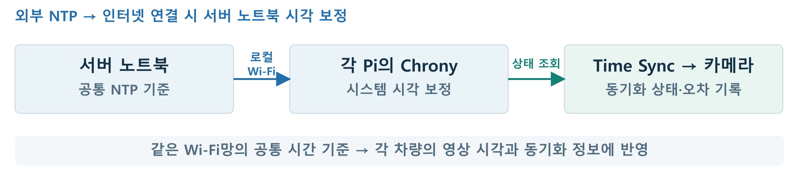

# 차량 간 영상 시각 동기화 · Time Sync

**여러 차량이 촬영한 영상을 같은 시각에 맞춰 볼 수 있도록 공통 시간 기준과 동기화 상태를 연결합니다.**

[프로젝트 소개](../README.md) · [카메라·AI](../ai/README.md) · [IPC](../ipc/README.md) · [측정 결과](../docs/measurements/README.md#차량-간-시각)

## 서버 노트북의 시각을 각 차량으로

[](../docs/assets/comms-time-sync.png)

같은 Wi-Fi망의 차량들은 **서버 노트북을 로컬 NTP 기준**으로 사용합니다. 인터넷에 연결되면 서버 노트북은 외부 NTP 기준에 맞춥니다. 각 Pi의 Chrony가 시스템 시계를 보정하고, Time Sync는 그 상태와 시간 오차를 조회해 카메라에 전달합니다.

| 담당 | 역할 |
|---|---|
| **Chrony** | 공통 NTP 기준에 맞춰 Pi 시스템 시각 보정 |
| **Time Sync** | 동기화 상태·오차·측정 시각을 IPC로 응답 |
| **카메라** | 영상 인계 시 시간 상태를 조회해 메타데이터에 기록 |

## 차량 간 시간차 측정

**사고차와 각 관측차 사이의 절대 시간차 P95는 11.30~19.18ms입니다.** 차량별로 시각 정보를 10,000회 교환해 계산했습니다.

| 관측차 | 시각 교환 | 절대 시간차 P95 | 최대 시간차 |
|---|---:|---:|---:|
| 1번 차량 · `craft3` | 10,000회 | 12.73ms | 17.32ms |
| 2번 차량 · `craft4` | 10,000회 | 11.30ms | 15.77ms |
| 3번 차량 · `seongugi` | 10,000회 | 19.18ms | 22.73ms |
| 4번 차량 · `craft6` | 10,000회 | 15.21ms | 22.46ms |

P95는 전체 측정값의 95%가 해당 값 이내였다는 뜻입니다. [집계 CSV](../docs/measurements/clock-summary-20260923.csv)

## 입출력과 기본값

| 항목 | 값·동작 |
|---|---|
| 측정 입력 | `chronyc -n tracking` |
| 측정 주기 | `TIME_SYNC_INTERVAL_MS=1000` · 1초 |
| 동기화 판정 | Leap Normal, 정상 stratum, system offset 절댓값 ≤ `TIME_SYNC_MAX_OFFSET_MS=100`ms |
| IPC endpoint | `/tmp/time-sync.sock` |
| 요청 / 응답 | `IPC_MSG_TIME_SYNC_REQUEST`(600) / `IPC_MSG_TIME_SYNC_STATUS`(601) |
| payload | `time_sync_request_t` / `time_sync_status_t` |

Pi의 시계 보정은 `chronyd`가 담당한다. Time Sync는 시작하자마자 다른 프로세스의 요청을 받고, 현재 동기화 상태·시간 오차·측정 시각을 응답한다. [응답 데이터 형식](../ipc/time_sync_protocol.h)

## 응답 상태

| 상태 | 의미 |
|---|---|
| `UNKNOWN` | 첫 측정 대기 |
| `SYNCING` | source는 있으나 offset이 허용값 초과 |
| `SYNCED` | Leap·stratum·offset 조건 충족 |
| `UNSYNCED` | 동기화된 NTP source 없음 |
| `ERROR` | 조회·해석 실패 또는 측정값 갱신 기한 초과 |

응답에는 system/last/RMS offset, stratum, NTP source, Leap 상태, 측정 시각과 generation이 포함된다. 카메라는 영상 인계 시 이 값을 조회해 영상 metadata에 저장한다.

## 스레드와 복구

| 스레드 | 담당 | 진행·대기 |
|---|---|---|
| Main/IPC | 상태 요청 검증·응답 | 1초 `poll()`; I/O 진행 없이 2초면 연결 종료 |
| Monitor | Chrony 측정 | 조회 전체 5초 제한; 초과한 자식 종료·회수 |
| State | 측정값 판정·Snapshot | 8칸 Queue 소비, 상태 변화 로그 |
| systemd 감시 | 업무 스레드 진행 감시 | 기한 만료 시 알림 중단, systemd 재시작 |

스레드가 함께 사용하는 대기열과 최신 측정값은 mutex로 보호한다. 새 측정값이 도착하거나 종료할 때는 조건변수로 대기 중인 스레드를 깨운다. 측정 주기+조회 제한 5초+여유 5초 동안 값이 갱신되지 않으면 `ERROR`를 응답하고, 다음 주기에 다시 측정한다.

## 빠른 시작

Chrony가 설치된 Pi의 저장소 루트에서 실행한다.

```bash
make -C time_sync
sudo sh time_sync/deploy/install-service.sh
./test/time_sync status
```

`time_sync.service`는 `time_sync/deploy/time_sync.env`를 읽고 `test/time_sync`를 실행한다. 최초 설치 후 부팅 때 자동으로 시작한다.

## 설정과 운영

<details>
<summary>환경값·Chrony 설치·수동 실행</summary>

```bash
sudo apt update
sudo apt install -y chrony tzdata
sudo systemctl enable --now chrony
```

`time_sync/deploy/time_sync.env`:

```ini
TIME_SYNC_INTERVAL_MS=1000
TIME_SYNC_MAX_OFFSET_MS=100
```

측정 주기는 200~60000ms다. 변경 후 `sudo systemctl restart time_sync.service`로 적용한다.

서비스를 멈춘 뒤 직접 실행할 수 있다.

```bash
sudo systemctl stop time_sync.service
set -a
. ./time_sync/deploy/time_sync.env
set +a
./test/time_sync
# Ctrl+C로 종료한 뒤
sudo systemctl start time_sync.service
```

| 명령 | 기능 |
|---|---|
| `time_sync` | 서비스 장기 실행 |
| `time_sync check` | 실행·IPC 계약 출력 |
| `time_sync status` | 실행 중 서비스 상태 조회 |

`--run`, `--check`, `--status`는 호환 별칭이다. `PrivateTmp=false`로 다른 프로세스와 소켓을 공유하며, `WatchdogSec=15s`로 정상 알림이 끊긴 프로세스를 복구한다.

</details>

<details>
<summary>VM 교차 빌드·개별 Pi 배포</summary>

팀 SDK 환경을 현재 터미널에 적용한 뒤 빌드한다.

```bash
cd /home/<Ubuntu계정>/2026ESWContest_mobility_ACE
source scripts/setting/setup_sdk.sh

make -C time_sync clean
make -C time_sync
```

빌드 결과:

```text
test/time_sync
```

확인:

```bash
file test/time_sync
```

ARM aarch64 ELF이면 정상이다.

### Ubuntu에서 Raspberry Pi로 배포

Pi에 저장소를 clone한 뒤, Ubuntu 프로젝트 루트에서 실행한다.

```bash
cd /home/<Ubuntu계정>/2026ESWContest_mobility_ACE
source scripts/setting/setup_sdk.sh

make -C time_sync deploy \
    TARGET=<RaspberryPi계정>@<RaspberryPi_IP>
```

`REMOTE_DIR`는 Pi에 clone한 저장소 루트이다. 생략하면 원격 계정의
`$HOME/2026ESWContest_mobility_ACE`를 사용한다. 다른 위치에 clone했다면 해당 절대 경로를 지정한다.

```bash
make -C time_sync deploy \
    TARGET=<RaspberryPi계정>@<RaspberryPi_IP> \
    REMOTE_DIR=/절대/저장소/경로
```

배포되는 파일:

```text
<저장소>/test/time_sync
<저장소>/time_sync/deploy/time_sync.env
<저장소>/time_sync/deploy/install-service.sh
<저장소>/time_sync/deploy/systemd/time_sync.service
```

</details>

<details>
<summary>IPC 클라이언트 구현</summary>

공용 헤더:

```c
#include "ipc.h"
#include "time_sync_protocol.h"
```

통신 순서:

```text
ipc_client_connect("/tmp/time-sync.sock")
  → IPC_MSG_TIME_SYNC_REQUEST 전송
  → IPC_MSG_TIME_SYNC_STATUS 수신
  → protocol version, state, offset 검증
  → ipc_close()
```

클라이언트는 공용 IPC 헤더와 `time_sync_protocol.h`의 자료형을 사용한다.

</details>

<details>
<summary>로그와 장애 점검</summary>

저장소 루트에서 실행한다.

```bash
systemctl is-active chrony.service
systemctl is-active time_sync.service
chronyc sources -v
chronyc tracking
./test/time_sync status
```

실행 구조 확인:

```bash
PID="$(pidof time_sync)"
ps -o pid,ppid,nlwp,rss,vsz,stat,cmd -p "$PID"
test -S /tmp/time-sync.sock && echo OK
```

정상 기준:

- 장기 실행하는 프로젝트 `time_sync` PID가 하나이다.
- `NLWP`는 직접 실행 시 3, systemd watchdog 실행 시 4이다.
- `/tmp/time-sync.sock`이 존재한다.
- `chronyc tracking`의 Leap status가 Normal이다.
- `time_sync status`가 `SYNCED`와 현재 offset을 출력한다.

| 장애 | 동작 |
|---|---|
| 동기화된 NTP source 없음 | `UNSYNCED` 제공 |
| chronyd 미실행 | `ERROR` 제공, time_sync는 계속 실행 |
| chronyc 없음 | `ERROR` 제공, time_sync는 계속 실행 |
| offset 기준 초과 | `SYNCING` 제공 |
| IPC 요청 없음 | Main 스레드는 1초 `poll()`로 입력 대기 |
| IPC 요청/응답 중단 | I/O timeout 뒤 해당 연결만 닫고 다음 요청 처리 |
| 측정값 없음 | State 스레드는 condition 대기 |
| SIGINT/SIGTERM | condition을 깨우고 업무·감시 스레드를 join한 뒤 소켓 제거 |

주요 로그:

```text
PROCESS_START
IPC_SERVER_READY
TIME_SYNC_STATE_CHANGED
TIME_SYNC_STATUS
PROCESS_STOP
```

상태 변화는 즉시 기록하고 같은 상태는 30회 측정마다 기록한다.

</details>

## 소스 찾기

| 파일 | 역할 |
|---|---|
| [`src/time_sync.c`](src/time_sync.c) | 업무·감시 스레드, Chrony 판정, IPC |
| [`deploy/time_sync.env`](deploy/time_sync.env) | 측정 주기·offset 기준 |
| [`deploy/systemd/time_sync.service`](deploy/systemd/time_sync.service) | 서비스 템플릿 |
| [`../ipc/runtime_watchdog.h`](../ipc/runtime_watchdog.h) | 업무 진행 감시 |
