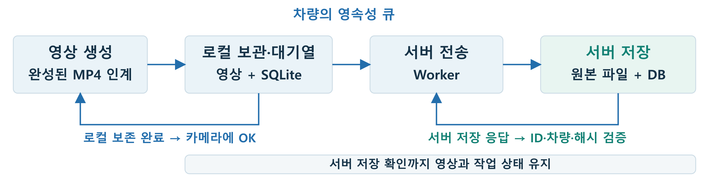

# Uploader — 사고 영상 보존과 서버 전송

**기여:** 이민석이 업로더 전체를 개발하고 Fail-safe 연계를 설계했습니다. 이후 CD 연동 과정에서 팀 수정·통합 개선이 반영됐습니다. 여기에는 헤더·C 소스·빌드·배포·테스트 전체를 포함했습니다. 설정은 [uploader.env.example](deploy/uploader.env.example)을 복사해 작성합니다.

**인터넷 연결 상태에 관계없이 사고 영상을 보관하고, 서버 저장이 확인될 때까지 전송 작업을 유지합니다.** 영상은 Pi의 로컬 보관 폴더(spool)에, 작업 상태는 SQLite 대기열에 남깁니다.

[전체 흐름](../README.md) · [영상 생성·인계](../ai/README.md) · [증거 서버](../server/README.md) · [공용 IPC](../ipc/README.md)



## 연결이 끊겨도 남아 있는 작업

| 상황 | 보존하는 것 | 이어지는 처리 |
|---|---|---|
| 인터넷 단절 | 로컬 영상·메타데이터·전송 대기 상태 | 연결 복구 후 대기열의 영상 전송 |
| 서버 저장 응답 유실 | 같은 사고의 원본과 작업 ID | 서버 저장 상태를 조회해 완료 여부 판단 |
| 프로그램 재시작 | 디스크의 영상과 SQLite 작업 기록 | 전송 중 작업을 대기로 되돌리고 저장 폴더·DB를 대조 |

**새 영상 접수와 서버 전송을 분리해, 전송을 기다리는 동안에도 다음 사고 영상을 보관합니다.** 서버 저장 상태·사고 ID·차량 ID·파일 해시가 모두 일치해야 작업을 완료합니다.

## 실제 단절·복구 시험

**인터넷 단절 중 발생한 사고 3회에서 영상 12건을 보관하고, 연결 복구 후 12건 모두 서버 저장을 확인했습니다.** 같은 시험의 전체 영상은 사고차 27건·관측차 54건으로, 81건 모두 사고 ID·차량 ID·SHA-256에 연결된 저장 응답을 받았습니다.

[12건의 보존·전송·저장 시각 CSV](../docs/measurements/20261008-scenarios/recovery.csv) · [시험 조건과 사용 버전](../docs/measurements/20261008-scenarios/README.md)

## 입출력

| 연결 | 전달 정보·동작 |
|---|---|
| 카메라 → Uploader | `/tmp/uploader.sock`, `IPC_MSG_CAMERA_READY`, protocol v7 |
| 입력 자료 | `uploader_evidence_ready_t`: MP4 절대 경로·사고 ID·시각·차량·시간 동기 상태 |
| 로컬 보존 | `$HOME/uploader/data/jobs`의 영상·metadata, `$HOME/uploader/data/queue.db` |
| Uploader → 서버 | `/api/v1/events/{event_id}/evidence` multipart 요청 |
| 완료 조건 | 서버 저장 상태·사고 ID·차량 ID·SHA-256 검증 성공 |

영상 파일 보존과 대기열 등록을 마치면 카메라에 `OK`를 돌려줍니다. 영상 처리 프로세스는 인계 기록(`.handoff`)을 정리하고 원본 MP4를 보존합니다. [IPC 데이터 형식](../ipc/uploader_ipc_protocol.h)

## Queue와 재시도

| 상태·상황 | 처리 |
|---|---|
| `PEND` | 로컬 영상 보존, 전송 순서·재시도 시각 대기 |
| `UPLOAD` | Worker가 작업을 가져와 서버 전송·저장 확인 |
| `DONE` | 서버 저장 ACK 또는 저장 상태 조회 검증 완료 |
| `FAIL` | 로컬 입력 오류·인증 거절 등 수정이 필요한 작업 |
| 일시 장애 | `5 → 10 → 20 → 40 → 최대 60초` 간격으로 횟수 제한 없이 재시도 |
| 불완전 ACK | `PEND + verification_required`로 보존 후 서버 저장 상태 재조회 |
| 재시작 | 전송 중이던 `UPLOAD`를 `PEND`로 복구하고 spool·DB 대조 |

재시도 시각은 DB에 남기며, 한 작업이 기다리는 동안 다른 준비된 작업을 처리합니다. 동일 `action_id + event_time_ns`의 재인계는 같은 `job_id`로 처리합니다.

## 영상 접수·대기열·전송을 나누어 처리

| 스레드 | 소유 자원 | 완료 지점 |
|---|---|---|
| Ingest | IPC·spool 파일 | 영상·metadata fsync → 디렉터리 rename → Queue 등록 |
| Queue | SQLite 연결 하나 | 작업 상태와 재시도 시각 반영 |
| Worker | HTTP/TLS·ACK | 서버 저장 검증 후 `DONE` |

세 스레드는 고정 크기 버퍼·mutex·조건변수로 데이터를 주고받습니다. 영상 저장 후 DB 등록이 실패해도 파일을 보관하고 등록을 다시 시도합니다. 서버 전송을 기다리는 동안에도 새 영상은 계속 접수합니다.

## 진행 감시와 복구

| 작업 | 감시 기준 |
|---|---|
| 로컬 처리 | 소유 스레드가 60초 동안 진행하지 않으면 정지 판정 |
| 파일 복사·SHA-256 | 청크 처리마다 진행 갱신 |
| DNS | 30초 진행 기한 |
| HTTP 전송 | 실제 송수신 바이트로 갱신; 기존 300초 I/O 대기 + 10초 여유 |
| 빈 Queue·backoff·서버 단절 | 유한 대기 루프가 진행을 갱신하며 재시도 |

업무 스레드의 진행이 멎으면 watchdog 알림을 중단하고 systemd의 `WatchdogSec=15s`로 재시작합니다. spool 복구 중에도 진행을 감시하며 Worker는 생성 시점부터 감시합니다.

## 빠른 시작

Pi 저장소 루트에서 실행합니다.

```bash
make -C uploader
sudo sh uploader/deploy/install-service.sh
systemctl status uploader.service
```

서비스는 `uploader/deploy/uploader.env`에서 hostname별 차량 ID·Node ID·API Key와 서버 주소를 읽어 `test/uploader`를 실행합니다. 설치 스크립트가 공개 CA를 `/etc/ace/certs/ace-ca.crt`에 설치합니다.

## 상세 통신 규약과 운영

<details>
<summary>CAMERA_READY 필드·로컬 응답·사고/작업 ID</summary>

Video Processor와 Inference는 공용 헤더 `ipc/uploader_ipc_protocol.h`와 팀 IPC 라이브러리를
사용하여 다음 endpoint로 `IPC_MSG_CAMERA_READY`를 보냄.

```text
socket   : /tmp/uploader.sock
protocol : UPLOADER_PROTOCOL_VERSION 7
payload  : uploader_evidence_ready_t
```

주요 payload 필드:

| 필드 | 의미 |
|---|---|
| `action_id` | 센서의 station_id·sequence_number를 결합한 사고 공통 식별자 |
| `event_time_ns` | 센서가 기록한 원본 사고 시각(Unix Epoch ns) |
| `clip_start_time_ns` | 영상 시작 시각 |
| `clip_end_time_ns` | 영상 종료 시각 |
| `accident_vehicle_id` | 사고 차량 식별자 |
| `vehicle_id` | 영상을 촬영한 차량 식별자 |
| `video_path` | close가 끝난 최종 MP4 절대 경로 |
| `time_sync_status` | `SYNCED`, `HOLDOVER`, `UNRELIABLE`, `UNKNOWN` |
| `chrony_offset_ms` | 영상 인계 시 조회한 시간 동기 오차 |

IPC에는 완성된 MP4의 경로와 고정 크기 metadata를 전달하여 메모리 사용량을 제한한다.

Video Processor와 Inference는 센서의 `station_id`와 `sequence_number`를
`(station_id << 16) | sequence_number`로 결합하여 `action_id` 숫자 문자열로 전달한다.
Uploader는 Unix ns 사고 시각을 한국시간으로 변환하고 사고 차량 ID와
결합하여 서버용 `event_id`를 생성한다.

```text
EVT_YYYYMMDD_HHMMSSmmm_CARXX
```

- 예: `EVT_20260818_152343266_CAR01`
- HTTP metadata·API URL·ACK 검증에는 `event_id`, IPC와 로컬 작업에는 `action_id`를 사용한다.
- 로컬 Queue의 `job_id`도 `action_id + event_time_ns`로 결정적으로 생성한다.
- 같은 `action_id + event_time_ns` 재입력은 기존 작업으로 처리한다.
- 같은 `action_id`라도 `event_time_ns`가 다르면 새 사고 작업으로 등록한다.
- `event_time_ns`는 센서가 기록하고 각 처리 경로에서 유지한 원본 사고 시각이다.

### CAMERA_READY 응답과 원본 소유권

| 응답 | 송신 측 동작 |
|---|---|
| `OK` | spool과 Queue 등록 완료. 원본 해제 가능 |
| `QUEUE_DEFERRED` | spool 확보, DB 등록 지연. 원본 유지 |
| `SOURCE_NOT_READY` | MP4 완성 후 같은 요청 재전송 |
| `INSUFFICIENT_SPACE` | 원본 유지 후 재시도 |
| `STORAGE_TEMPORARY_ERROR` | 원본 유지 후 재시도 |
| IPC 단절 | 원본과 최초 payload를 유지하여 같은 요청 재전송 |

</details>

<details>
<summary>spool commit·HTTP 상태별 재시도·Queue 복구</summary>

### Spool commit

1. `<spool>/.incoming-<job>-<pid>/`에 임시 파일을 만듦.
2. MP4와 metadata를 기록하고 파일에 `fsync()`를 수행한다.
3. 디렉터리까지 `fsync()`한 뒤 최종 `<spool>/<job_id>/`로 원자적 `rename`한다.
4. 최종 공개 전 실패하면 현재 호출이 만든 임시 파일만 정리한다.
5. 최종 공개 후 Queue·네트워크 오류가 발생하면 spool을 보존하여 재시도한다.

시작 시 5분 이상 지난 `.incoming-*`의 알려진 임시 파일을 정리한다. 예상 밖 파일이 있으면 디렉터리를 보존한다.

### Queue 등록 복구

spool commit 후 SQLite 등록이 실패하면 완성된 spool을 보존한다. 실행 중에도
주기적으로 spool과 DB를 대조해 누락된 작업을 재등록하며 재부팅 후에도 같은 복구를
수행한다.

### 네트워크 재시도

연결 실패, timeout, HTTP 408/409/422/425/429, HTTP 5xx와 불완전하거나 검증을 통과하지 못한 ACK는 `PEND`로 재시도한다. 지연은 `5초 → 10초 → 20초 → 40초 → 최대 60초`로 증가한다. `attempts`에 누적 시도 횟수를 기록하며, 횟수 제한 없이 이 재시도 간격으로 성공할 때까지 계속 시도한다.

`FAIL`은 로컬 영상 검사 실패, 해석할 수 없는 로컬 metadata, 인증 거절 등의 오류에 사용한다.

ACK가 불완전하면 `PEND + verification_required`로 저장하고 서버 상태를 다시 조회한다. 조회 응답의 저장 상태·사고 ID·차량 ID·SHA가 모두 맞을 때 `DONE`으로 바꿈. 404면 보존된 원본을 다시 전송하며, 서버 원본 복원이 필요한 경우에도 같은 경로를 사용한다. 409는 간격을 두고 재확인한다. 422는 HTTP metadata에서 레거시 `action_id`를 제외한 뒤 POST를 재시도한다. 나머지 필수 사고값은 원본 정보를 확인하여 고쳐야 한다. 인증 401/403은 `FAIL`로 처리한다.

기존 `FAIL` 중 오류가 정확히 `upload rejected: HTTP 422`이고 유효한 metadata에 레거시 `action_id`가 포함된 작업만 시작 시 재대기로 돌림. 다른 실패 작업과 spool 원본은 변경하지 않음. 재시도 시각은 DB에 기록하고, 대기 중에는 다른 준비된 작업을 처리한다.

</details>

<details>
<summary>HTTPS/TLS 인증서와 빌드 의존성</summary>

`UPLOADER_SERVER_URL`은 `http://`와 `https://`를 모두 받는다. HTTPS를 사용할
때는 Server/Deploy가 발급한 공개 Private CA 인증서
`uploader/deploy/certs/ace-ca.crt`를 사용한다. Uploader 서비스 설치 스크립트가
이 공개 인증서를 Pi의 `/etc/ace/certs/ace-ca.crt`에 설치한다.
`UPLOADER_CA_FILE`의 기본값도 이 경로이다. 이 저장소는 CA 인증서·개인키를
생성하지 않으며, CA 파일이 없는 상태에서 HTTPS를 HTTP로 자동 전환하지 않는다.
다른 `UPLOADER_CA_FILE` 경로를 지정한다면 운영자가 같은 CA 인증서를 해당
경로에 별도로 설치하고 Uploader 서비스 계정의 읽기 권한을 확인해야 한다.

```sh
UPLOADER_SERVER_URL=https://192.168.2.1:8000
UPLOADER_CA_FILE=/etc/ace/certs/ace-ca.crt
```

서버 인증서는 URL의 실제 IPv4 주소를 IP SAN으로 포함해야 한다. hostname을
사용한다면 DNS SAN을 검사한다. TLS 1.2 이상과 지정한 CA 파일만 신뢰하며
시스템 trust store는 사용하지 않는다. 서버 인증서·개인키 배포는 서버 측
책임이다. CA 로드에 실패해도 Ingest와 Queue는 계속 실행되어 영상을 spool과
PEND에 보존한다. Worker는 TLS 설정을 재시도하며 인증서 검증 실패 시 HTTP로
우회하지 않는다. 설정 변경 후에는 `sudo systemctl restart uploader.service`를
실행한다.
현재 포함된 CA의 유효기간은 2026-09-22부터 2027-09-22까지이며, 만료 전
Server/Deploy 측에서 갱신하고 Uploader를 재배포해야 한다. 서버 인증서·개인키는
Pi 또는 이 저장소에 배포하지 않는다.

Pi에서 직접 빌드할 때는 `libssl-dev`가 필요하다. VM에서 ARM64로 교차 빌드한다면
SDK sysroot에도 OpenSSL 개발 헤더와 `libssl`·`libcrypto` 링크용 라이브러리가
필요하다. 런타임 `.so.3` 파일만으로는 교차 빌드할 수 없다.

### Ubuntu SDK 빌드

- ARM64 cross compiler
- SDK sysroot의 `sqlite3.h`
- SDK sysroot의 링크용 `libsqlite3.so`
- pthread와 libc
- 저장소 공용 `ipc/ipc.c`, `ipc/ipc.h`, `ipc/uploader_ipc_protocol.h`, `ipc/runtime_watchdog.h`

### Raspberry Pi 실행

- `libsqlite3.so.0`
- `libssl.so.3`, `libcrypto.so.3`
- libc와 pthread runtime
- 시간 동기화를 위한 `chrony`, `tzdata`

서버와는 HTTPS/TLS로 통신하며, `uploader.env`의 기본 주소는
`https://192.168.2.1:8000`이다. 지정한 공개 CA로 서버 인증서와 주소를 검증한다.
`sqlite3` CLI로 Queue DB를 점검할 수 있음.

</details>

<details>
<summary>VM 빌드·개별 배포·hostname별 설정</summary>

팀 SDK 환경을 먼저 현재 터미널에 적용한다.

```bash
cd /home/<Ubuntu계정>/2026ESWContest_mobility_ACE
source scripts/setting/setup_sdk.sh

make -C uploader clean
make -C uploader
```

제품 결과물:

```text
test/uploader
```

확인:

```bash
file test/uploader
```

### Ubuntu에서 Raspberry Pi로 배포

Pi에 저장소를 clone한 뒤, Ubuntu 프로젝트 루트에서 실행한다.

```bash
cd /home/<Ubuntu계정>/2026ESWContest_mobility_ACE
source scripts/setting/setup_sdk.sh

make -C uploader deploy \
    TARGET=<RaspberryPi계정>@<RaspberryPi_IP>
```

`REMOTE_DIR`는 Pi에 clone한 저장소 루트이다. 생략하면 원격 계정의
`$HOME/2026ESWContest_mobility_ACE`를 사용한다. 다른 위치에 clone했다면 해당 절대 경로를 지정한다.

```bash
make -C uploader deploy \
    TARGET=<RaspberryPi계정>@<RaspberryPi_IP> \
    REMOTE_DIR=/절대/저장소/경로
```

배포되는 파일:

```text
<저장소>/test/uploader
<저장소>/uploader/deploy/uploader.env
<저장소>/uploader/deploy/certs/ace-ca.crt
<저장소>/uploader/deploy/install-service.sh
<저장소>/uploader/deploy/systemd/uploader.service
```

### Raspberry Pi 최초 설정

`uploader/deploy/uploader.env`에서 hostname에 따라 다음 값과 해당 차량의 API Key를 선택한다.

| hostname | Node ID | 차량 ID |
|---|---|---|
| `craft2` | `NODE_PI_02_TEST` | `CAR_02` |
| `craft3` | `NODE_PI_03_TEST` | `CAR_03` |
| `craft4` | `NODE_PI_04_TEST` | `CAR_04` |
| `seongugi`, `craft5` | `NODE_PI_05_TEST` | `CAR_05` |
| `craft6` | `NODE_PI_06_TEST` | `CAR_06` |

서버 주소나 차량별 인증 정보를 바꾸려면 저장소 루트에서 파일을 수정한다.

```bash
nano uploader/deploy/uploader.env
```

Queue DB와 영상 spool은 서비스 실행 계정의 기존 데이터 경로를 사용한다.

```text
$HOME/uploader/data/queue.db
$HOME/uploader/data/jobs
```

서비스 등록은 문서 맨 위의 명령으로 최초 한 번 수행한다. 설치 스크립트가 실행 계정과 저장소 경로를 반영하여 `/etc/systemd/system/uploader.service`를 등록한다.

</details>

<details>
<summary>서비스·수동 실행·전송 일시정지</summary>

서비스는 시작할 때 shell로 저장소의 `uploader/deploy/uploader.env`를 읽어 hostname별 설정을 적용하고, `test/uploader check`를 수행한 뒤 `test/uploader`를 인자 없이 실행한다.

서비스 명령:

```bash
sudo systemctl restart uploader.service
systemctl is-enabled uploader.service
systemctl is-active uploader.service
sudo journalctl -u uploader.service -n 100 --no-pager
```

환경 파일을 수정했다면 위의 `restart` 명령으로 반영한다.

터미널에서 직접 실행할 때는 저장소 루트에서 환경 파일을 적용한다.

```bash
sudo systemctl stop uploader.service
. ./uploader/deploy/uploader.env && ./test/uploader
```

직접 실행을 `Ctrl+C`로 마치면 `sudo systemctl start uploader.service`로 서비스를 다시 시작한다.

### 실행 명령

```text
uploader                        정식 장기 실행
uploader daemon                 이전 명령과의 호환 별칭
uploader check                  실행 계약과 IPC 규약 점검
uploader status                 pause 상태 조회
uploader pause REASON LEASE_MS  제한 시간 동안 전송 일시정지
uploader resume REASON          전송 재개
```

systemd의 `ExecStart`는 항상 인자 없는 `uploader`를 사용한다.

</details>

<details>
<summary>로그·Queue 확인·Chrony 상태</summary>

로그 형식:

```text
직접 실행          → human
systemd/journald   → structured
```

환경변수로 강제 선택할 수 있음.

```ini
UPLOADER_LOG_VIEW=human
UPLOADER_LOG_VIEW=structured
UPLOADER_LOG_VIEW=both
```

외부 IPC 소켓 확인:

```bash
test -S /tmp/uploader.sock && echo OK
```

Queue 확인:

```bash
sqlite3 -header -column "$HOME/uploader/data/queue.db" \
  "SELECT id,job_id,status,attempts,last_error FROM jobs ORDER BY id;"
```

정상 기준:

- 서버 ACK를 검증한 작업만 `DONE`이다.
- 네트워크 단절 중 작업은 spool 파일이 남은 채 `PEND`이다.
- 서버가 복구되면 업로드를 자동 재시도한다.

Raspberry Pi의 `chronyd`가 시스템 시간을 동기화한다. Uploader는 최초 `CAMERA_READY`의 동기 상태와 offset을 서버 metadata에 보존한다.

Raspberry Pi에서 chrony 확인:

```bash
sudo systemctl enable --now chrony
chronyc sources -v
chronyc tracking
timedatectl status
```

정상 동기화 상태는 선택된 source와 `Leap status: Normal`로 확인한다. 시간 상태가 좋지 않아도 Uploader는 증거 영상을 버리지 않으며, 서버가 해당 metadata로 병합 품질을 판단한다.

</details>

<details>
<summary>소스 구조와 종료 순서</summary>

```text
uploader/
├── README.md                       # 구조, 빌드·배포·운영 문서
├── Makefile                        # 제품 빌드와 배포 진입점
├── include/                        # Uploader 내부 모듈 헤더
├── src/
│   ├── uploader.c                  # 업무·감시 스레드, 외부 IPC
│   ├── common/uploader_log.c       # 구조화/한글 로그
│   ├── ingest/uploader_spool.c     # 안전한 디스크 저장
│   ├── queue/uploader_queue.c      # SQLite FIFO와 상태 전이
│   └── worker/
│       ├── uploader_config.c       # 환경설정과 장치 신원
│       ├── uploader_metadata.c     # metadata 검증
│       ├── uploader_sha256.c       # 영상 해시
│       ├── uploader_http.c         # health와 multipart 전송
│       └── uploader_ack.c          # 서버 ACK 검증
└── deploy/
    ├── deploy.sh                   # Ubuntu → Raspberry Pi 원자적 배포
    ├── install-service.sh          # Pi systemd 최초 등록
    ├── uploader.env                # 서버 설정과 hostname별 차량·인증 정보
    └── systemd/uploader.service    # 서비스 템플릿

ipc/
├── ipc.c / ipc.h                   # 팀 공용 Unix Domain Socket 라이브러리
└── uploader_ipc_protocol.h         # Video Processor·Inference ↔ Uploader 규약
```

```text
SIGINT/SIGTERM
  → Ingest IPC loop 종료
  → runtime stopping 설정과 condition broadcast
  → Worker 스레드 join
  → Queue의 남은 내부 명령 처리와 SQLite close
  → Queue 스레드 join
  → /tmp/uploader.sock 제거
  → 내부 감시 스레드 종료
  → API Key 메모리 초기화
```

프로세스 종료 전에 장기 실행 스레드를 모두 `join`하여 회수한다.

</details>
