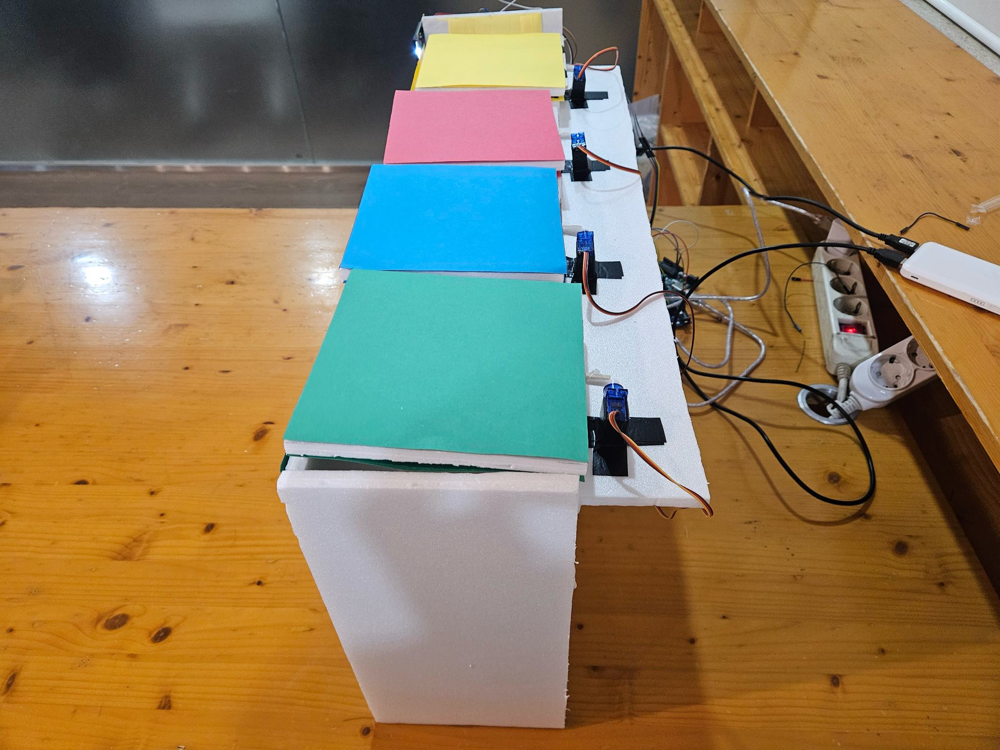
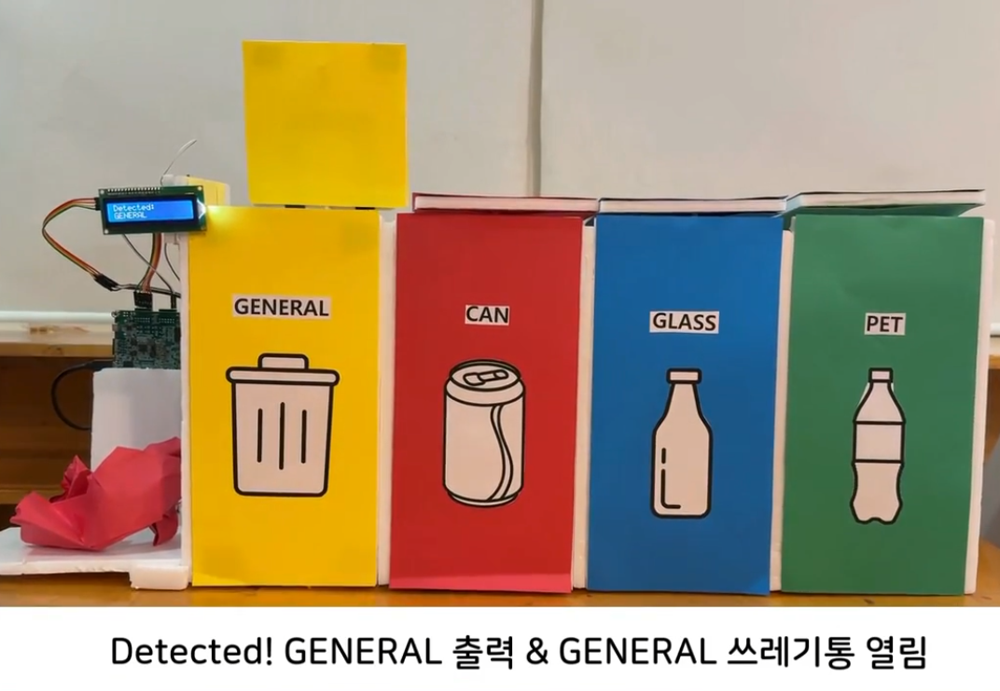
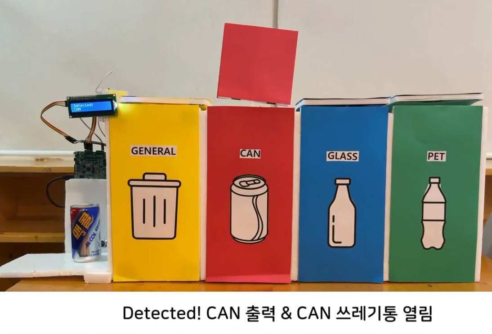
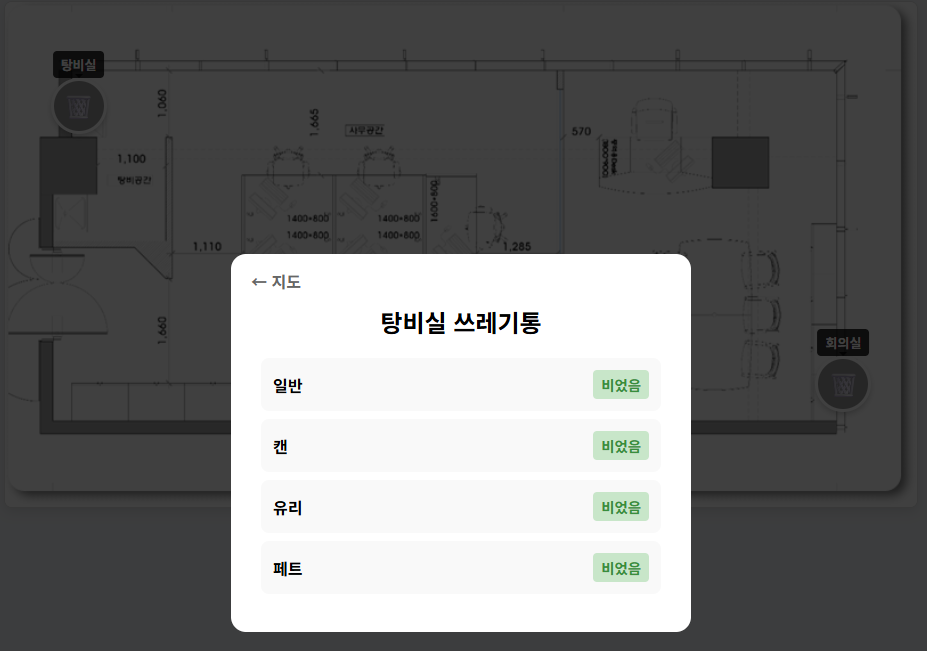

# Edge AI Trash Sorter

**저전력 엣지 AI 기반 쓰레기 분류 시스템** — Zybo Z7-20의 ARM Cortex-A9에서 카메라 영상을 분류하고, Arduino가 해당 쓰레기통 뚜껑을 여는 임베디드 팀 프로젝트입니다. 별도 Arduino와 ESP8266은 적재 상태를 Flask 서버로 보내 웹 대시보드에 표시합니다.


<!-- LOC:START -->
## 코드 규모와 기술적 과제

**1,541 LOC · 18개 파일** · 구현 1,391 / 테스트·예제 119 / 빌드·CI·설정 31.

주석·빈 줄·외부 코드·자동 생성 파일을 제외한 프로젝트 규모입니다. [언어별·범주별 분석](docs/LOC.md)

- **기술적 과제:** 촬영·추론·UART가 공유 버퍼와 완료 순서를 지키도록 동기화.
- **설계 선택:** 태스크·큐·세마포어로 소유권과 요청·완료 신호를 구분.
- **확인 근거:** 실보드 연동·시연, 전처리 C·서버 API 검사. [문제·해결·검증](../../docs/TECHNICAL_CHALLENGES.md#edge-ai-trash-sorter)
<!-- LOC:END -->


## 제출용 프로젝트 요약

| 항목 | 내용 |
|---|---|
| 분야 | 엣지 AI · 실시간 임베디드 제어 · IoT 관제 |
| 사용 기술 | C/C++, FreeRTOS, Zybo Z7-20, Vivado/Vitis, TensorFlow Lite Micro, Arduino UNO, ESP8266, Python/Flask, HTML/CSS/JavaScript |
| 분류 대상 | 캔 · 일반 쓰레기 · 유리 · PET · Empty |
| 모델 구조 | MobileNetV2 α=0.5, RGB 128×128 입력, 5개 클래스 |
| 핵심 기여 | 시스템 설계·통합, Zybo 카메라·AI·RTOS, AI 학습·변환, Arduino 적재량·통신, 서버·대시보드 |
| 검증 | 실보드 시스템 연동·실행, 공개 코드의 Arduino 컴파일·C/서버 테스트 |

카메라 촬영부터 AI 분류, UART 명령, 뚜껑 제어, 적재 상태 전송과 관제 화면까지 실보드에서 연동해 동작을 검증했습니다.

## 개인 기여 범위

이민석의 담당 영역은 다음과 같습니다.

- **아이디어·시스템 설계·통합**: 전체 동작 흐름, 보드 역할 분담, 배선 및 통합 시연
- **Zybo 하드웨어·카메라**: Vivado 핀 설정, SPI/I2C 통신, ArduCAM 초기화와 JPEG 촬영
- **AI 학습·모델 변환**: 데이터셋 구성, MobileNetV2 학습, TFLite 모델 생성
- **Zybo AI 실행·FreeRTOS**: 이미지 전처리와 추론, 태스크·큐·세마포어, Arduino UART 통신
- **Arduino 2 — 적재량·Wi-Fi**: 초음파 센서 4개, UART 원형 버퍼, ESP8266과 HTTP 전송
- **Flask 서버·웹 대시보드**: 상태 API, 위치별 쓰레기통 표시, 상세 화면과 주기적 갱신

**Arduino 1의 물체 감지·뚜껑 서보·LCD 제어는 공동 작업 영역**입니다. Zybo 분류 명령과 연결되는 센싱·구동 노드입니다.

## 주요 기능

- 물체가 10 cm 이내에서 2초간 감지되면 분류 요청
- ArduCAM OV5642 카메라에서 JPEG 프레임 획득
- RGB 변환·128×128 리사이즈·[-1, 1] 정규화 후 TFLite Micro 추론
- UART로 분류 결과를 전달하고 대응하는 서보와 LCD 제어
- 초음파 센서 4개로 종류별 쓰레기통 적재 상태 확인
- ESP8266 AT 명령으로 적재 상태를 서버에 전송
- 위치별 포화 상태와 종류별 상세 상태를 1초 간격으로 표시

Arduino 1은 분류 결과에 해당하는 뚜껑을 5초 동안 연 뒤 닫습니다. 센서 미수신 항목은 대시보드에 “확인 중”으로 표시합니다.

## 시스템 구조

```text
물체 감지 초음파 센서
        │
        ▼
Arduino 1 ── UART '1': 분류 요청 ──▶ Zybo Z7-20 PS
서보 4개·LCD ◀─ UART '1'~'6' ────── ARM Cortex-A9 / FreeRTOS
                                           │ SPI + I2C
                                           ▼
                                    ArduCAM OV5642
                                           │ JPEG → RGB
                                           ▼
                                   TensorFlow Lite Micro
                                   MobileNetV2 / 5 classes

적재량 초음파 센서 4개
        │
        ▼
Arduino 2 ── UART / AT commands ──▶ ESP8266
                                        │ HTTP
                                        ▼
                                 Flask 상태 API
                                        │ /status, 1초 갱신
                                        ▼
                                  관제 웹 대시보드
```

PL은 주변장치 연결과 핀 라우팅을 맡습니다. **AI 추론은 PS의 ARM 프로세서에서 수행하며, FPGA에서 CNN을 가속한 구현은 아닙니다.**

### 보드 역할

| 구성 요소 | 역할 | 핵심 인터페이스 |
|---|---|---|
| Zybo Z7-20 PS | 촬영·이미지 전처리·AI 추론·태스크 스케줄링 | SPI, I2C, UART, FreeRTOS |
| Arduino 1 | 물체 감지·분류 요청·뚜껑·LCD | 초음파, SoftwareSerial, Servo, I2C |
| Arduino 2 | 적재 상태·Wi-Fi 전송 | 초음파 4개, USART RX 인터럽트, Timer1 |
| ESP8266 | 로컬 네트워크 연결 | AT 명령, TCP/HTTP |
| Flask 서버 | 위치·종류별 상태 저장·조회 | HTTP API, 메모리 내 상태 |
| 웹 대시보드 | 상태 시각화·상세 화면 | HTML/CSS/JavaScript, 주기적 fetch |

## 통신·제어 안정성 개선

- Wi-Fi 접속 정보를 `secrets.h`로 분리하고 예시 설정만 공개
- `true || IsValidJPEG(...)`로 우회되던 JPEG 검사를 복구
- 카메라 레지스터 목록 순회에서 미초기화 변수와 종료 sentinel 처리 수정
- 촬영 요청·프레임 준비·AI 완료·AI 초기화 완료 신호를 각각 분리
- 실패 경로에서도 버퍼 반환과 오류 응답을 보장하도록 AI 흐름 수정
- FLOAT32 입력 크기·자료형과 출력 크기를 검사하고 잘못된 모델 거부
- nearest-neighbor 전처리를 보고서의 학습 방식에 맞춘 bilinear로 변경
- UART 수신 루프 제한 카운터, 주변장치 초기화, C/C++ 연결 선언 수정
- 적재량 조건을 가까운 거리 기준 히스테리시스로 변경하고 시간 측정을 Timer1으로 통일
- 전송 성공 응답을 확인한 뒤 상태를 반영하고 실패 시 재시도·주기적 재전송
- 서버 오류 응답 코드, 초기 미확인 상태, 리셋 방식, 대시보드 누락 이미지와 연결 실패 표시 수정

오류 수정과 검사 결과는 [코드 검증 기록](docs/CODE_REVIEW.md), 세부 설계는 [시스템 구조](docs/ARCHITECTURE.md)에 정리했습니다.

## AI 모델과 성능 기록

ImageNet 기반 MobileNetV2 전이학습에 Global Average Pooling과 Dense 분류기를 연결하고 단계별 fine-tuning을 적용했습니다. 클래스 순서는 `can, general, glass, pet, empty`이며 런타임 명령도 같은 순서입니다.

| 항목 | 학습·실행 설정 |
|---|---|
| 입력 | FLOAT32, [1, 128, 128, 3], [-1, 1] 정규화 |
| 분류 출력 | FLOAT32, 5개 softmax 점수 |
| 모델 파라미터 | 876,469개 |
| 최종 accuracy | 학습 결과 0.7229 (약 72.29%) |
| Tensor arena | 4 MiB |

입력·출력은 FLOAT32이며, 디버그 전송에는 int8 배열을 사용했습니다.

## 빌드 및 설정

### 관제 서버 실행

```bash
cd server
python3 -m venv .venv
source .venv/bin/activate
pip install -r requirements.txt
python app.py
```

브라우저에서 `http://127.0.0.1:5000`을 엽니다. 하드웨어 없이 `http://127.0.0.1:5000/t1/fill/ca`에 접속하면 탕비실 캔 상태를 “수거 필요”로 바꿔 확인할 수 있습니다. 비우기는 `/t1/empty/ca`, 전체 종류는 `al`입니다. 센서값은 연속 적재율이 아니라 **포화 여부**입니다.

ESP8266 연결 시 같은 LAN에서 `flask --app app run --host 0.0.0.0 --port 5000`으로 실행하고 서버 IP를 로컬 설정에 입력합니다. 서버는 위치·종류별 상태를 메모리에 저장해 관제 화면에 제공합니다.

### Arduino 1

Arduino AVR Boards(UNO), Servo, LiquidCrystal I2C 라이브러리를 설치합니다. Wire와 SoftwareSerial은 AVR core에 포함됩니다.

```bash
arduino-cli compile --fqbn arduino:avr:uno firmware/arduino_lid
```

### Arduino 2

`secrets.example.h`를 같은 폴더의 `secrets.h`로 복사하고 Wi-Fi·서버·위치 ID를 입력합니다. `secrets.h`는 커밋하지 않습니다.

```bash
avr-gcc -mmcu=atmega328p -DF_CPU=16000000UL -Os -std=c11   -Wall -Wextra -Werror firmware/arduino_monitor/main.c -o monitor.elf
```

이는 Arduino framework를 사용하는 스케치가 아닌 **독립 AVR C 펌웨어**입니다. Arduino core와 동시에 링크하지 않습니다. Timer1은 시간 측정용으로 사용합니다.

### Zybo

Vivado/Vitis에서 원 배선에 맞는 하드웨어 플랫폼과 FreeRTOS BSP를 생성하고 `firmware/zybo`와 `firmware/common/vision_core.c`를 추가합니다. 모델·TensorFlow Lite Micro·카메라 레지스터 테이블·stb_image 구현이 추가로 필요합니다. [펌웨어 통합 안내](firmware/README.md)와 [하드웨어 설정](hardware/README.md)을 참고하세요.

### 테스트

프로젝트 폴더에서 실행합니다.

```bash
make -C tests test
python3 -m unittest discover -s tests -p 'test_*.py' -v
node tests/test_dashboard.cjs
```

Python 테스트에는 `server/requirements.txt`의 Flask가 필요합니다.

## 코드 읽기

처음 보는 분을 위한 [파일별 역할·호출 흐름 안내](docs/CODE_GUIDE.md)를 제공합니다. 각 source 파일의 첫머리와 함수 위에도 기능·입력·출력·처리 구조를 한글로 설명했습니다.

## 저장소 구조

```text
firmware/
├── common/               # JPEG 검증, bilinear 전처리, 클래스 명령
├── zybo/                 # FreeRTOS tasks, ArduCAM, PS peripherals
├── arduino_lid/          # 물체 감지·서보·LCD 공동 작업 영역
└── arduino_monitor/      # 초음파·USART ring buffer·ESP8266
server/                   # Flask API, templates, 시연용 배치도
ml/                       # MobileNetV2 학습 구조와 모델 준비 안내
docs/                     # architecture, technical notes, code review
hardware/                 # XDC 핀 설정과 보드 배선 안내
media/                    # 시제품·회로·모델·관제 화면
tests/                    # 이미지 로직·서버 회귀 테스트
```

## 시연 영상 및 결과

[전체 동작 시연 영상](https://drive.google.com/file/d/1xSyefF0ejK1Y60eP9jwrPD4I7R57ZHVT/view?usp=sharing)

| 일반 쓰레기 분류 | 캔 분류 |
|---|---|
|  |  |



사진과 관제 화면은 실보드에서 실행한 시제품의 동작 기록입니다. 서버에는 로컬 실행을 위한 시연용 배치도를 함께 제공합니다.

## 참고 자료

- [FreeRTOS binary semaphores](https://sources.freertos.org/Documentation/02-Kernel/02-Kernel-features/02-Queues-mutexes-and-semaphores/02-Binary-semaphores)
- [AMD/Xilinx embedded software drivers](https://github.com/Xilinx/embeddedsw)
- [Arduino SoftwareSerial](https://docs.arduino.cc/learn/built-in-libraries/software-serial)
- [ESP8266 TCP/IP AT commands](https://docs.espressif.com/projects/esp-at/en/release-v2.1.0.0_esp8266/AT_Command_Set/TCP-IP_AT_Commands.html)
