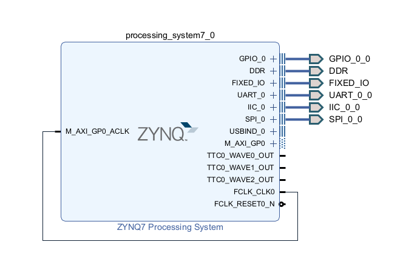

# Hardware notes

보고서의 핀 설정과 부록 코드에서 정리한 배선 정보다. 핀 설정은 실제 Vivado 프로젝트의 port 이름에 맞춰 적용한다.

## Arduino 1 UNO

| 장치 | 핀 |
|---|---|
| 물체 감지 초음파 | D12 trig / D4 echo |
| Zybo UART | D7 RX / D8 TX |
| Servo 캔/일반/유리/PET | D11 / D9 / D5 / D6 |
| I2C LCD | UNO SDA/SCL, 주소 0x27 |

## Arduino 2 ATmega328P

| 종류 | AVR port bit | UNO digital pin |
|---|---|---|
| 일반 | PD4 trig / PD5 echo | D4 / D5 |
| 캔 | PD6 trig / PD7 echo | D6 / D7 |
| 유리 | PB0 trig / PB1 echo | D8 / D9 |
| PET | PB2 trig / PB3 echo | D10 / D11 |
| ESP8266 USART | PD0 RX / PD1 TX | D0 / D1 |

Timer1을 시간 측정에 사용한다. UART와 sensor 모두 보드 간 ground와 전압 호환을 확인한다. ESP8266에 적합한 전원과 GPIO level 변환을 구성한다.

## Zybo

pins.xdc는 보고서의 PL 핀 constraint만 추출한 파일이다. Verilog block wrapper와 같은 port 이름이어야 한다. SPI0는 ArduCAM, I2C0는 sensor register, UART0는 Arduino, UART1은 PC debug에 사용한다. GPIO의 INPUT_BTN부터 4개 입력과 LD6 RGB 출력은 실제 EMIO routing을 확인한다.

보고서에서 “JE의 SPI/I2C”와 “JD의 I2C” 설명이 혼재하므로 XDC와 실물 배선을 기준으로 확인한다.
