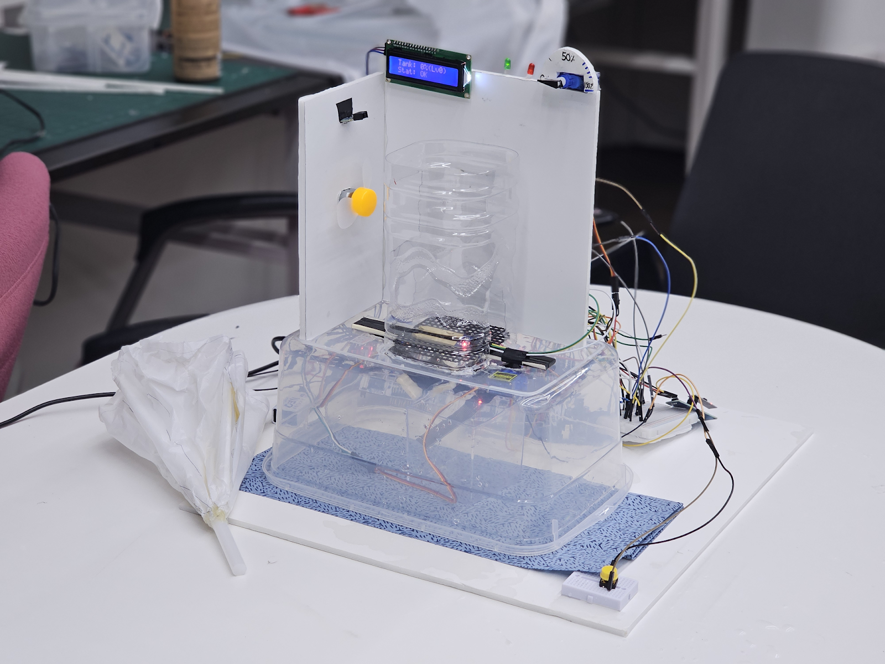

# Smart Umbrella Stand

습도·수위·우산 감지 센서와 기상청 단기예보를 결합해 우산 건조와 상태 표시를 자동화한 임베디드 시스템 프로젝트입니다. STM32F103 보드 3대가 센싱/구동, 중앙 제어, 날씨/LCD 처리를 분담하며 SPI로 통신합니다.



**개인 담당:** 아이디어 제안, Master의 상태 판단·SPI 통신·ML 추론, Slave2의 기상 API·LCD·수위 표시. [사진으로 보는 동작과 구현](docs/IMPLEMENTATION_GALLERY.md)
<!-- LOC:START -->
## 코드 규모

**687 LOC · 17개 파일** · 구현 596 / 테스트·예제 77 / 빌드·CI·설정 14.

주석·빈 줄·외부 코드·자동 생성 파일을 제외한 프로젝트 규모입니다. [언어별·범주별 분석](docs/LOC.md)
<!-- LOC:END -->


## 프로젝트 요약

| 항목 | 내용 |
|---|---|
| 분야 | 임베디드 시스템 · 센서 데이터 처리 · 경량 ML 추론 |
| 사용 기술 | C, STM32F103, SPI, ADC/DMA, PWM, Python, NumPy |
| 핵심 기여 | 아이디어 제안, Master 제어·통신, Slave2 날씨·표시 기능 |
| 검증 | 하드웨어 독립 C 테스트, ASan/UBSan, Python 학습 파이프라인 확인 |

코드 분석과 수정 내역은 [검증 기록](docs/CODE_REVIEW.md)에 정리했습니다.

## 개인 기여 범위

이 프로젝트는 팀 프로젝트이며, 그중 이 저장소 작성자의 주요 담당 범위는 다음과 같습니다.

- **아이디어 제안**: 날씨 정보 제공, 우산 자동 건조, 건조 완료 후 승강, 빗물받이 상태 표시를 하나의 스마트 우산꽂이로 통합하는 아이디어를 제안했습니다.
- **Master STM32 담당**
  - Slave1·Slave2와의 SPI 통신 구조와 프레임 설계
  - 센서값과 기상 데이터의 수집·검증·통합
  - 통신 오류가 전체 제어 루프를 멈추지 않도록 timeout과 복구 흐름 구현
  - 습도·우산 유무·습도 이동평균·변화량을 이용한 wet/dry 모델 추론
  - 모델 판정과 강수 상태를 결합한 팬·승강 서보 제어 명령 생성
- **Slave2 STM32 전체 담당**
  - ESP8266 연결 및 기상청 단기예보 API 요청·응답 처리
  - HTTP 시간 정보를 이용한 기상청 조회 날짜와 기준시각 생성
  - 강수확률·강수형태·온도 데이터 처리
  - Master와의 SPI 통신 및 응답 상태 머신
  - LCD 화면, 버튼 입력, 수위 다이얼 서보와 상태 LED 제어

Slave1의 센서 취득·팬·승강부는 팀원이 담당한 영역이며, 공개 저장소에서는 Master와 연결되는 프로토콜 정합성 및 공개용 코드 구조를 위해 함께 정리했습니다.

## 공개본에서 반영한 개선 사항

통신 정합성·오류 복구·날짜 처리와 모델 판정 로직을 다음과 같이 개선했습니다.

- Wi-Fi SSID·비밀번호·기상청 API 키를 제거하고 `secrets.example.h` 구조로 변경
- C 구조체 padding에 의존하던 센서 패킷을 명시적인 6바이트 wire format으로 통일
- Master–Slave1 통신을 SPI1 동기식 DMA, Master–Slave2 통신을 timeout이 있는 SPI2 polling으로 명확히 구분
- Slave2가 첫 SPI clock부터 `0xC7` 헤더를 전송하도록 response header preload 상태 머신 적용
- loop 횟수 기반 timeout을 `HAL_GetTick()` 기반 실제 시간 timeout으로 변경
- SYSCLK 64 MHz/APB1 timer clock 64 MHz 조건에 맞게 TIM2·TIM3 prescaler를 63으로 수정
- 센서 기반 wet/dry 판정은 학습 모델 점수만 사용하고, 모델 확률 60%/40% 히스테리시스 적용
- 강수형태 PTY 값을 NONE/RAIN/RAIN-SNOW/SNOW/SHOWER enum으로 구분
- GMT→KST 변환 과정에 월말·연말 rollover와 윤년 처리 추가
- HAL 초기화와 register 초기화가 같은 peripheral에 중복 적용되지 않도록 역할 경계 정리
- DMA 성능 결과의 단위를 35.4 µs와 18.3 µs로 바로잡고, 센서 업데이트 구간 cycle 약 48.3% 감소로 표현

세부 변경 근거는 [기술 노트](docs/TECHNICAL_NOTES.md)에 정리했습니다.

## 주요 기능


- 우산 유무와 내부 습도를 이용한 팬 자동 제어
- 건조 상태에 따른 우산 승강 서보 제어
- 빗물받이 수위 측정, 다이얼 서보 및 경고 LED 표시
- ESP8266과 기상청 API를 이용한 강수확률·강수형태 조회
- LCD를 통한 온도, 강수 상태, 예보 정보 표시
- ADC circular DMA와 이동평균 필터
- DWT cycle counter를 이용한 센서 처리 구간 성능 측정
- 로지스틱 회귀 기반 lightweight wet/dry 분류

## 시스템 구조

```text
습도/수위/IR 센서
        │ ADC+DMA / GPIO
        ▼
┌────────────────┐  SPI1, 6-byte sensor frame  ┌────────────────┐
│ Slave1 STM32   │◀────────────────────────────▶│ Master STM32   │
│ 센싱·팬·승강   │   servo/fan commands         │ 판단·상태 통합 │
└────────────────┘                              └───────┬────────┘
                                                       │ SPI2, 4 bytes
                                                       ▼
                                               ┌────────────────┐
                                               │ Slave2 STM32   │
                                               │ ESP8266·LCD    │
                                               │ 다이얼·LED     │
                                               └───────┬────────┘
                                                       │ HTTP
                                                       ▼
                                               기상청 단기예보 API
```

### 보드 역할

| 보드 | 역할 | 핵심 주변장치 |
|---|---|---|
| Slave1 | 습도·수위·IR 취득, 팬과 승강 서보 구동 | ADC1 circular DMA, SPI1 slave, TIM2/TIM3 PWM |
| Master | 센서/날씨 통합, wet/dry 추론, 명령 생성 | SPI1 master DMA, SPI2 master polling, DWT, UART |
| Slave2 | 날씨 API 요청/파싱, LCD·다이얼·LED 제어 | ESP8266 UART, SPI1 slave, I2C LCD, TIM2 PWM |

## 데이터 흐름과 통신

Slave1의 센서 프레임은 구조체 메모리를 직접 전송하지 않고 6바이트로 명시적으로 직렬화합니다.

```text
[0] 0xA5
[1] humidity LSB
[2] humidity MSB
[3] water LSB
[4] water MSB
[5] umbrella_present (0/1)
```

Master가 같은 SPI 프레임에서 보내는 첫 두 바이트는 각각 승강 서보 명령(0~2)과 팬 명령(3=중간, 4=강, 5=정지)입니다. Master–Slave1은 DMA로 6바이트를 이동한 뒤 완료 플래그를 기다리는 동기식 DMA 방식입니다. Master–Slave2는 트래픽이 적어 폴링을 사용하며, `HAL_GetTick()` 기준 타임아웃으로 보드 장애가 전체 제어 루프를 막지 않게 했습니다.

## 성능 측정

Slave1에서 DWT cycle counter로 **센서 업데이트 구간만** 측정한 결과입니다. 따라서 아래 수치는 전체 루프 시간이나 CPU 사용률이 아닙니다.

| 방식 | 평균 cycle | 64 MHz 환산 |
|---|---:|---:|
| ADC polling (non-DMA) | 약 2,264 cycles | 약 35.4 µs |
| ADC circular DMA | 약 1,171 cycles | 약 18.3 µs |

측정 구간의 cycle은 약 **48.3% 감소**했습니다. DMA 자체가 ADC 변환 시간을 없애는 것은 아니며, CPU가 EOC를 기다리는 작업을 제거한 효과입니다.

## ML 분류

추론 계수는 `firmware/master/Core/Inc/wet_model_params.h`에서 관리합니다. Python 학습 스크립트는 같은 이름의 C 헤더로 가중치와 bias를 내보냅니다.

입력 feature는 현재 습도, 우산 유무, 습도 이동평균, 현재값과 평균의 차이입니다. 센서 기반 wet/dry 판정은 학습 모델의 점수만 사용합니다. 상태 흔들림을 막기 위해 모델 확률 60% 이상(`z ≥ 0.405`)에서 wet으로 진입하고 40% 이하(`z ≤ -0.405`)에서 dry로 해제하며, 그 사이에서는 이전 판정을 유지합니다.

```bash
cd ml
python -m venv .venv
source .venv/bin/activate       # Windows: .venv\Scripts\activate
pip install -r requirements.txt
python collect_wet_data.py /dev/tty.usbmodemXXXX 1
python train_wet_model.py
```

## 빌드 및 설정

1. STM32CubeIDE에서 보드별 STM32F103 프로젝트를 생성하고 SYSCLK를 64 MHz로 설정합니다.
2. `firmware/common`과 각 보드의 `Core/Inc`, `Core/Src`를 프로젝트 include/source path에 추가합니다.
3. Slave2에서 `secrets.example.h`를 `secrets.h`로 복사해 로컬 값을 입력합니다. `secrets.h`는 `.gitignore`에 포함되어 있습니다.
4. Slave1은 ADC1 CH0/CH1 scan + circular DMA, Master SPI1은 DMA1 Channel2/3, Slave2 SPI는 RXNE/NSS 상태 머신을 설정합니다.
5. 실제 배선과 CubeMX 설정을 [기술 노트](docs/TECHNICAL_NOTES.md)와 대조한 뒤 빌드·플래시합니다.

```c
/* firmware/slave2/Core/Inc/secrets.h — 커밋 금지 */
#define WIFI_SSID "..."
#define WIFI_PASS "..."
#define KMA_API_KEY "..."
```

## 코드 읽기

처음 보는 분을 위한 [파일별 역할·호출 흐름 안내](docs/CODE_GUIDE.md)를 제공합니다. 각 source 파일의 첫머리와 함수 위에도 기능·입력·출력·처리 구조를 한글로 설명했습니다.

## 저장소 구조

```text
firmware/
├── common/              # 6-byte protocol, date/leap-year utilities
├── slave1/              # sensor DMA, filtering, fan/servo, SPI slave
├── master/              # control/ML logic, SPI1 DMA, SPI2 timeout
└── slave2/              # secrets template, SPI response state machine
ml/                      # UART data collection and model training
docs/                    # architecture and technical corrections
hardware/                # 배선·부품 구성 안내
media/                   # 완성품·건조부·LCD·수위 시연 사진
tests/                    # host tests for protocol/date/control logic
```

호스트에서 하드웨어 독립 로직을 확인하려면:

```bash
make -C tests test
```

## 시연 영상

- [AI 학습 과정](https://drive.google.com/file/d/1AmFgw-nhqzb8nmwNfXXKzHeBjOAHC7Xe/view?usp=sharing)
- [비가 오지 않을 때 동작](https://drive.google.com/file/d/1Wdwf_McOUhwqzr1X0eZw1-9wORFyLKaN/view?usp=drive_link)
- [비가 올 때 동작](https://drive.google.com/file/d/1K-F9B-3mpb7NX8fyssa5rvmC3RNQnH0G/view?usp=drive_link)
- [빗물받이 수위 표시](https://drive.google.com/file/d/1FUCR_OLGt3hA9a2zzPWqerka4epM1BJQ/view?usp=drive_link)
- [LCD 화면 전환](https://drive.google.com/file/d/1b_ATY3lZpcJqls4Zzektr2JBRo9v-8Os/view?usp=drive_link)

## 참고 자료

- [STM32F10x reference material](https://www.keil.com/dd/docs/datashts/st/stm32f10xxx.pdf)
- [기상청 단기예보 조회서비스](https://www.data.go.kr/data/15084084/openapi.do)
