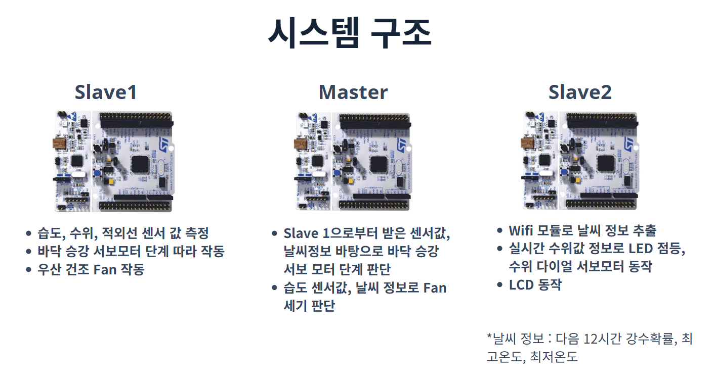
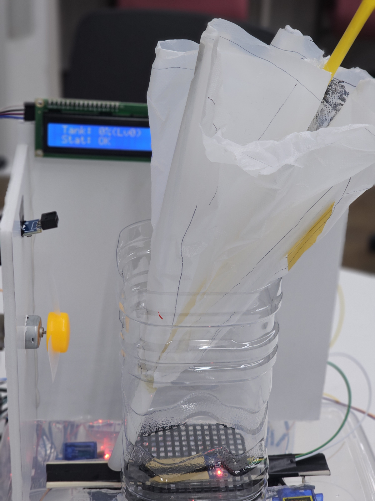
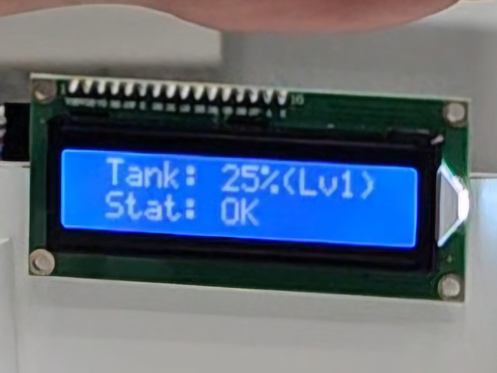
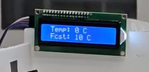
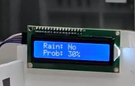
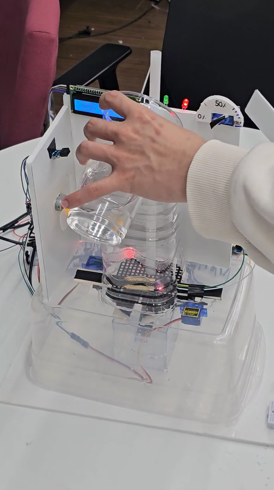

# Smart Umbrella Stand · 장치와 동작

날씨 확인과 젖은 우산 관리를 한 장치에 연결했습니다. STM32F103 3대가 센싱·제어·날씨와 표시를 나누어 처리하며, 중앙 Master가 SPI로 두 Slave를 연결합니다.

## 완성품과 보드 역할

투명한 하부는 빗물받이이며, 우산통 아래에는 습도 센서와 승강부가 있습니다. 전면에는 팬·우산 감지 센서, 상단에는 LCD·상태 LED·수위 다이얼을 배치했습니다. 장치 제작과 전체 통합은 팀 작업입니다.

**개인 담당:** 아이디어 제안과 Master·Slave2입니다. Master는 센서·날씨 데이터를 수집하고 wet/dry 판정과 팬·승강 명령을 생성합니다. Slave2는 ESP8266·기상청 API와 LCD·수위 다이얼·LED·버튼을 처리합니다. Slave1의 센서 취득·건조 팬·승강부는 팀원 담당입니다.

## 젖음 판정과 건조·승강

**입력:** 현재 습도, 우산 유무, 습도 이동평균과 현재값·평균의 차이, 강수 상태입니다. 센서값은 Slave1에서 SPI로 받아 검증합니다.

**판단:** Master에서 경량 로지스틱 회귀 점수를 계산하고 60%·40% 히스테리시스로 wet/dry 상태를 갱신합니다. 경계 근처에서 팬과 승강부 명령이 반복 전환되는 것을 줄이기 위한 구조입니다.

**출력:** 젖은 우산은 팬으로 건조하고, 건조가 끝나면 승강 명령을 보냅니다. 비가 오는 상태에서는 건조 팬·승강 단계에 날씨를 반영합니다.

[Master 제어 코드](../firmware/master/Core/Src) · [학습 도구](../ml) · [프로토콜·동작 구조](ARCHITECTURE.md)

## 직접 담당한 날씨·LCD·수위 표시

| 수위 표시 | 온도 표시 | 강수 상태·확률 표시 |
|---|---|---|
|  |  |  |

ESP8266으로 기상청 단기예보를 요청하고 온도·강수형태·강수확률을 정리합니다. 조회 날짜·기준 시각에는 GMT→KST 변환과 월말·윤년 처리를 적용했습니다. 버튼을 누르면 수위·온도·강수 정보 화면을 전환합니다.

Master와의 SPI 응답은 헤더를 미리 준비하는 상태 머신으로 구성해 첫 clock부터 정해진 프레임을 반환합니다. 통신 타임아웃은 시스템 tick으로 판정해 한 보드의 응답 지연이 전체 제어를 막지 않게 했습니다.

수위 값은 다이얼 서보와 LCD에 함께 표시하고, 높은 수위에서는 빨간 LED로 물 비우기를 알립니다. 위 사진은 수위 75% 시연 장면입니다.

[Slave2 코드](../firmware/slave2/Core/Src) · [배선·설정과 기술 노트](TECHNICAL_NOTES.md) · [시연 영상](../README.md#시연-영상)
