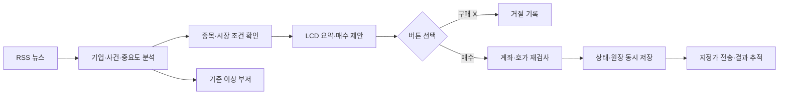

# StockAuto News Trader · 뉴스와 물리 버튼을 연결한 주식 주문

중요 뉴스를 수집해 관심종목과 연결하고 **Arduino UNO의 16×2 LCD에 분석 근거·수량·지정가를 표시**합니다. 매수 버튼으로 주문을 승인하고, 구매 X 버튼으로 거절합니다. 중요도가 기준 이상이면 부저가 세 번 울립니다.

기존 키움 OpenAPI+ 자동매매 프로그램의 RSI·계좌 조회·주문·DB 코드를 바탕으로, 뉴스 분석과 물리 승인 장치를 결합한 개인 프로젝트입니다.

| 먼저 확인할 내용 | 자료 |
|---|---|
| 기능과 실제 구현 위치 | [코드 읽는 순서](docs/CODE_GUIDE.md) |
| 뉴스·매수·청산 판단 기준 | [자동화 규칙](docs/AUTOMATION_RULES.md) |
| PC·UNO 통신과 주문 상태 | [시스템 구조](docs/ARCHITECTURE.md) |
| 배선·실행·설정 | [사용 안내](docs/USAGE.md) |
| 검수한 오류와 수정 | [검수 기록](docs/CODE_REVIEW.md) |
| 실제 자동 검사 | [GitHub Actions](https://github.com/eLunaaaa/portfolio/actions/workflows/portfolio-ci.yml) |

## 구현한 내용

| 영역 | 수행한 작업 |
|---|---|
| 뉴스 수집·분석 | RSS/Atom 파싱, 기업명·문맥 구분, 확정/전망/악재 분류, 사건 통합·최초 보도·가격 기록 |
| 매수 판단 | 뉴스·RSI·결합 전략, 계약 규모·스프레드·거래량·가격 변화 검사, 수수료 포함 수량 계산 |
| 물리 승인 장치 | UNO I²C LCD, D2 매수·D3 구매 X, 디바운스·동시 입력·만료 처리, D8 비차단 부저 |
| 주문·상태 관리 | 키움 ActiveX 어댑터, 승인 후 계좌·호가 재조회, SQLite 선기록, 체결 누계·원격 주문번호·재시작 복구 |
| 보유종목 관리 | 손절·익절·보유기간·일일 손실 기준, 확인된 본 프로그램 미체결 주문의 잔량 취소 |
| 전략 재생·검사 | 공통 전략 함수·고정 승인 수량·다음 봉 체결·수수료·슬리피지를 적용한 비교, Python·펌웨어·UNO 빌드 검사 |

프로그램이 매수한 수량은 확인된 체결 누계로 별도 관리합니다. 같은 종목을 수동으로 추가 매수해도 자동 매도 수량에 합치지 않습니다. 최신 악재·미확정 보도가 승인 근거를 바꾸면 LCD 제안을 취소하고, 이미 접수한 매수는 확인된 미체결 잔량의 취소 대상으로 넘깁니다.

**기술:** Python · SQLite · Qt/ActiveX · RSS/Atom · UART · C++ · Arduino UNO · I²C LCD · GPIO · GitHub Actions.

## 전체 동작



매수 제안은 기본 90초 동안 유효합니다. PC와 UNO가 같은 제안 ID·만료시간을 확인하고, 버튼 승인 후에도 화면에 표시한 수량·가격과 계좌 조건을 다시 검사합니다. 주문 전송과 실제 체결은 별도 상태로 관리합니다.

## 바로 확인하기

이 프로젝트 폴더에서 실행합니다. 기본 실행 모드는 로컬 `paper`입니다.

```sh
python -m pip install -r requirements-test.txt
python examples/demo_without_hardware.py --decision BUY
python examples/demo_without_hardware.py --decision NO
make test qt-test firmware-test
```

가상 뉴스에서 중요도 6을 계산하고, BUY는 로컬 주문 1건, NO는 0건으로 이어지는 흐름을 확인할 수 있습니다. 장치 연결 실행은 `python -m stockauto --port COM3 --demo`입니다. [배선·키움 연결](docs/USAGE.md)

## 검증

- **Python 88개:** 뉴스 문맥·시장 조건·승인·거절·중복·재시작·청산·재생·DB 실패 경계 검사.
- **Qt 통합 3개:** 실제 QEventLoop 조회 대기 중 거절·새 뉴스·만료를 처리하고 주문이 전송되지 않는지 검사합니다.
- **실제 펌웨어 검사:** 배포하는 `.ino`를 C++ 검사기에 포함해 프레임·버튼·알람·만료를 확인하고 Python 전송 바이트를 같은 수신기에 입력합니다.
- **UNO 컴파일:** Flash 9,858 bytes / 32,256 bytes, SRAM 1,046 bytes / 2,048 bytes.
- **전략 비교 예제:** [가상 입력](examples/replay_sample.json) · [계산 결과](examples/replay_result.json). `synthetic: true`로 표시한 기능 검사용 데이터입니다.

Python 실행 모듈의 함수와 주요 펌웨어 함수에 역할·입력·출력·처리 구조·설계 이유를 한글로 설명했습니다. [파일별 출처와 hash](PROVENANCE.json)
