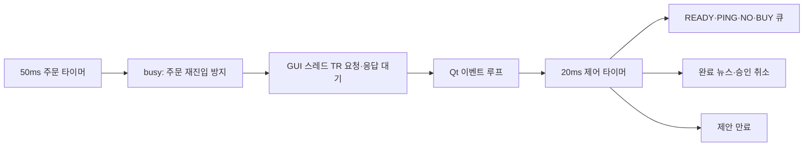

# 구조와 통신

## PC 작업의 구분

`Runner.service_io`는 20ms Qt 타이머로 통신·거절·만료·새 뉴스 반영을 처리하고, `Runner.tick`은 50ms 타이머로 조회·승인·위험 관리를 직렬 실행합니다. `Engine`은 주문의 유일한 진입점입니다. `ThreadPoolExecutor`에서는 RSS 수집만 수행하고 증권사 객체를 호출하지 않습니다.

키움 모드의 `QTimer`와 모든 ActiveX 호출은 GUI 스레드에서 동작합니다. TR 응답 대기 중 Qt 이벤트가 중첩되어도 `Runner.busy`가 두 번째 주문 처리를 막습니다. 응답 시간 초과 시 해당 조회 세션을 종료하고 주문을 자동 재전송하지 않습니다.

## 전송 규격

115200 baud의 ASCII 줄 단위 프로토콜입니다. 마지막 문자는 `\n`입니다. ID는 16자리 소문자 16진수이며, LCD 요약은 최대 60자입니다.

```text
PC → UNO
RESET
OFFER|id|종목코드|수량|지정가|중요도|알람기준|남은초|영문요약
NEWS|id|중요도|알람기준|영문요약
RESULT|id|ACCEPTED 또는 FAILED 또는 UNKNOWN 또는 REJECTED 또는 EXPIRED

UNO → PC
READY
PING|현재id
DECIDE|현재id|BUY 또는 NO
```

`OFFER`에서만 버튼을 활성화합니다. `NEWS`는 악재나 예산/시간 조건상 매수하지 않는 뉴스 표시입니다. 중요도가 임계값 이상이면 두 유형 모두 알립니다. `NEWS`는 승인 대기 화면을 덮어쓰지 않습니다.

PC는 80바이트가 넘는 수신 줄을 통째로 폐기하고, UNO는 192바이트 고정 버퍼를 사용합니다. 길이가 넘친 줄의 뒷부분을 별도 명령으로 처리하지 않습니다. PC와 UNO 모두 승인 유효시간을 검사하고, 현재 ID와 다른 결정은 무시합니다.

## LCD와 부저

LCD 페이지는 종목코드·중요도·뉴스 요약과 매수 수량·지정가·버튼 안내를 번갈아 보여줍니다. 부저는 2,200Hz를 120ms 켜고 쉬는 패턴으로 세 번 울립니다. `millis()` 기반이므로 `delay()`로 버튼 처리를 막지 않습니다.

입력은 35ms 안정화 후 새 눌림을 검출합니다. 제안이 표시된 뒤 두 버튼을 놓은 상태를 확인해야 승인할 수 있습니다. 두 버튼이 함께 눌리면 거절을 우선합니다.

## 데이터 보관

`runtime/orders.db`에는 후보 키, 제안 ID, 코드, 상태, 제안 내용, 사유를 저장합니다. 후보 키는 UNIQUE여서 같은 뉴스/종목을 다시 승인하지 않습니다. `runtime/app.log`에는 한글 기사와 분석 근거, 처리 결과를 기록합니다.

계좌번호·토큰·비밀번호와 실행 DB/로그는 Git 공개 소스에 포함하지 않습니다. 동일 DB의 두 실행은 운영체제 파일 잠금으로 차단합니다.


## 확장한 판단·관리 흐름

뉴스 후보는 `events` 원장으로 정규화해 최초 보도/가격을 유지합니다. `risk.entry_reason`은 시장 조건을 검사하고, `RiskManager`는 주기적으로 일일 자산·보유종목·확인된 원격 미체결을 조회합니다. 주문은 제안 상태와 `jobs`의 SUBMITTING을 같은 트랜잭션으로 먼저 기록하고 전송하며, 명시적 완료 상태로만 정리합니다.

위험 관리도 Qt 메인 스레드에서 처리하고 기존 busy 보호를 공유합니다. 자동 청산은 별도 BUY 버튼을 요구하지 않으며 `auto_exit` 설정으로 제어합니다. 상세 판정은 `AUTOMATION_RULES.md`를 참조합니다.

## 체결 원장과 계좌 범위

`jobs`에는 제출 수량, 누계 체결 수량, 잔량, 확인된 체결 금액과 상태를 저장합니다. `OrderSnapshot`의 주문일·원격 번호·종목·방향을 모두 대조하고 **증가한 체결 수량만** `owned_positions`에 반영합니다. 같은 응답이 반복되거나 과거 부분 체결이 뒤늦게 도착해도 수량을 중복 가산하지 않습니다.

자동 매도는 `min(프로그램 소유 잔량, 계좌 실제 보유 수량, 매도 가능 수량)`으로 제한합니다. 평균가는 프로그램 체결 원장의 원가를 사용합니다. `manage_existing_positions: true`를 명시하면 기존 계좌 잔고까지 관리하는 별도 정책입니다.

`PARTIALLY_FILLED`와 `CANCELLED`를 구분하므로 2주 체결 후 나머지를 취소해도 실제 소유 2주가 남습니다. `UNKNOWN`만으로 소유 수량을 만들지 않습니다. 모의·실제 계좌 컨텍스트가 다른 DB는 시작 단계에서 거부합니다. 계좌 출처가 기록되지 않은 이전 주문 DB도 임의로 새 계좌에 연결하지 않습니다.

## 키움 통보와 재시작

`OnReceiveTrData` 주문 응답에서 로컬 ID와 원격 번호를 바로 기록하고, `OnReceiveChejanData`의 주문·체결 통보를 `OrderBook`으로 정규화합니다. FID 900·902는 주문·미체결 수량, 903은 누계 체결 금액, 909는 체결번호입니다. 계좌가 일치하는 주문 통보만 받고 저장 원문에는 계좌번호를 포함하지 않습니다. [공식 이벤트·FID 명세](https://download.kiwoom.com/web/openapi/kiwoom_openapi_plus_devguide_ver_1.7.pdf)

재시작 시 기록한 통보를 복원하고 조회 결과와 대조합니다. `UNKNOWN`도 늦게 확인된 번호를 연결하며, 번호·날짜를 추측해 다른 주문과 합치지 않습니다. 모의 계좌도 현금·예약금·주문·잔고를 같은 DB에서 복구합니다.

## 조회 중에도 동작하는 제어 경로



제어 타이머는 증권사 조회·전송을 호출하지 않습니다. NO·만료·새 악재는 즉시 DB와 LCD에 반영하고, BUY는 결정 큐로 넘깁니다. TR 응답이 돌아오면 Engine이 제안 ID·상태·최신 뉴스·연결 세대를 다시 검사해 취소된 승인으로 전송하지 않습니다. ActiveX는 생성한 GUI 스레드에 유지합니다.

## 실행과 재생의 공통 판단

`strategy.signal_reason`은 시간·뉴스 확정성·계약 규모·RSI·시장 조건을 검사하고, `build_intent`는 승인 수량·지정가·만료·근거를 고정합니다. Engine과 replay가 같은 함수를 호출합니다. 재생은 신호 시 즉시 승인하고 다음 봉에서 체결을 계산하며, 다음 봉 가격이 낮아져도 승인 수량을 늘리지 않습니다.

`owned_positions`는 체결 원장에서 재계산하는 캐시입니다. 매수 체결은 lot으로 쌓고 매도 체결은 먼저 매수한 lot부터 차감합니다. 늦게 확인된 평균 체결가도 수량을 중복 가산하지 않고 원가에 반영합니다.
