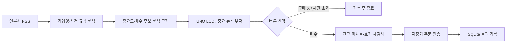

# StockAuto News Trader

중요 뉴스를 수집하고 관심종목과 연결한 뒤, Arduino UNO의 LCD에 뉴스 요약과 매수 제안을 표시하는 프로그램입니다. **D2 버튼은 매수 승인, D3 버튼은 구매 X**입니다. 뉴스 중요도가 기준 이상이면 D8 패시브 부저가 짧게 세 번 울립니다.

기존 키움 연동·RSI·DB 프로그램을 뉴스 분석과 물리 버튼 승인 구조로 확장한 실행본입니다.



## 화면과 조작

LCD는 종목코드·중요도·영문 사건 요약을 스크롤하고, 수량·지정가·버튼 안내를 번갈아 표시합니다. 기사 제목과 링크, 선택 이유는 PC 콘솔과 `runtime/app.log`에 한글로 기록합니다. 16×2 문자 LCD에는 영문 요약을 보내므로 UTF-8 한글의 깨진 바이트가 화면에 출력되지 않습니다.

- **D2 / 매수**: 현재 화면의 종목·수량·지정가를 승인합니다. 승인 직후 시세와 계좌를 다시 확인합니다.
- **D3 / 구매 X**: 해당 뉴스 후보를 거절하고 기록합니다.
- **동시 누름**: 구매 X를 우선합니다. 누르고 있던 버튼은 새 제안의 승인으로 사용하지 않습니다.
- **90초 경과**: 제안이 만료됩니다. 알람이 울려도 자동으로 매수하지 않습니다.
- **중요도 5 이상**: 기본 부저 기준입니다. `alarm_threshold`에서 1~10으로 변경합니다.

## 하드웨어 연결

| 부품 | UNO 연결 |
|---|---|
| I²C 16×2 LCD VCC / GND | 5V / GND |
| LCD SDA / SCL | A4 / A5 |
| 매수 버튼 | D2 ↔ 버튼 ↔ GND |
| 구매 X 버튼 | D3 ↔ 버튼 ↔ GND |
| 소형 패시브 피에조 부저 + / − | D8 / GND |
| PC | USB |

버튼에는 `INPUT_PULLUP`을 사용합니다. LCD 기본 주소는 `0x27`이며 다른 주소의 모듈은 스케치 생성자에서 변경합니다. 부저 코드는 `tone()`을 사용하는 패시브 피에조 기준입니다. 전류가 큰 스피커는 트랜지스터/증폭기 입력으로 D8 신호를 연결합니다.

Arduino IDE에서 **LiquidCrystal I2C 1.1.2** 라이브러리를 설치하고 [news_lcd.ino](../firmware/news_lcd/news_lcd.ino)를 UNO에 업로드합니다. Arduino 시리얼 모니터는 닫은 뒤 PC 프로그램을 실행합니다.

## 실행

Python 3.10 이상 환경에서 이 폴더를 작업 디렉터리로 사용합니다.

```sh
python -m pip install -r requirements.txt
python -m stockauto --port COM3 --demo
```

Arduino 없이도 `python examples/demo_without_hardware.py --decision BUY` 또는 `--decision NO`로 뉴스 분석·승인·거절의 로컬 결과를 확인할 수 있습니다.

`--demo`는 가상 기업·가상 기사·로컬 주문만 사용합니다. 시간 제한을 생략하므로 배선과 버튼을 확인하기 좋습니다. macOS의 포트 예시는 `/dev/cu.usbmodemXXXX`입니다.

실제 RSS와 관심종목으로 실행하려면 `--demo`를 빼고 실행합니다. 기본 `mode: "paper"`에서는 실제 증권사 주문 대신 로컬 주문을 기록합니다. `paper_quotes`의 가격은 동작 확인용 설정값입니다.

```sh
python -m stockauto --port COM3
```

키움 연동은 OpenAPI+ ActiveX가 등록된 Windows와 해당 구성에 맞는 Python/PyQt5 환경에서 실행합니다. 계좌 비밀번호는 키움의 계좌 비밀번호 저장 화면에서 설정합니다. 계좌번호는 소스에 넣지 않고 환경변수로 전달합니다.

```powershell
python -m pip install -r requirements-kiwoom.txt
$env:KIWOOM_ACCOUNT="본인계좌번호"
# config/settings.json의 mode를 kiwoom으로 변경
python -m stockauto --port COM3
```

키움 `SendOrder`의 반환값 0은 **주문 전송 성공**으로 기록하며, LCD에는 `ORDER SENT`를 표시합니다. 체결 여부는 증권사 주문/체결 내역으로 구분합니다. 전송 결과가 미확정이면 같은 주문을 자동 재전송하지 않습니다.

## 분석과 설정

분석은 제목의 기업명·기업별 문맥·사건 단어·확정성을 사용하는 **규칙 기반 분석**입니다. 전망·부인·부정 표현을 먼저 검사한 뒤 `수주`, `흑자전환`, `실적 개선` 등의 사건에 점수를 부여하고, 기업명·별칭이 일치하는 관심종목에 연결합니다. 악재가 섞인 기사는 뉴스 표시와 알람에 사용하고 매수 제안에서 제외합니다.

| 사건군 | 방향 점수 | 중요도 |
|---|---:|---:|
| 수주·공급계약 | +3 | 3 |
| 실적 개선·흑자전환·사상 최대 | +3 | 3 |
| 투자 확대·증설 | +2 | 2 |
| 배당 확대·자사주 소각 | +2 | 2 |
| 소송·횡령·거래정지·리콜 | −5 | 5 |
| 적자전환·실적 악화·계약 해지 | −5 | 5 |

동일 사건군은 한 번만 합산하고 중요도 합계는 최대 10입니다. 예를 들어 수주와 실적 개선이 함께 있으면 중요도 6으로 기본 알람 기준 5를 넘습니다. 점수는 뉴스 분류 기준이며 수익률 예측값이 아닙니다.

[settings.json](../config/settings.json)에서 관심종목·별칭·LCD용 영문명·RSS·매수 금액·수수료율을 설정합니다.

| 설정 | 의미 |
|---|---|
| `alarm_threshold` | 부저가 울릴 중요도, 기본 5 |
| `min_news_score` | 매수 후보의 최소 방향 점수, 기본 3 |
| `max_order_won` | 한 주문의 수수료 포함 상한, 기본 100,000원 |
| `max_positions` | 보유·미체결·결과 확인 대기 종목 수 상한, 기본 10 |
| `buy_fee_rate` | 본인 계좌의 매수 수수료율 |
| `strategy_mode` | 뉴스·RSI·결합 전략 선택 |
| `auto_exit` | 관리 종목 자동 청산 여부 |
| `annual_revenue_won` | 관심종목별 계약 규모 평가용 연매출, 0은 미입력 |
| `holidays` | 거래소 휴장일을 `YYYY-MM-DD` 목록으로 설정 |
| `approval_seconds` | 화면의 승인 유효시간, 기본 90초 |

`strategy_mode`에서 `news`, `rsi`, `combined`를 선택합니다. RSI 단독 모드는 뉴스와 독립적으로 후보를 검사하고, 결합 모드는 뉴스와 RSI 조건을 모두 요구합니다. 종가 배열은 과거→현재 순서로 계산하며 보합의 RSI는 50으로 처리합니다.

매수는 버튼 승인이 필요하고, 기본 `auto_exit: true`에서는 프로그램이 매수한 종목을 손절·익절·보유기간·RSI·일일 손실 기준으로 자동 관리합니다. 다른 수동 보유종목은 기본 대상에서 제외합니다. 원격 번호가 확인된 미체결 매수는 시간 제한 후 잔량 취소를 요청합니다.

[개선한 판단 기준·청산 설정·전략 비교](AUTOMATION_RULES.md)에 조건과 초기 설정값을 자세히 정리했습니다.

## 코드 읽기

각 파일 상단에는 역할·전체 구조·설계 이유를 적었고, 함수에는 기능·입력·출력·처리 구조를 한글로 설명했습니다.

| 파일 | 역할 |
|---|---|
| [news.py](../stockauto/news.py) | RSS 수집·날짜 검사·기업명 매칭·점수와 근거 |
| [engine.py](../stockauto/engine.py) | 승인·거절·만료·주문 전 재검사 |
| [store.py](../stockauto/store.py) | 상태 영구 저장·중복 방지·재시작 복구 |
| [kiwoom.py](../stockauto/kiwoom.py) | 키움 로그인·TR 조회·지정가 주문 |
| [broker.py](../stockauto/broker.py) | 로컬 계좌와 주문 기록 |
| [market.py](../stockauto/market.py) | 거래 시간·수수료·수량·RSI 계산 |
| [protocol.py](../stockauto/protocol.py) | PC↔UNO 메시지 규격 |
| [app.py](../stockauto/app.py) | 수집 작업·버튼 입력·주기 실행 |
| [risk.py](../stockauto/risk.py) | 시장 필터·청산·일일 손실·미체결 취소 |
| [replay.py](../stockauto/replay.py) | 시간순 데이터로 3개 전략 비교 |
| [models.py](../stockauto/models.py) | 뉴스·후보·계좌·제안·전송 결과 자료형 |
| [news_lcd.ino](../firmware/news_lcd/news_lcd.ino) | LCD·디바운스·부저·시리얼 |

[기존 코드의 문제와 수정](CODE_REVIEW.md) · [통신과 상태 구조](ARCHITECTURE.md)

## 검증

```sh
python -m unittest discover -s tests -v
# C++ 컴파일러가 있는 환경에서 실제 .ino의 호스트 검사
mkdir -p build
c++ -std=c++17 -Wall -Wextra -Werror -Itests/arduino_stub tests/test_firmware.cpp -o build/test_firmware
./build/test_firmware
PYTHONPATH=. python tests/check_serial_contract.py
# Arduino CLI가 PATH에 있는 환경
arduino-cli compile --fqbn arduino:avr:uno firmware/news_lcd
```

Python 테스트 58개, 펌웨어의 프레임·버튼·알람·만료 검사, UNO 컴파일을 통과했습니다. UNO 컴파일 결과는 Flash 9,858바이트, SRAM 1,046바이트입니다. 실제 RSS 수집기로 한국경제 증권 피드의 XML 수신·기사 파싱도 확인했습니다.

## 참고

- [한국경제 공식 RSS 목록](https://www.hankyung.com/feed)
- [키움 OpenAPI+ 개발가이드](https://download.kiwoom.com/web/openapi/kiwoom_openapi_plus_devguide_ver_1.7.pdf)
- [Arduino INPUT_PULLUP](https://docs.arduino.cc/language-reference/en/variables/constants/inputOutputPullup/)
- [운영체제 인증서 저장소를 사용하는 truststore](https://truststore.readthedocs.io/en/latest/)
